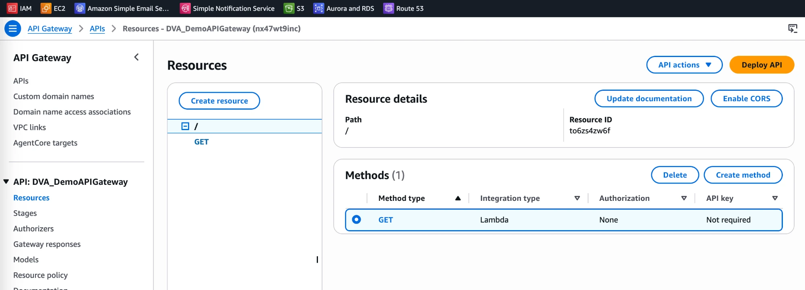
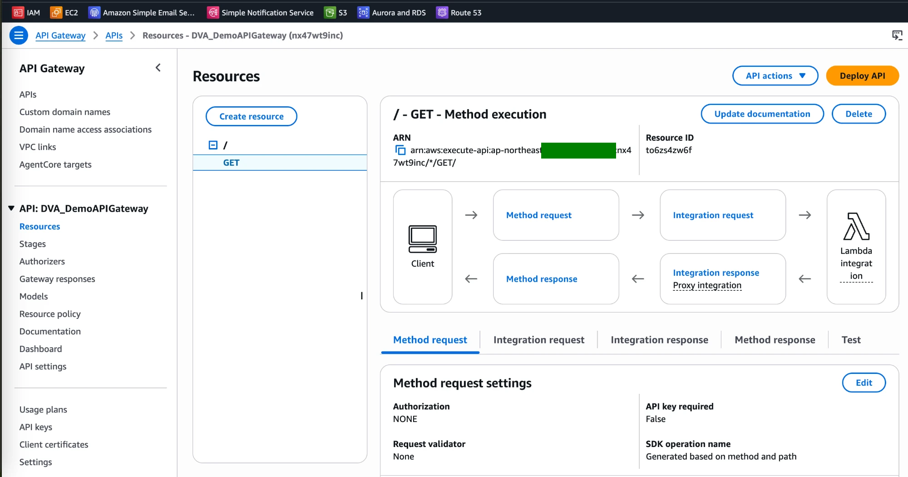
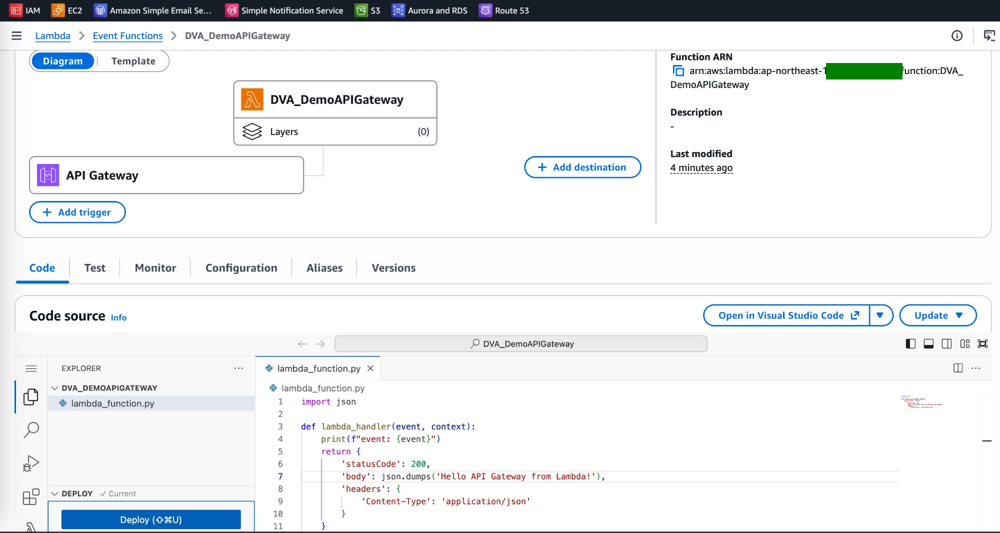
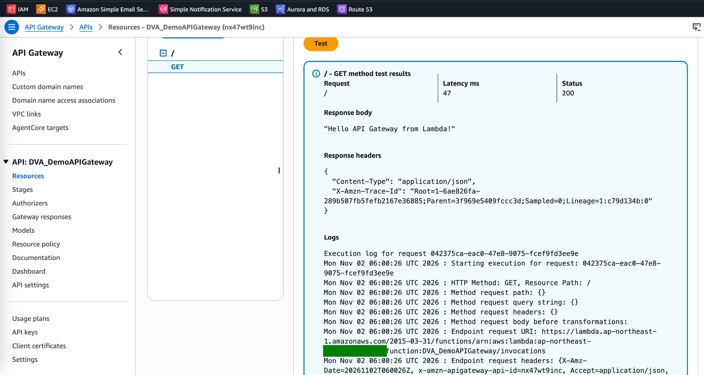
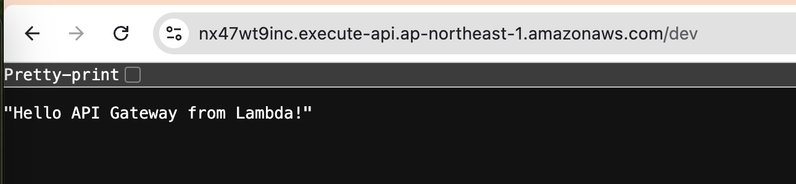

# API Gateway Lab: REST API Backed by a Lambda Function

[← Labs index](../README.md) · **Service:** API Gateway · **Level:** Beginner · **Est. time:** 20 min · **Est. cost:** Free tier

**Reference:** [Udemy DVA-C01 - API Gateway Basics Hands On](https://www.udemy.com/course/aws-certified-developer-associate-dva-c01/learn/lecture/11851432#overview)

## Contents

- [Objectives](#objectives)
- [Prerequisites](#prerequisites)
- [Steps](#steps)
- [Verification](#verification)
- [Troubleshooting](#troubleshooting)
- [Cleanup](#cleanup)
- [References](#references)

## Objectives

- Create a **REST API** with a `GET` method on `/` that uses a **Lambda proxy integration**.
- Return an HTTP response (`statusCode`, `headers`, `body`) from Lambda and test it in the console.
- **Deploy** the API to a `dev` stage and call its invoke URL from a browser.

## Prerequisites

- An AWS account with API Gateway, Lambda, IAM and CloudWatch Logs permissions.
- Theory: [Amazon API Gateway in the Serverless mind map](../../mind_maps/markdown/ServerlessArchitecture.md).

## Steps

### 1. Create the Lambda Function

1. Open the **Lambda Console** > **Create function** > **Author from scratch**.
2. **Function name:** `DVA_DemoAPIGateway`. **Runtime:** Python 3.x. Keep
    **Create a new role with basic Lambda permissions** and click **Create function**.
3. Replace the code with a handler that returns an HTTP response, then click **Deploy**:

    ```python
    import json

    def lambda_handler(event, context):
        print(f"event: {event}")
        return {
            'statusCode': 200,
            'body': json.dumps('Hello API Gateway from Lambda!'),
            'headers': {
                'Content-Type': 'application/json'
            }
        }
    ```

> 💡 With a **proxy integration**, API Gateway passes the whole HTTP request to Lambda as `event`
> and turns the returned `statusCode`, `headers` and `body` into the HTTP response. `body` must be a string.

### 2. Create the REST API

1. Open the **API Gateway Console** > **Create API** > **REST API** > **Build**.
2. Choose **New API**. **API name:** `DVA_DemoAPIGateway`. Keep the default endpoint type and
    click **Create API**.

### 3. Add a GET Method that Calls Lambda

1. With the root resource `/` selected, click **Create method**.
2. **Method type:** `GET`. **Integration type:** **Lambda function**.
3. Turn on **Lambda proxy integration**, pick your Region and the function `DVA_DemoAPIGateway`.
    Keep the default timeout and click **Create method**.

    

4. The **Method execution** view shows the flow: client → method request → integration request →
    Lambda → integration response (proxy) → method response.

    

> 💡 The console adds a **resource-based policy** to the function so API Gateway may invoke it. The
> function's diagram now shows **API Gateway** as a trigger.



### 4. Test the Method in the Console

1. Open the **Test** tab of the `GET` method and click **Test** (no query string or headers needed).
2. The result shows **Status 200**, the response body `"Hello API Gateway from Lambda!"`, the
    `Content-Type` header and the execution logs (request, Lambda endpoint, response).

    

### 5. Deploy the API to a Stage

1. Click **Deploy API**. **Stage:** **New stage**, **Stage name:** `dev`. Click **Deploy**.
2. Copy the **Invoke URL** of the stage, e.g. `https://API_ID.execute-api.REGION.amazonaws.com/dev`.
3. Open it in a browser. The page shows the Lambda response.

    

> 💡 Changes to resources and methods are **not live** until you deploy them again to a stage.

## Verification

- The console test returns **Status 200** with the Lambda body (step 4).
- The `dev` invoke URL returns `"Hello API Gateway from Lambda!"` (step 5).
- The function's log group `/aws/lambda/DVA_DemoAPIGateway` has an `event:` line per call, with
    `httpMethod: GET` and `path: /`.
- CLI alternative:

    ```bash
    curl https://API_ID.execute-api.REGION.amazonaws.com/dev
    aws logs tail /aws/lambda/DVA_DemoAPIGateway --since 5m
    ```

## Troubleshooting

| Symptom | Likely cause | Fix |
|---------|--------------|-----|
| `{"message":"Internal server error"}` / 502 | The function's return value is not a valid proxy response (e.g. `body` is not a string) | Return `statusCode`, `headers` and a JSON-string `body` |
| `{"message":"Missing Authentication Token"}` | Wrong path or stage in the URL, or the API is not deployed | Use the exact stage invoke URL (`.../dev`) and deploy the API |
| A change does not show up on the invoke URL | The API was not redeployed | **Deploy API** to the `dev` stage again |
| 500 with an invoke permission error in the logs | API Gateway may not invoke the function | Recreate the integration from the console, or add a `lambda:InvokeFunction` permission for `apigateway.amazonaws.com` |

## Cleanup

> 💸 A deployed API stays public on the Internet until you delete it.

- [ ] Delete the API `DVA_DemoAPIGateway` in the API Gateway console (this removes the `dev` stage).
- [ ] Delete the function `DVA_DemoAPIGateway`, its log group and its execution role.

## References

- [Tutorial: Create a REST API with a Lambda proxy integration (AWS docs)](https://docs.aws.amazon.com/apigateway/latest/developerguide/api-gateway-create-api-as-simple-proxy-for-lambda.html)
- [Lambda proxy integration input and output format (AWS docs)](https://docs.aws.amazon.com/apigateway/latest/developerguide/set-up-lambda-proxy-integrations.html)
- [Deploying a REST API (AWS docs)](https://docs.aws.amazon.com/apigateway/latest/developerguide/how-to-deploy-api.html)
