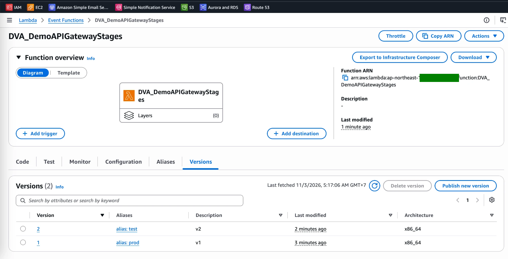
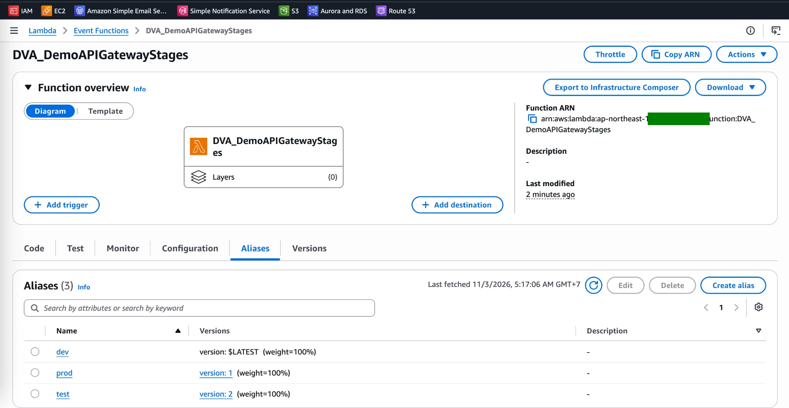
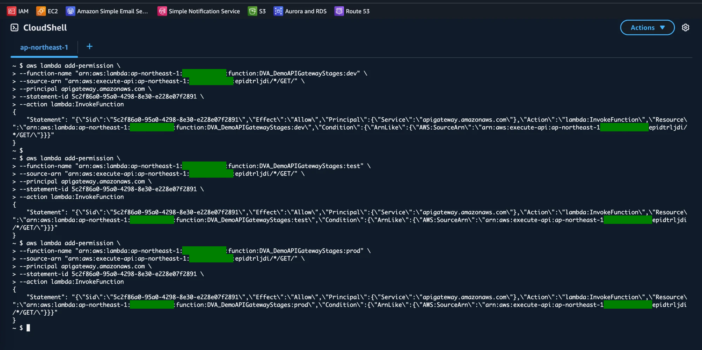
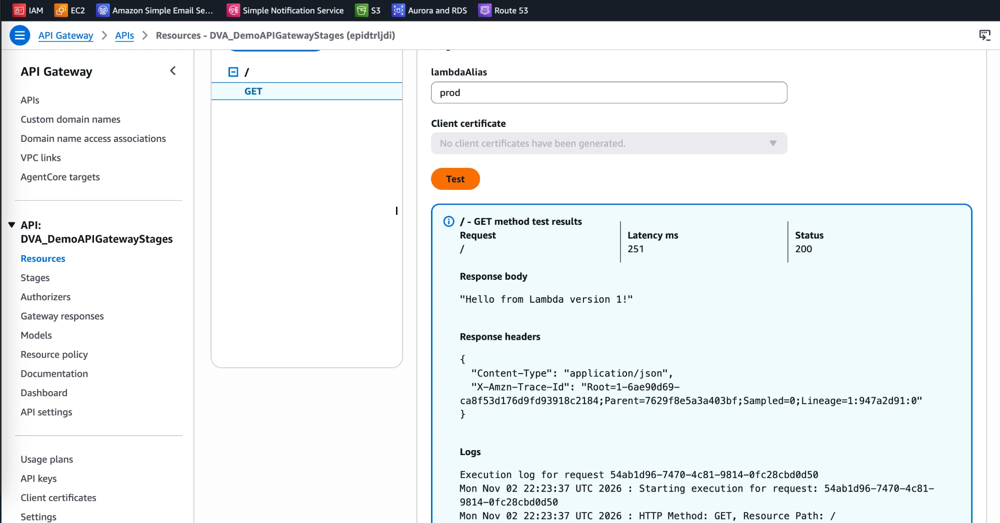
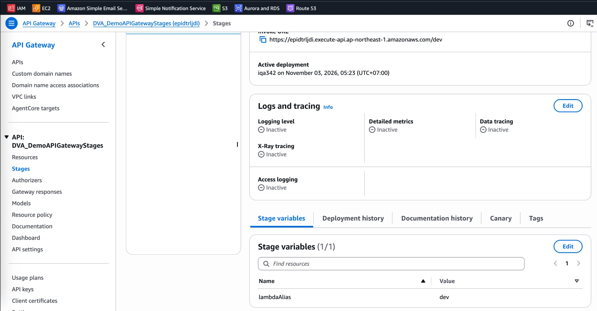
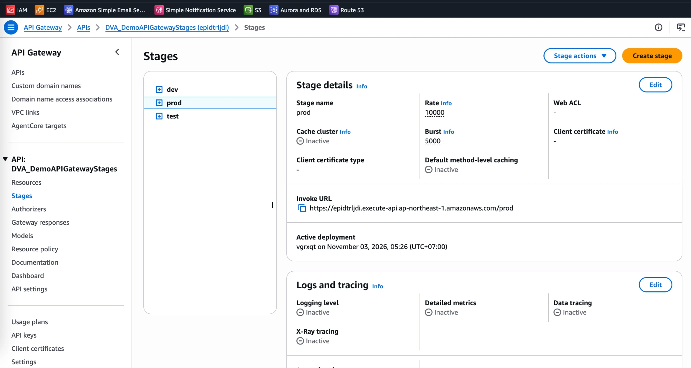
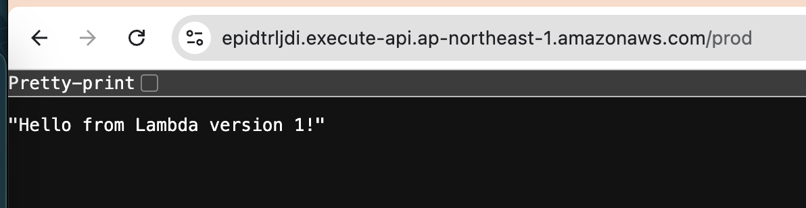
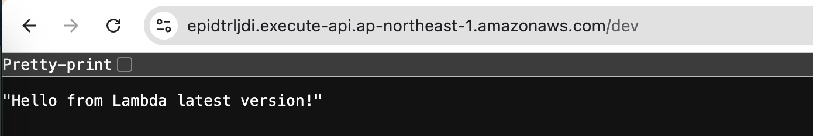

# API Gateway Lab: Stages, Stage Variables and Lambda Aliases

[← Labs index](../README.md) · **Service:** API Gateway · **Level:** Intermediate · **Est. time:** 30 min · **Est. cost:** Free tier

**Reference:** [Udemy DVA-C01 - API Gateway Stages and Deployment Hands On](https://www.udemy.com/course/aws-certified-developer-associate-dva-c01/learn/lecture/11851424#overview)

## Contents

- [Objectives](#objectives)
- [Prerequisites](#prerequisites)
- [Steps](#steps)
- [Verification](#verification)
- [Troubleshooting](#troubleshooting)
- [Cleanup](#cleanup)
- [References](#references)

## Objectives

- Publish two **Lambda versions** and point the aliases `dev`, `test` and `prod` at `$LATEST`, version 2 and version 1.
- Integrate one API method with `function:<name>:${stageVariables.lambdaAlias}`, so the **stage variable** picks the alias.
- Allow API Gateway to invoke **each alias** with `aws lambda add-permission`.
- Deploy the API to `dev`, `test` and `prod` stages and see each stage call a different Lambda version.

## Prerequisites

- An AWS account with API Gateway, Lambda, IAM and CloudShell permissions.
- [Lab 01 - REST API Backed by a Lambda Function](01_rest_api_with_lambda.md) (how to create a GET method and deploy).
- Theory: [API Gateway deployments and stages in the Serverless mind map](../../mind_maps/markdown/ServerlessArchitecture.md).

## Steps

### 1. Create the Function and Publish Two Versions

1. Open the **Lambda Console** > **Create function** > **Author from scratch**.
    **Function name:** `DVA_DemoAPIGatewayStages`. **Runtime:** Python 3.x. Click **Create function**.
2. Paste this code, change the message to `Hello from Lambda version 1!` and click **Deploy**:

    ```python
    import json

    def lambda_handler(event, context):
        # TODO implement
        return {
            'statusCode': 200,
            'body': json.dumps('Hello from Lambda latest version!'),
            'headers': {
                'Content-Type': 'application/json'
            },
        }
    ```

3. **Versions** tab > **Publish new version**, description `v1`.
4. Change the message to `Hello from Lambda version 2!`, **Deploy**, then publish a new version with description `v2`.
5. Change the message back to `Hello from Lambda latest version!` and **Deploy** without publishing.
    This code only lives in `$LATEST`.

### 2. Create the Aliases

1. **Aliases** tab > **Create alias** three times:
    - `dev` → version `$LATEST`
    - `test` → version `2`
    - `prod` → version `1`
2. The **Versions** tab now shows which alias points to each published version.

    

    

### 3. Create the API with a Stage Variable in the Integration

1. Open the **API Gateway Console** > **Create API** > **REST API** > **Build**.
    **API name:** `DVA_DemoAPIGatewayStages`. Click **Create API**.
2. On `/` click **Create method**: **Method type** `GET`, **Integration type** Lambda function,
    turn on **Lambda proxy integration**.
3. In **Lambda function**, type the function ARN with the stage variable instead of an alias name:

    ```text
    arn:aws:lambda:REGION:ACCOUNT_ID:function:DVA_DemoAPIGatewayStages:${stageVariables.lambdaAlias}
    ```

4. Click **Create method**. Because the console cannot know which alias you will use, it does **not**
    add the invoke permission. Instead it shows an `aws lambda add-permission` command; copy it.

### 4. Allow API Gateway to Invoke Each Alias

1. Open **CloudShell** from the console toolbar (same Region).
2. Run the copied command once per alias, replacing `${stageVariables.lambdaAlias}` with `dev`, then `test`, then `prod`:

    ```bash
    aws lambda add-permission \
    --function-name "arn:aws:lambda:REGION:ACCOUNT_ID:function:DVA_DemoAPIGatewayStages:dev" \
    --source-arn "arn:aws:execute-api:REGION:ACCOUNT_ID:API_ID/*/GET/" \
    --principal apigateway.amazonaws.com \
    --statement-id STATEMENT_ID \
    --action lambda:InvokeFunction
    ```

3. Each call returns the new policy statement: `Allow` for `apigateway.amazonaws.com` on that alias,
    limited to your API's `GET /` (`AWS:SourceArn`).

    

> 💡 A permission is attached to a **qualified ARN** (function + alias). Permission on `:dev` does not
> cover `:prod`, which is why the command runs once per alias.

### 5. Test the Method with a Stage Variable

1. Open the `GET` method > **Test** tab. Under **Stage variables**, set `lambdaAlias` = `prod`.
2. Click **Test**. The body is `"Hello from Lambda version 1!"`, the code of version 1 behind the `prod` alias.

    

### 6. Deploy the Stages and Set Their Stage Variables

1. **Deploy API** > **New stage** `dev`. Then open **Stages** > `dev` > **Stage variables** > **Edit** and add
    `lambdaAlias` = `dev`.

    

2. Repeat for `test` (`lambdaAlias` = `test`) and `prod` (`lambdaAlias` = `prod`).
    Each stage has its own invoke URL, active deployment and settings (e.g. throttling rate and burst).

    

3. Open each invoke URL in a browser:
    - `/prod` → `"Hello from Lambda version 1!"`
    - `/test` → `"Hello from Lambda version 2!"`
    - `/dev` → `"Hello from Lambda latest version!"`

    

    

> 💡 To release version 2 to production, point the `prod` alias at version 2 (or split its weight
> 90/10 for a canary). The API and its stages stay unchanged and need no new deployment.

## Verification

- Each stage URL returns the message of the version its alias points to (step 6).
- `aws lambda get-policy --function-name DVA_DemoAPIGatewayStages:prod` shows the `apigateway.amazonaws.com` statement.
- CLI alternative:

    ```bash
    for s in dev test prod; do curl -s https://API_ID.execute-api.REGION.amazonaws.com/$s; echo; done
    aws apigateway get-stages --rest-api-id API_ID \
      --query "item[].{stage:stageName,vars:variables}"
    ```

## Troubleshooting

| Symptom | Likely cause | Fix |
|---------|--------------|-----|
| `{"message": "Internal server error"}` and an `Invalid permissions on Lambda function` log | No invoke permission for that alias | Run `add-permission` for the alias the stage uses (step 4) |
| One stage works, another returns 500 | That stage's `lambdaAlias` value is missing or misspelled, or its alias has no permission | Check **Stage variables** of the stage and `aws lambda get-policy` on the alias |
| Test in the console fails with an empty stage variable | `lambdaAlias` was not filled in the **Test** tab | Enter `lambdaAlias` = `prod` (or `dev`/`test`) before **Test** |
| `/dev` still shows old code | The function was edited but not deployed, or the browser cached the response | Click **Deploy** in Lambda and reload; `$LATEST` needs no publish |
| Changing the method does not affect a stage URL | The API was not redeployed to that stage | **Deploy API** to the stage again (stage variables are kept) |

## Cleanup

> 💸 Deployed stages stay public on the Internet until you delete the API.

- [ ] Delete the API `DVA_DemoAPIGatewayStages` (removes the `dev`, `test` and `prod` stages).
- [ ] Delete the function `DVA_DemoAPIGatewayStages` (removes its versions, aliases and permissions),
    its log group and its execution role.

## References

- [Set up stage variables for a REST API (AWS docs)](https://docs.aws.amazon.com/apigateway/latest/developerguide/stage-variables.html)
- [Use stage variables to invoke a Lambda function alias (AWS docs)](https://docs.aws.amazon.com/apigateway/latest/developerguide/stage-variables-tutorial.html)
- [Lambda function aliases (AWS docs)](https://docs.aws.amazon.com/lambda/latest/dg/configuration-aliases.html)
- [aws lambda add-permission (AWS CLI reference)](https://docs.aws.amazon.com/cli/latest/reference/lambda/add-permission.html)
