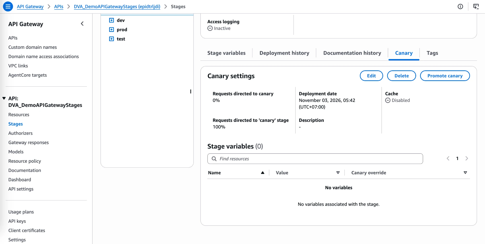
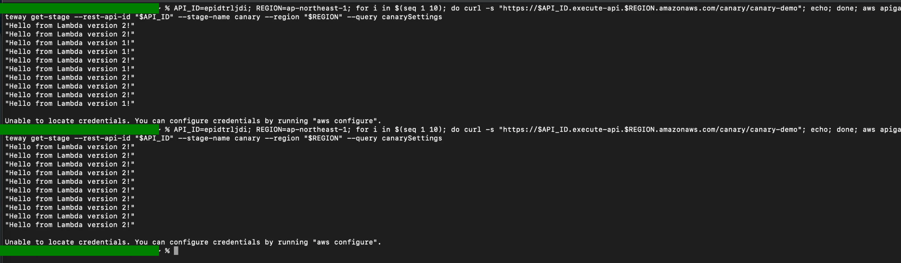

# API Gateway Lab: Canary Deployment on a Stage

[← Labs index](../README.md) · **Service:** API Gateway · **Level:** Intermediate · **Est. time:** 20 min · **Est. cost:** Free tier

**Reference:** [Udemy DVA-C01 - API Gateway Canary Deployment Hands On](https://www.udemy.com/course/aws-certified-developer-associate-dva-c01/learn/lecture/19731564#overview)

## Contents

- [Objectives](#objectives)
- [Prerequisites](#prerequisites)
- [Steps](#steps)
- [Verification](#verification)
- [Troubleshooting](#troubleshooting)
- [Cleanup](#cleanup)
- [References](#references)

## Objectives

- Add a method that calls **Lambda version 1** and deploy it to a new stage `canary`.
- Turn on **canary settings** for the stage and send **50%** of the requests to the canary.
- Deploy a change (the method now calls **version 2**) to the **canary only**, then promote or roll it back.

## Prerequisites

- [Lab 02 - Stages, Stage Variables and Lambda Aliases](02_stages_and_stage_variables.md): the API
    `DVA_DemoAPIGatewayStages` and the function `DVA_DemoAPIGatewayStages` with versions `1` and `2`.
- Theory: [Canary deployment in the Serverless mind map](../../mind_maps/markdown/ServerlessArchitecture.md).

## Steps

### 1. Add a Method that Calls Version 1

1. Open the API `DVA_DemoAPIGatewayStages` > **Resources** > **Create resource**, **Resource name** `canary-demo`.
2. On `/canary-demo` click **Create method**: **Method type** `GET`, **Integration type** Lambda function,
    turn on **Lambda proxy integration**, and enter the ARN of **version 1**:

    ```text
    arn:aws:lambda:REGION:ACCOUNT_ID:function:DVA_DemoAPIGatewayStages:1
    ```

3. Click **Create method**. The ARN points to one version (no stage variable), so the console adds the
    invoke permission for `:1` itself.

### 2. Deploy a New Stage

1. **Deploy API** > **New stage**, **Stage name** `canary` > **Deploy**.
2. Open `https://API_ID.execute-api.REGION.amazonaws.com/canary/canary-demo`: it returns `"Hello from Lambda version 1!"`.

### 3. Turn on the Canary for the Stage

1. **Stages** > `canary` > **Canary** tab > **Create canary**.
2. **Requests directed to canary:** `50` (50/50 makes the split easy to see; in real life start small, e.g. 5–10%).
    Click **Create**.

    

> 💡 **Stage variables** has a **Canary override** column: the canary can use other values than the base
> (e.g. a different `lambdaAlias`) without a separate stage.

### 4. Point the Method at Version 2 and Deploy to the Canary

1. **Resources** > `/canary-demo` > `GET` > **Integration request** > **Edit**.
2. Change the Lambda function to **version 2** and click **Save** (the console adds the permission for `:2`):

    ```text
    arn:aws:lambda:REGION:ACCOUNT_ID:function:DVA_DemoAPIGatewayStages:2
    ```

3. **Deploy API** > **Stage** `canary` > **Deploy**. Because the stage has a canary, this deployment goes to the
    **canary** only; the base deployment still serves version 1.

### 5. Test the Split, Promote the Canary and Test Again

1. In a terminal, call the stage 10 times. Put your own API ID (the first part of the invoke URL) and Region
    in the two variables:

    ```bash
    API_ID=<your-api-id>; REGION=<your-region>; for i in $(seq 1 10); do curl -s "https://$API_ID.execute-api.$REGION.amazonaws.com/canary/canary-demo"; echo; done
    ```

    With the canary at 50%, the answers mix `"Hello from Lambda version 1!"` and `"Hello from Lambda version 2!"`
    (the split is random per request, e.g. 6/4 over 10 calls).

2. Version 2 looks healthy, so open **Stages** > `canary` > **Canary** tab > **Promote canary** and confirm.
    The canary's deployment becomes the stage's base deployment: **Requests directed to canary** drops to `0%`
    and the stage serves `100%`.

    

3. Run the same command again. Every answer is now `"Hello from Lambda version 2!"`.

    

> 💡 Promoting keeps the canary settings at `0%`, ready for the next release. To **roll back** instead of
> promoting, click **Delete** on the canary: all traffic returns to the base deployment (version 1).

## Verification

- With the canary at 50%, repeated calls return both messages (step 5.1).
- After **Promote canary**, every call returns `"Hello from Lambda version 2!"` (step 5.3).
- The stage's canary settings, from the CLI (needs AWS credentials; on a laptop without `aws configure`, run it
    in CloudShell). `--rest-api-id` takes the API ID only, not an ARN:

    ```bash
    aws apigateway get-stage --rest-api-id "$API_ID" --stage-name canary --region "$REGION" --query canarySettings
    ```

    Before promoting: `"percentTraffic": 50.0`. After promoting: `"percentTraffic": 0.0`.

## Troubleshooting

| Symptom | Likely cause | Fix |
|---------|--------------|-----|
| Every call still returns version 1 | The change was saved but not deployed, or deployed before the canary existed | Create the canary first, then **Deploy API** to the `canary` stage |
| Every call returns version 2 right away | The canary was promoted, or the stage had no canary when you deployed | Check the **Canary** tab; recreate it and redeploy |
| 500 `Internal server error` from one side of the split | No invoke permission for that version | Re-select the function in the integration request so the console adds it, or run `aws lambda add-permission` for `:1` / `:2` |
| `{"message":"Missing Authentication Token"}` | Wrong path | Call `/canary/canary-demo` (stage, then resource) |
| `zsh: no matches found: arn:aws:execute-api:...` | An ARN was passed to `--rest-api-id`; zsh expands its unquoted `*` | Pass only the API ID, e.g. `--rest-api-id "$API_ID"` |
| `Unable to locate credentials` | The local AWS CLI has no credentials | Run `aws configure`, or run the `aws` command in CloudShell |

## Cleanup

> 💸 Deployed stages stay public on the Internet until you delete them.

- [ ] Delete the `canary` stage (or the whole API `DVA_DemoAPIGatewayStages` if you are done with Lab 02 too).
- [ ] Delete the function `DVA_DemoAPIGatewayStages`, its log group and its execution role when you no longer need them.

## References

- [Set up an API Gateway canary release deployment (AWS docs)](https://docs.aws.amazon.com/apigateway/latest/developerguide/canary-release.html)
- [Promote a canary release (AWS docs)](https://docs.aws.amazon.com/apigateway/latest/developerguide/promote-canary-deployment.html)
