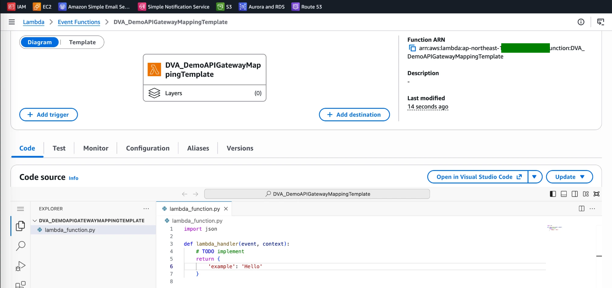
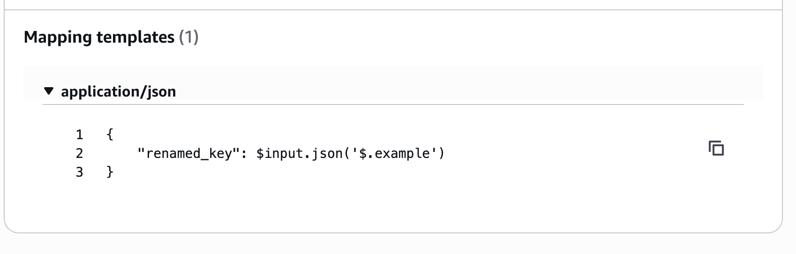
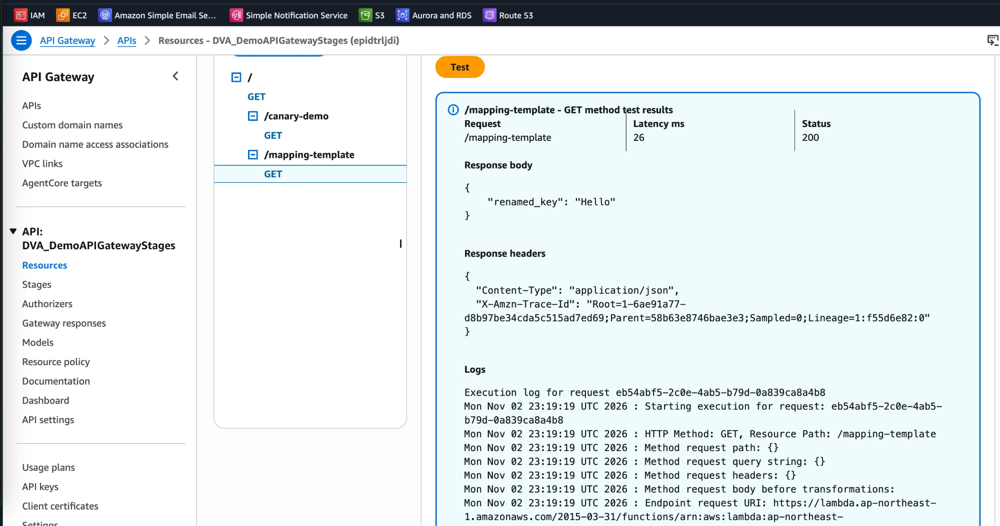

# API Gateway Lab: Rename a Response Field with a Mapping Template

[← Labs index](../README.md) · **Service:** API Gateway · **Level:** Intermediate · **Est. time:** 15 min · **Est. cost:** Free tier

**Reference:** [Udemy DVA-C01 - API Gateway Mapping Templates Hands On](https://www.udemy.com/course/aws-certified-developer-associate-dva-c01/learn/lecture/19731588#overview)

## Contents

- [Objectives](#objectives)
- [Prerequisites](#prerequisites)
- [Steps](#steps)
- [Verification](#verification)
- [Troubleshooting](#troubleshooting)
- [Cleanup](#cleanup)
- [References](#references)

## Objectives

- Integrate a method with Lambda **without** proxy integration (`AWS` integration type).
- Add a **mapping template** to the **integration response** that renames `example` to `renamed_key`.
- Explain why mapping templates only apply to non-proxy integrations.

## Prerequisites

- The API `DVA_DemoAPIGatewayStages` from [Lab 02](02_stages_and_stage_variables.md) (any REST API works).
- Theory: [Mapping templates in the Serverless mind map](../../mind_maps/markdown/ServerlessArchitecture.md).

## Steps

### 1. Create the Lambda Function

1. Open the **Lambda Console** > **Create function** > **Author from scratch**.
    **Function name:** `DVA_DemoAPIGatewayMappingTemplate`. **Runtime:** Python 3.x. Click **Create function**.
2. Replace the code and click **Deploy**. It returns a plain JSON object, not an HTTP response
    (`statusCode`/`body`), because API Gateway will build the response:

    ```python
    import json

    def lambda_handler(event, context):
        # TODO implement
        return {
            'example': 'Hello'
        }
    ```

    

### 2. Add a GET Method Without Proxy Integration

1. Open the API `DVA_DemoAPIGatewayStages` > **Resources** > **Create resource**, **Resource name** `mapping-template`.
2. On `/mapping-template` click **Create method**: **Method type** `GET`, **Integration type** Lambda function.
3. Leave **Lambda proxy integration** **off**, select the function `DVA_DemoAPIGatewayMappingTemplate`
    and click **Create method**.
4. **Test** tab > **Test**: the body is the function's object as is, `{"example": "Hello"}`.

> 💡 With proxy integration **on**, API Gateway hands the whole request to Lambda and returns its answer
> unchanged, so the integration request and response have no mapping templates. Turn it off to use them.

### 3. Add a Mapping Template to the Integration Response

1. Open the method's **Integration response** tab > the default response (`200`) > **Edit**.
2. Under **Mapping templates**, click **Add mapping template**, **Content type** `application/json`, and enter:

    ```json
    {
        "renamed_key": $input.json('$.example')
    }
    ```

3. Click **Save**.

    

> 💡 `$input.json('$.example')` reads the backend's JSON with a JSONPath and keeps it as JSON (here the string
> `"Hello"` with its quotes). `$input.path('$.example')` returns the raw value instead.

### 4. Test the Renamed Response

1. **Test** tab > **Test** again.
2. The body is now `{"renamed_key": "Hello"}`: Lambda still returns `example`, and API Gateway rewrote it.

    

3. To call it from outside, **Deploy API** to a stage (e.g. `dev`) and open `/dev/mapping-template`.

## Verification

- Before the template: `{"example": "Hello"}`. After the template: `{"renamed_key": "Hello"}` (steps 2 and 4).
- The method's **Integration request** shows **Lambda proxy integration: False**.
- After deploying to `dev`, from a terminal (put your own API ID and Region in the variables):

    ```bash
    API_ID=<your-api-id>; REGION=<your-region>; curl -s "https://$API_ID.execute-api.$REGION.amazonaws.com/dev/mapping-template"; echo
    ```

## Troubleshooting

| Symptom | Likely cause | Fix |
|---------|--------------|-----|
| There is no **Mapping templates** section in the integration response | **Lambda proxy integration** is on | Edit the integration request and turn proxy integration off |
| The response is still `{"example": "Hello"}` | The template was not saved, or its content type is not `application/json` | Edit the `200` integration response and check the template |
| `"renamed_key": Hello` makes invalid JSON | `$input.path` used without quotes | Use `$input.json('$.example')`, or wrap `$input.path(...)` in quotes |
| The stage URL still returns the old body | The API was not redeployed | **Deploy API** to the stage again |

## Cleanup

> 💸 Deployed stages stay public on the Internet until you delete them.

- [ ] Delete the resource `/mapping-template` (or the whole API when you are done with the API Gateway labs) and redeploy.
- [ ] Delete the function `DVA_DemoAPIGatewayMappingTemplate`, its log group and its execution role.

## References

- [Mapping templates for REST APIs (AWS docs)](https://docs.aws.amazon.com/apigateway/latest/developerguide/models-mappings.html)
- [Variables for data transformations: $input (AWS docs)](https://docs.aws.amazon.com/apigateway/latest/developerguide/api-gateway-mapping-template-reference.html)
- [Choose an API Gateway API integration type (AWS docs)](https://docs.aws.amazon.com/apigateway/latest/developerguide/api-gateway-api-integration-types.html)
