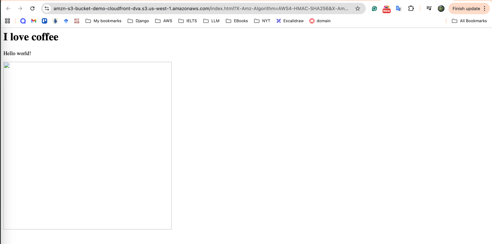
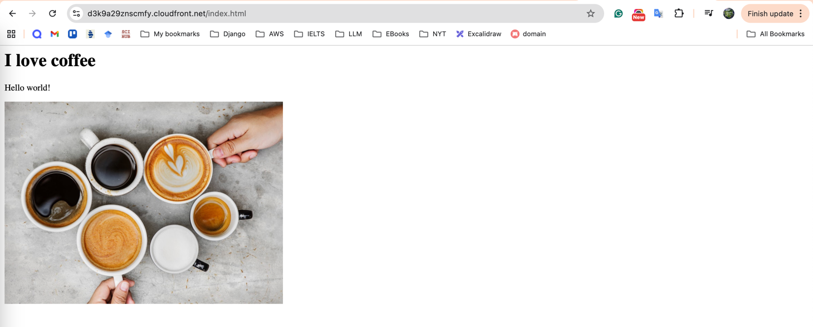

# CloudFront Lab: Distribution with an S3 Origin (OAC)

[← Labs index](../README.md) · **Service:** CloudFront · **Level:** Beginner · **Est. time:** 30 min · **Est. cost:** Free tier

**Reference:** [Udemy DVA-C01 - CloudFront with S3](https://www.udemy.com/course/aws-certified-developer-associate-dva-c01/learn/lecture/19729726#overview)

## Contents

- [Objectives](#objectives)
- [Prerequisites](#prerequisites)
- [Steps](#steps)
- [Verification](#verification)
- [Troubleshooting](#troubleshooting)
- [Cleanup](#cleanup)
- [References](#references)

## Objectives

- Serve a **private** S3 bucket through a CloudFront distribution with **Origin Access Control (OAC)**.
- Explain how the bucket policy lets only your distribution read the bucket.
- Observe that the CloudFront URL works while the direct S3 URL stays **Access Denied**.

## Prerequisites

- An AWS account with S3 and CloudFront permissions.
- A local `index.html` that shows an image with a relative path (for example
    ``), and that `image.jpg`.
- AWS CLI configured (`aws configure`) and `curl` for the verification commands.

> 🔗 [Cache Invalidation](02_cache_invalidation.md) reuses this distribution. If you plan to
> do it next, skip this lab's cleanup until you have finished it.

## Steps

### 1. Create a Private S3 Origin

1. Create an S3 bucket with default settings (**Block all public access** stays on).
2. Upload `index.html` and `image.jpg`.
3. Open each object's **Object URL** in a private browser window. Both return
    **Access Denied**, confirming the bucket is private.



### 2. Create the Distribution

1. Open the **CloudFront Console** and click **Create distribution**.
2. **Origin domain:** select your S3 bucket.
3. **Origin access:** select **Origin access control settings (recommended)**, click
    **Create new OAC**, keep the defaults and click **Create**.
4. **Viewer protocol policy:** **Redirect HTTP to HTTPS**.
5. **Default root object:** `index.html` (so the bare domain serves the page).
6. Leave the other settings at their defaults and click **Create distribution**.

> 💡 Depending on the console version, you may see an option to let CloudFront update the
> bucket policy for you. If you use it, step 3 is already done: just confirm the policy in
> the bucket's **Permissions** tab.

### 3. Update the Bucket Policy

1. After creation, a banner says *The S3 bucket policy needs to be updated*. Click
    **Copy policy**.
2. Open the bucket > **Permissions** > **Bucket policy** > **Edit**, paste the policy and
    **Save changes**. It looks like this, with your bucket name, account ID and distribution
    ID:

    ```json
    {
      "Version": "2012-10-17",
      "Statement": {
        "Sid": "AllowCloudFrontServicePrincipal",
        "Effect": "Allow",
        "Principal": { "Service": "cloudfront.amazonaws.com" },
        "Action": "s3:GetObject",
        "Resource": "arn:aws:s3:::YOUR-BUCKET-NAME/*",
        "Condition": {
          "StringEquals": {
            "AWS:SourceArn": "arn:aws:cloudfront::123456789012:distribution/EDISTRIBUTIONID"
          }
        }
      }
    }
    ```

The `AWS:SourceArn` condition means only **your** distribution can read the bucket.

> 🔒 Before sharing screenshots or policy JSON, redact the account ID, distribution ID and
> any personal bucket names.

## Verification

1. Wait for the distribution's **Last modified** to change from **Deploying** to a date.
2. Copy the **Distribution domain name** (for example `d111111abcdef8.cloudfront.net`) and
    open `https://<distribution-domain>/` in a browser. The page and the image load.

    

3. From a terminal, request the page twice and watch the cache header:

    ```bash
    curl -sI https://d111111abcdef8.cloudfront.net/index.html | grep -iE '^HTTP|^x-cache'
    # 1st request: HTTP/2 200 and "x-cache: Miss from cloudfront"
    # 2nd request: HTTP/2 200 and "x-cache: Hit from cloudfront"
    ```

4. Direct S3 access is still blocked:

    ```bash
    curl -sI https://YOUR-BUCKET-NAME.s3.amazonaws.com/index.html | head -n 1
    # Expected: HTTP/1.1 403 Forbidden
    ```

## Troubleshooting

| Symptom | Likely cause | Fix |
|---------|--------------|-----|
| `403 AccessDenied` from the CloudFront URL | Bucket policy not added, or it names a different distribution | Repeat step 3 with the policy copied from **this** distribution |
| `403` on `https://<domain>/` but `/index.html` works | No default root object | Set **Default root object** to `index.html` in the distribution settings |
| Page loads but the image is broken | The `` path is absolute, or the image was not uploaded | Use a relative path and upload `image.jpg` |
| Changes to the bucket do not show up | CloudFront is serving a cached copy | See the [Cache Invalidation lab](02_cache_invalidation.md) |

## Cleanup

> 💸 Skip this if you are continuing to [Cache Invalidation](02_cache_invalidation.md); that
> lab's cleanup covers these resources.

- [ ] **Disable** the distribution, wait until it finishes deploying, then **Delete** it.
- [ ] Delete the OAC (**CloudFront** > **Origin access**) once no distribution uses it.
- [ ] Empty and delete the S3 bucket.

## References

- [Restricting access to an Amazon S3 origin (AWS docs)](https://docs.aws.amazon.com/AmazonCloudFront/latest/DeveloperGuide/private-content-restricting-access-to-s3.html)
- [Specifying a default root object (AWS docs)](https://docs.aws.amazon.com/AmazonCloudFront/latest/DeveloperGuide/DefaultRootObject.html)
