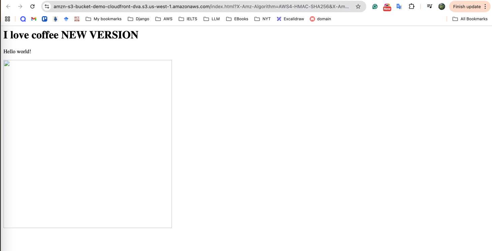
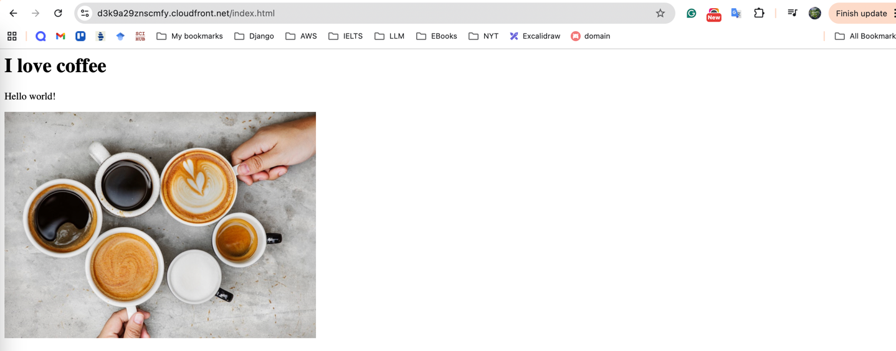
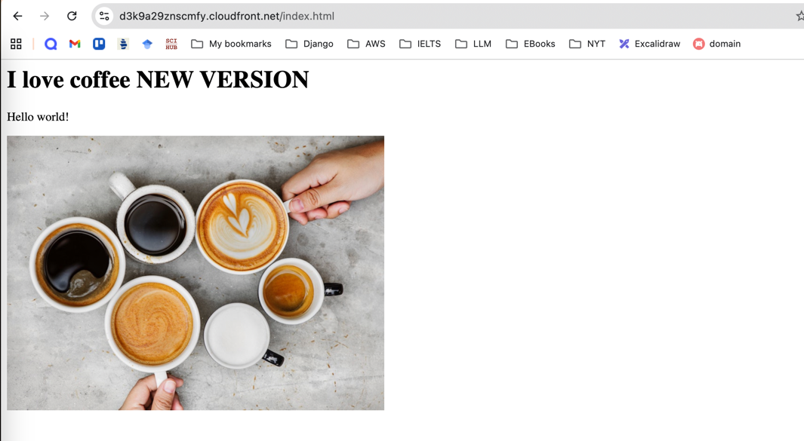

# CloudFront Lab: Cache Invalidation

[← Labs index](../README.md) · **Service:** CloudFront · **Level:** Beginner · **Est. time:** 20 min · **Est. cost:** Free tier (the first 1,000 invalidation paths each month are free)

**Reference:** [Udemy DVA-C01 - CloudFront Invalidation](https://www.udemy.com/course/aws-certified-developer-associate-dva-c01/learn/lecture/36528154#overview)

## Contents

- [Objectives](#objectives)
- [Prerequisites](#prerequisites)
- [Steps](#steps)
- [Verification](#verification)
- [Troubleshooting](#troubleshooting)
- [Cleanup](#cleanup)
- [References](#references)

## Objectives

- [ ] See CloudFront keep serving a cached object after the origin changes.
- [ ] Create a **CloudFront invalidation**.
- [ ] Confirm the updated content is served after invalidating.

## Prerequisites

- The distribution and private bucket from
  [Distribution with an S3 Origin (OAC)](01_cloudfront_distribution_with_s3_origin.md),
  still deployed.
- AWS CLI configured (`aws configure`) and `curl`.
- Your distribution domain (`d111111abcdef8.cloudfront.net`) and distribution ID
  (`EDISTRIBUTIONID`), from the CloudFront console.

## Steps

### 1. Cache Version 1

Make sure `index.html` is in CloudFront's cache **before** changing it, otherwise there is
nothing stale to observe.

1. Make sure your local `index.html` contains the text `Version 1`, and upload it to the
   bucket.
2. Request it through CloudFront until it is a cache hit:

   ```bash
   curl -sI https://d111111abcdef8.cloudfront.net/index.html | grep -i '^x-cache'
   # Repeat until: x-cache: Hit from cloudfront
   ```

### 2. Update the Origin

1. Change the local text to `Version 2` and upload `index.html` to the bucket again.
2. Confirm the **origin** has the new content. The bucket is private, so copying the
   **Object URL** returns Access Denied. Use either of these instead:
   - In the S3 console, select `index.html` and click **Open**. The console opens a
     temporary **pre-signed URL** (note the `X-Amz-...` query string), which works on a
     private bucket.
   - From the CLI, with your credentials:

     ```bash
     aws s3 cp s3://YOUR-BUCKET-NAME/index.html - | grep -o 'Version [0-9]'
     # Expected: Version 2
     ```

   

### 3. Observe the Stale Cache

Open `https://d111111abcdef8.cloudfront.net/index.html`. It still shows **Version 1**: the
edge location keeps its cached copy until the TTL expires (24 hours by default with the
*CachingOptimized* policy).



### 4. Invalidate the Cache

1. Open the **CloudFront Console** > your distribution > **Invalidations** tab >
   **Create invalidation**.
2. **Object paths:** `/index.html` (or `/*` to clear everything, which still counts as one
   path).
3. Click **Create invalidation** and wait for the status to change from **InProgress** to
   **Completed**.

The CLI equivalent:

```bash
aws cloudfront create-invalidation --distribution-id EDISTRIBUTIONID --paths "/index.html"
```

> 🔒 Before sharing screenshots, redact the distribution ID, account ID and bucket name.

## Verification

- The next request misses the cache and fetches Version 2 from the origin:

  ```bash
  curl -s https://d111111abcdef8.cloudfront.net/index.html | grep -o 'Version [0-9]'
  # Expected: Version 2

  curl -sI https://d111111abcdef8.cloudfront.net/index.html | grep -i '^x-cache'
  # First request after the invalidation: x-cache: Miss from cloudfront
  ```

  

- Check the invalidation status:

  ```bash
  aws cloudfront list-invalidations --distribution-id EDISTRIBUTIONID \
    --query 'InvalidationList.Items[].{Id:Id,Status:Status}'
  # Expected: "Status": "Completed"
  ```

## Troubleshooting

| Symptom | Likely cause | Fix |
|---------|--------------|-----|
| Step 3 already shows Version 2 | The page was never cached before the update | Do step 1 first, so Version 1 is cached |
| Still Version 1 after invalidating | Invalidation not finished, or your browser cached the page | Wait for **Completed**, then hard-refresh or use `curl` |
| `aws s3 cp` returns `AccessDenied` | Your CLI identity lacks `s3:GetObject` on the bucket | Use credentials with read access to the bucket |

## Cleanup

> 💸 This cleans up the resources from both CloudFront labs.

- [ ] **Disable** the distribution, wait until it finishes deploying, then **Delete** it.
  (Invalidation history cannot be deleted; it goes away with the distribution.)
- [ ] Delete the OAC (**CloudFront** > **Origin access**).
- [ ] Empty and delete the S3 bucket.

## References

- [Invalidating files to remove content (AWS docs)](https://docs.aws.amazon.com/AmazonCloudFront/latest/DeveloperGuide/Invalidation.html)
- [Managing how long content stays in the cache (AWS docs)](https://docs.aws.amazon.com/AmazonCloudFront/latest/DeveloperGuide/Expiration.html)
