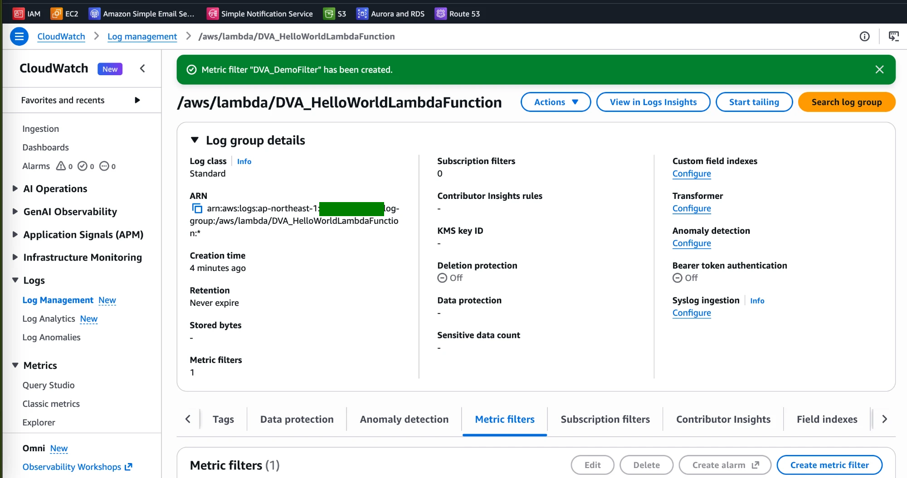
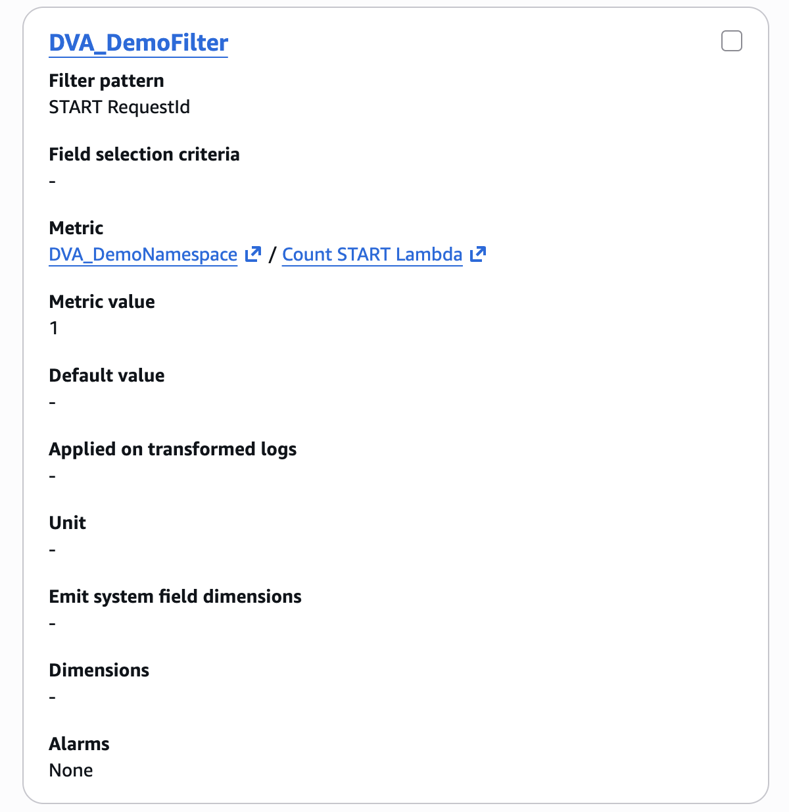

# CloudWatch Logs Lab: Metric Filter on Lambda Logs

[← Labs index](../README.md) · **Service:** CloudWatch · **Level:** Beginner · **Est. time:** 20 min · **Est. cost:** Free tier

**Reference:** [Udemy DVA-C01 - CloudWatch Logs](https://www.udemy.com/course/aws-certified-developer-associate-dva-c01/learn/lecture/29322962#overview)

## Contents

- [Objectives](#objectives)
- [Prerequisites](#prerequisites)
- [Steps](#steps)
- [Verification](#verification)
- [Troubleshooting](#troubleshooting)
- [Cleanup](#cleanup)
- [References](#references)

## Objectives

- Generate logs by running a **Lambda** function and find them in a **CloudWatch Logs log group**.
- Create a **metric filter** that turns log lines matching a pattern into a **custom metric**.
- Explain that a metric filter only counts log events ingested **after** it is created.

## Prerequisites

- An AWS account with Lambda and CloudWatch permissions.
- A region of your choice. Use the **same region** for every step.

## Steps

### 1. Create a Hello World Lambda Function

1. Open the **Lambda Console** and click **Create function**.
2. Choose **Use a blueprint** and select the **Hello world** blueprint for your runtime
    (or **Author from scratch** and keep the default hello world code).
3. **Function name:** `DVA_HelloWorldLambdaFunction`.
4. Leave **Create a new role with basic Lambda permissions** selected, then click
    **Create function**.

> 💡 The basic Lambda role allows the function to write to CloudWatch Logs. Lambda creates
> the log group `/aws/lambda/DVA_HelloWorldLambdaFunction` the first time the function runs.

### 2. Invoke the Function to Generate Logs

1. Open the **Test** tab, create a test event (any name, default JSON) and click **Test**.
2. Run it a few times so the log group holds several invocations.
3. Open the **CloudWatch Console** > **Logs** > **Log management** and open the log group
    `/aws/lambda/DVA_HelloWorldLambdaFunction`.
4. Open a log stream. Each invocation writes a line starting with `START RequestId`, your
    function's output, then `END RequestId` and `REPORT RequestId`.

### 3. Create a Metric Filter

1. In the log group, open the **Metric filters** tab and click **Create metric filter**.
2. **Filter pattern:** `START RequestId`. Optionally test it against a log stream in
    **Test pattern**.
3. Click **Next** and set:
    - **Filter name:** `DVA_DemoFilter`
    - **Metric namespace:** `DVA_DemoNamespace`
    - **Metric name:** `Count START Lambda`
    - **Metric value:** `1`
4. Click **Next**, then **Create metric filter**. A banner confirms the filter was created.

    

5. Open the filter's details to check the settings.

    

> 💡 **Metric value** `1` adds 1 to the metric for every matching log event, so the metric
> is a count of invocations. A pattern with several terms matches only events that contain
> **all** of them.

### 4. Generate New Matching Logs

1. Go back to the Lambda function and click **Test** a few more times.
2. A metric filter does not process old logs, so only these new invocations are counted.

## Verification

- The log group shows **Metric filters: 1** and `DVA_DemoFilter` lists the metric
    `DVA_DemoNamespace` / `Count START Lambda`.
- Open **CloudWatch** > **Metrics** > **All metrics** > **DVA_DemoNamespace** and select
    `Count START Lambda`. After a few minutes the graph shows data points equal to the number
    of invocations from step 4 (use the **Sum** statistic).
- CLI alternative (replace the times with the last hour, in UTC):

    ```bash
    aws cloudwatch get-metric-statistics --namespace DVA_DemoNamespace \
      --metric-name "Count START Lambda" --statistics Sum --period 300 \
      --start-time 2026-01-01T00:00:00Z --end-time 2026-01-01T01:00:00Z
    ```

## Troubleshooting

| Symptom | Likely cause | Fix |
|---------|--------------|-----|
| The metric `DVA_DemoNamespace` does not appear | No matching log event arrived after the filter was created | Invoke the function again and wait a few minutes |
| The metric is empty although logs exist | The filter pattern does not match the log text | Use **Test pattern** with a log stream; match the exact casing, e.g. `START RequestId` |
| The log group `/aws/lambda/...` does not exist | The function has never run, or the role cannot write logs | Run a test; check the execution role has basic Lambda (CloudWatch Logs) permissions |
| The Metrics console shows nothing | Wrong region selected | Open the console in the region where the function runs |

## Cleanup

> 💸 Delete resources to avoid surprise charges. Stored logs and custom metrics can be billed.

- [ ] Delete the metric filter `DVA_DemoFilter` (or the whole log group below).
- [ ] Delete the log group `/aws/lambda/DVA_HelloWorldLambdaFunction`.
- [ ] Delete the Lambda function `DVA_HelloWorldLambdaFunction`.
- [ ] Delete the IAM role that Lambda created for it (named like `DVA_HelloWorldLambdaFunction-role-...`).

## References

- [Create metrics from log events using filters (AWS docs)](https://docs.aws.amazon.com/AmazonCloudWatch/latest/logs/MonitoringLogData.html)
- [Filter pattern syntax for metric filters (AWS docs)](https://docs.aws.amazon.com/AmazonCloudWatch/latest/logs/FilterAndPatternSyntax.html)
- [Using Amazon CloudWatch Logs with AWS Lambda (AWS docs)](https://docs.aws.amazon.com/lambda/latest/dg/monitoring-cloudwatchlogs.html)
