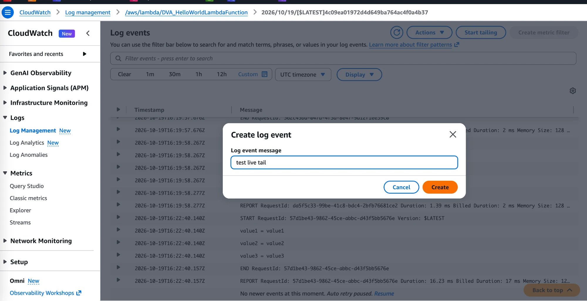
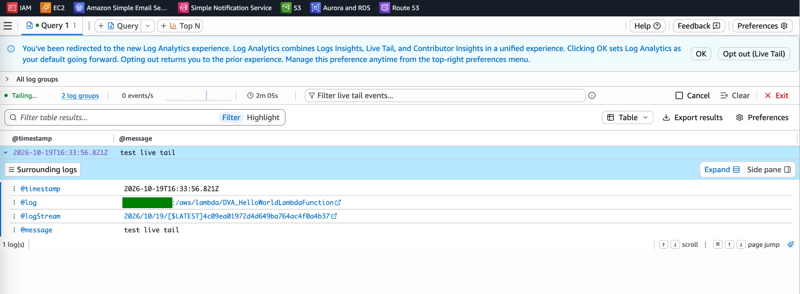

# CloudWatch Logs Lab: Live Tail

[← Labs index](../README.md) · **Service:** CloudWatch · **Level:** Beginner · **Est. time:** 10 min · **Est. cost:** Free tier

**Reference:** [Udemy DVA-C01 - CloudWatch Logs](https://www.udemy.com/course/aws-certified-developer-associate-dva-c01/learn/lecture/29322962#overview)

## Contents

- [Objectives](#objectives)
- [Prerequisites](#prerequisites)
- [Steps](#steps)
- [Verification](#verification)
- [Troubleshooting](#troubleshooting)
- [Cleanup](#cleanup)
- [References](#references)

## Objectives

- Use **CloudWatch Logs Live Tail** to watch log events arrive in near real time.
- Send a test log event by hand and see it appear in the live stream.
- Filter the live stream to the events you care about.

## Prerequisites

- The log group `/aws/lambda/DVA_HelloWorldLambdaFunction` from
    [CloudWatch Logs Lab 01](01_logs_metric_filter.md). Any log group with a log stream works.
- Use the **same region** as the log group.

## Steps

### 1. Start Live Tail

1. Open the **CloudWatch Console** > **Logs** > **Log management** and open the log group
    `/aws/lambda/DVA_HelloWorldLambdaFunction`.
2. Click **Start tailing**. The console opens **Log Analytics** with a live stream
    (the status shows **Tailing…**).
3. If a banner about the new Log Analytics experience appears, click **OK**.
4. Keep this tab open. Optionally type a term in **Filter live tail events** to show only
    matching events.

### 2. Create a Test Log Event

1. In a new browser tab, open the log group and then one of its log streams.
2. Click **Actions** > **Create log event**.
3. **Log event message:** `test live tail`, then click **Create**.

    

> 💡 You can also trigger real events by invoking the Lambda function again; each
> invocation streams `START`, `END` and `REPORT` lines into the live tail.

### 3. Watch the Event Arrive

1. Switch back to the Live Tail tab.
2. The event `test live tail` shows up within a few seconds. Expand it to see
    `@timestamp`, `@log`, `@logStream` and `@message`.

    

3. Click **Exit** to stop the session.

> 💡 Live Tail only shows events that arrive **while it is running**. It is meant for
> debugging, not for searching old logs (use **Logs Insights** for that).

## Verification

- The event `test live tail` appears in Live Tail after you create it (step 3).
- Create another event with a different message. With a filter such as `live`, only
    messages that contain it stay visible.
- CLI alternative to start a live tail session:

    ```bash
    aws logs start-live-tail --log-group-identifiers YOUR-LOG-GROUP-ARN
    ```

## Troubleshooting

| Symptom | Likely cause | Fix |
|---------|--------------|-----|
| Live Tail shows `0 events/s` | No new events since it started | Create a log event or invoke the Lambda function again |
| The test event does not show up | The filter hides it, or you tail a different log group | Clear the filter; check the log group in the session |
| **Create log event** is not available | You are not inside a log stream | Open a log stream from the log group first |
| The session stops by itself | Live Tail sessions end after a time limit | Click **Start tailing** again |

## Cleanup

> 💸 Live Tail has a monthly free allowance and is billed per minute after that.

- [ ] Click **Exit** or **Cancel** on the Live Tail session.
- [ ] Delete the lab 01 resources (log group, Lambda function and role) if you are done.

## References

- [Troubleshoot with CloudWatch Logs Live Tail (AWS docs)](https://docs.aws.amazon.com/AmazonCloudWatch/latest/logs/CloudWatchLogs_LiveTail.html)
- [Amazon CloudWatch pricing](https://aws.amazon.com/cloudwatch/pricing/)
