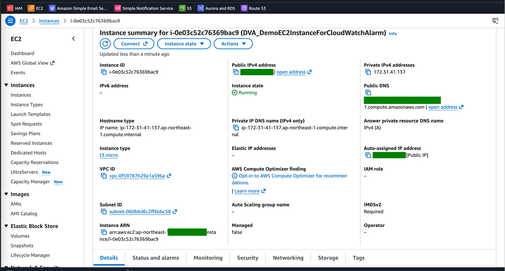
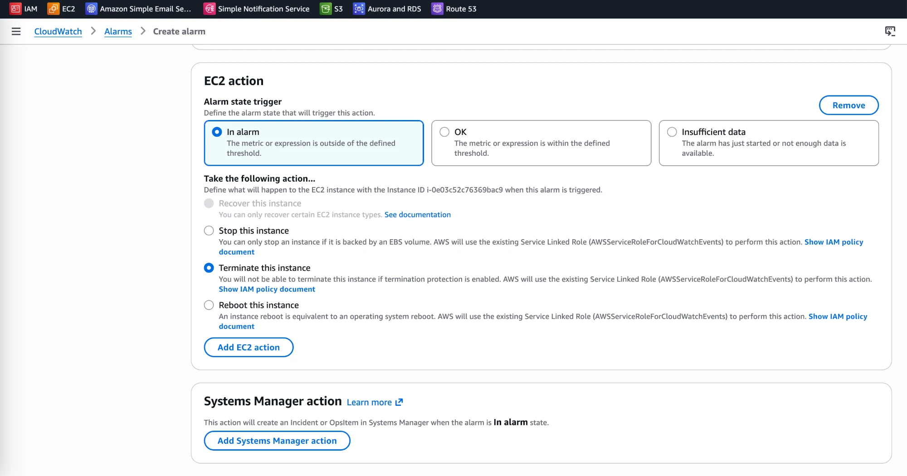
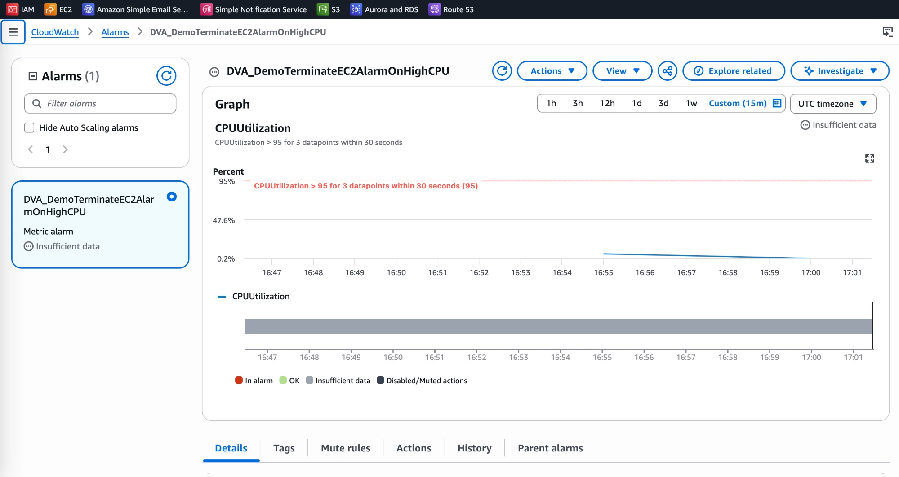
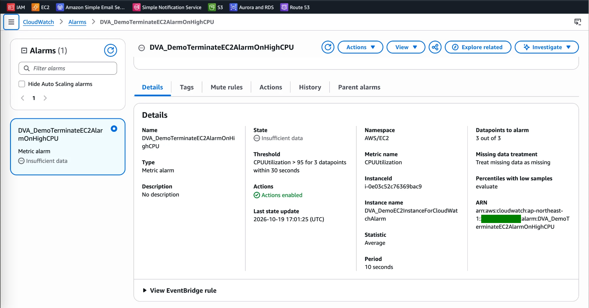
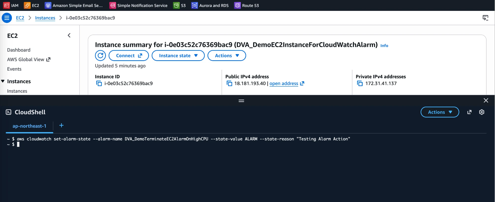
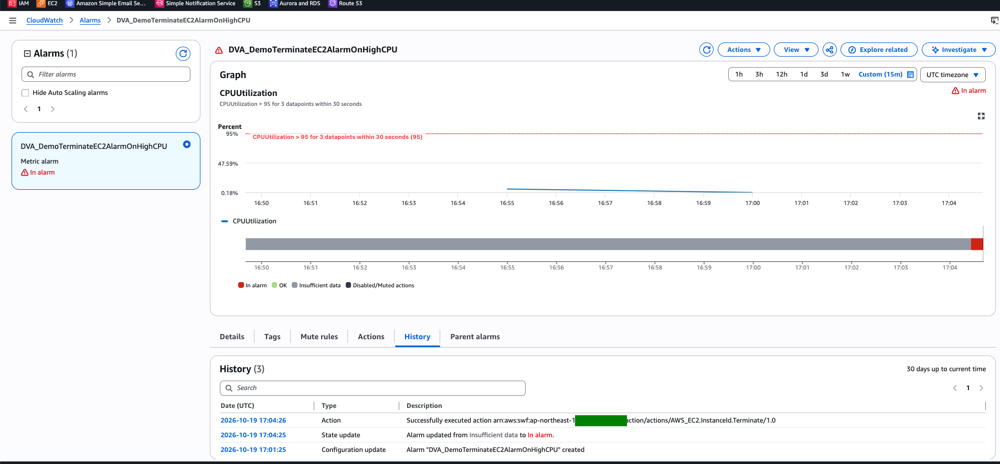
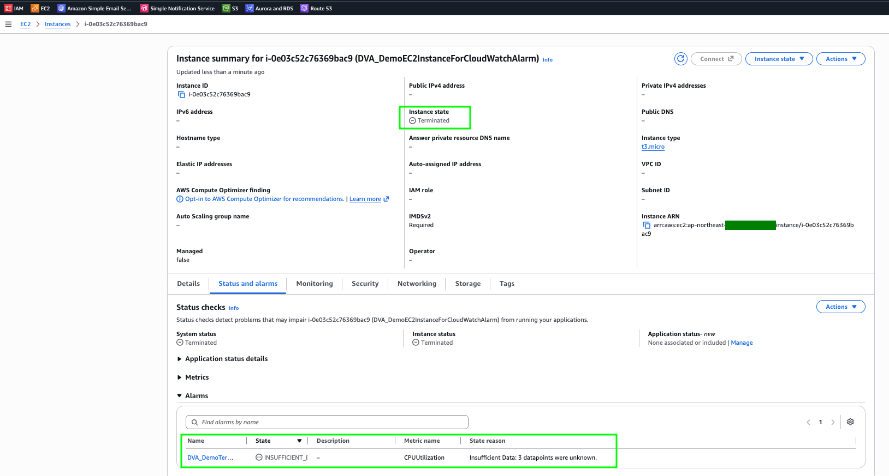

# CloudWatch Alarm Lab: Terminate an EC2 Instance on High CPU

[← Labs index](../README.md) · **Service:** CloudWatch · **Level:** Beginner · **Est. time:** 20 min · **Est. cost:** Free tier

**Reference:** [Udemy DVA-C01 - CloudWatch Alarms Hands On](https://www.udemy.com/course/aws-certified-developer-associate-dva-c01/learn/lecture/27548626#overview)

## Contents

- [Objectives](#objectives)
- [Prerequisites](#prerequisites)
- [Steps](#steps)
- [Verification](#verification)
- [Troubleshooting](#troubleshooting)
- [Cleanup](#cleanup)
- [References](#references)

## Objectives

- Create a **CloudWatch alarm** on the `CPUUtilization` metric of an EC2 instance.
- Attach an **EC2 action** that terminates the instance when the alarm goes to **In alarm**.
- Test the alarm action quickly with `set-alarm-state` from **CloudShell**, without generating real CPU load.

## Prerequisites

- An AWS account with EC2 and CloudWatch permissions.
- A region of your choice. Use the **same region** for every step (CloudShell uses the region selected in the console).
- Familiarity with launching an instance: see [EC2 Lab 01](../ec2/01_launch_ec2_instance.md).

## Steps

### 1. Create an EC2 Instance

1. Open the **EC2 Console** and click **Launch instance**.
2. **Name:** `DVA_DemoEC2InstanceForCloudWatchAlarm`.
3. Choose the default Amazon Linux AMI and the `t3.micro` instance type (free tier eligible).
4. Leave the other settings at their defaults and click **Launch instance**.
5. Wait until **Instance state** is **Running** and note the **Instance ID**.

    

### 2. Create the Alarm

1. Open the **CloudWatch Console** > **Alarms** > **Create alarm** and click **Select metric**.
2. Choose **EC2** > **Per-Instance Metrics**, search for your **Instance ID** and select
    the **CPUUtilization** metric. Click **Select metric**.
3. Set the metric conditions:
    - **Statistic:** Average
    - **Period:** `10` seconds
    - **Threshold type:** Static, **Greater than** `95`
    - **Datapoints to alarm:** `3` out of `3`
4. Click **Next**. Under **EC2 action**, click **Add EC2 action** and set:
    - **Alarm state trigger:** In alarm
    - **Take the following action:** **Terminate this instance**

    

5. Click **Next**, set **Alarm name** to `DVA_DemoTerminateEC2AlarmOnHighCPU`, then
    click **Next** and **Create alarm**.

> 💡 The console may offer to create the **service-linked role** used for EC2 actions
> (`AWSServiceRoleForCloudWatchEvents`). Accept it if asked.

### 3. Check the New Alarm

1. Open the alarm. Its state is **Insufficient data**.

    

2. Open the **Details** tab and check the settings: namespace `AWS/EC2`, metric
    `CPUUtilization`, **Period** 10 seconds, **Datapoints to alarm** 3 out of 3.

    

> 💡 The state stays **Insufficient data** because EC2 publishes `CPUUtilization` every
> 5 minutes by default, so a 10-second period never gets 3 datapoints. That is why the next
> step forces the alarm state instead of waiting for real CPU load.

### 4. Force the Alarm State from CloudShell

1. Open **CloudShell** (the icon in the console toolbar) in the same region as the alarm.
2. Run:

    ```bash
    aws cloudwatch set-alarm-state --alarm-name DVA_DemoTerminateEC2AlarmOnHighCPU \
      --state-value ALARM --state-reason "Testing Alarm Action"
    ```

    

> 💡 `set-alarm-state` only changes the state temporarily for testing. The alarm goes back
> to the state computed from the metric the next time it is evaluated.

### 5. Check the Alarm History

1. Refresh the alarm page: the state is now **In alarm**.
2. Open the **History** tab. You see the state update and an **Action** entry saying the
    action `AWS_EC2.InstanceId.Terminate` was executed successfully.

    

### 6. Check That the Instance Was Terminated

1. Open the **EC2 Console** > **Instances** and open the instance.
2. **Instance state** is **Terminated**. On the **Status and alarms** tab, the alarm is listed
    with the state **Insufficient data** again, because the instance no longer sends metrics.

    

## Verification

- The alarm history shows **State update** (to **In alarm**) followed by **Action** `AWS_EC2.InstanceId.Terminate` (step 5).
- The instance state is **Terminated** (step 6).
- CLI alternative:

    ```bash
    aws cloudwatch describe-alarm-history --alarm-name DVA_DemoTerminateEC2AlarmOnHighCPU \
      --history-item-type Action
    aws ec2 describe-instances --instance-ids YOUR-INSTANCE-ID \
      --query "Reservations[].Instances[].State.Name"
    ```

## Troubleshooting

| Symptom | Likely cause | Fix |
|---------|--------------|-----|
| The instance is not terminated after `set-alarm-state` | The alarm has no EC2 action, or the action is on the wrong state | Edit the alarm and check that the **In alarm** state triggers **Terminate this instance** |
| The instance is not terminated although the action ran | **Termination protection** is enabled | Disable termination protection on the instance |
| `set-alarm-state` returns `ResourceNotFound` | Wrong alarm name or CloudShell is in another region | Check the alarm name and the region shown in the CloudShell tab |
| The alarm stays in **Insufficient data** | EC2 publishes metrics every 5 minutes, but the alarm needs 3 datapoints in 30 seconds | Expected in this lab; use `set-alarm-state`, or enable detailed monitoring and use a 60-second period |

## Cleanup

> 💸 Delete resources to avoid surprise charges.

- [ ] Confirm the EC2 instance is **Terminated** (it disappears from the list after a while).
- [ ] Delete the alarm `DVA_DemoTerminateEC2AlarmOnHighCPU`.

## References

- [Using Amazon CloudWatch alarms (AWS docs)](https://docs.aws.amazon.com/AmazonCloudWatch/latest/monitoring/AlarmThatSendsEmail.html)
- [Add stop, terminate, reboot, or recover actions to an Amazon CloudWatch alarm (AWS docs)](https://docs.aws.amazon.com/AmazonCloudWatch/latest/monitoring/UsingAlarmActions.html)
- [set-alarm-state (AWS CLI reference)](https://docs.aws.amazon.com/cli/latest/reference/cloudwatch/set-alarm-state.html)
