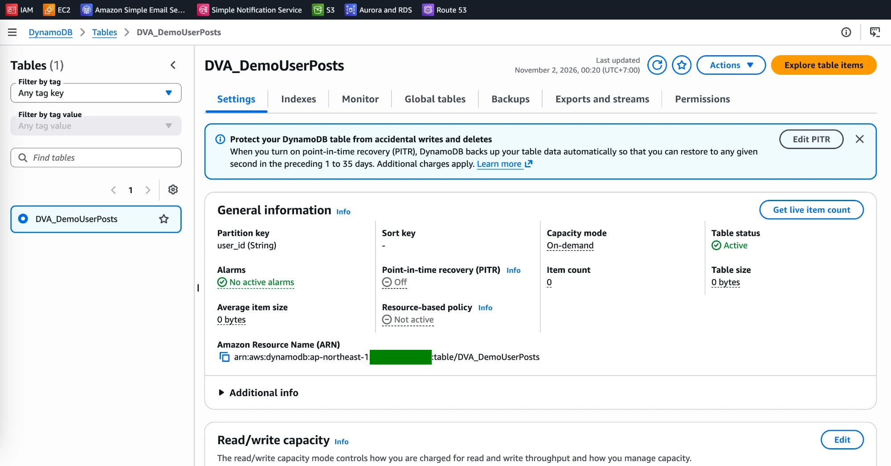
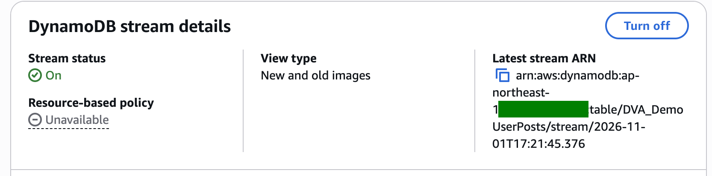
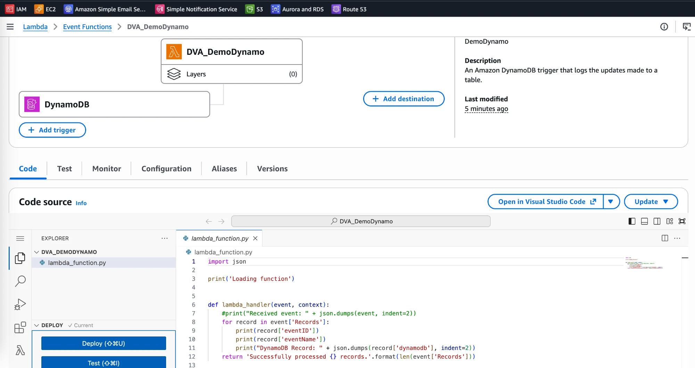
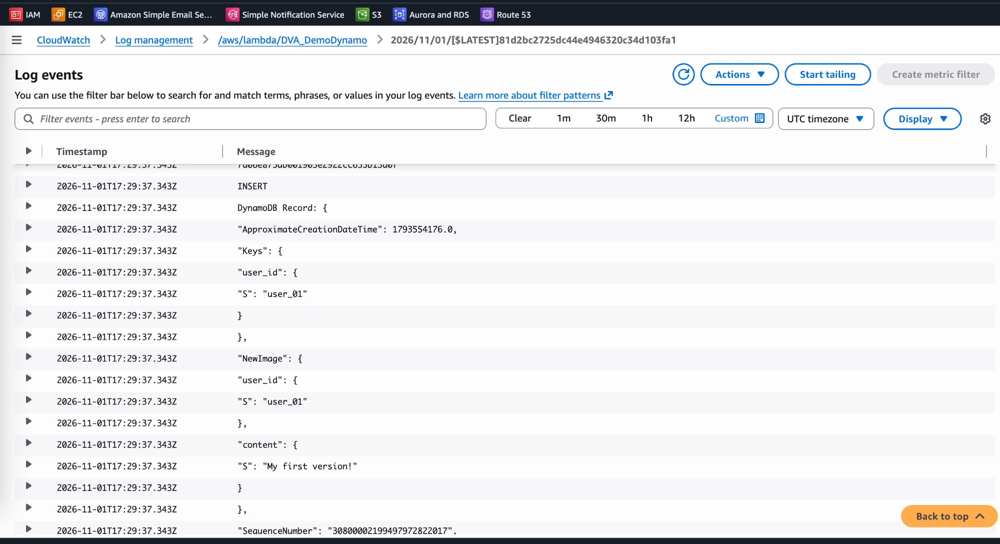

# DynamoDB Lab: Process DynamoDB Streams with Lambda

[← Labs index](../README.md) · **Service:** DynamoDB · **Level:** Beginner · **Est. time:** 20 min · **Est. cost:** Free tier

**Reference:** [Udemy DVA-C01 - DynamoDB Streams Hands On](https://www.udemy.com/course/aws-certified-developer-associate-dva-c01/learn/lecture/28646620#overview)

## Contents

- [Objectives](#objectives)
- [Prerequisites](#prerequisites)
- [Steps](#steps)
- [Verification](#verification)
- [Troubleshooting](#troubleshooting)
- [Cleanup](#cleanup)
- [References](#references)

## Objectives

- Turn on a **DynamoDB stream** with the **New and old images** view type.
- Give a Lambda function permission to read the stream and add the table as a **trigger** (an event source mapping).
- Write items and read the `INSERT` / `MODIFY` stream records in **CloudWatch Logs**.

## Prerequisites

- An AWS account with DynamoDB, Lambda, IAM and CloudWatch Logs permissions.
- Theory: [DynamoDB Streams in the Serverless mind map](../../mind_maps/markdown/ServerlessArchitecture.md).

## Steps

### 1. Create the Table

1. Open the **DynamoDB Console** > **Tables** > **Create table**.
2. **Table name:** `DVA_DemoUserPosts`. **Partition key:** `user_id` (String). No sort key.
3. Keep the default settings (capacity mode **On-demand**) and click **Create table**.
    Wait until the status is **Active**.

    

### 2. Turn on the Stream

1. Open the table > **Exports and streams** tab.
2. Under **DynamoDB stream details**, click **Turn on**.
3. **View type:** **New and old images**, then click **Turn on stream**.

    

> 💡 The stream only records changes made **after** it is turned on. Items written before are
> never added to it.

### 3. Create the Lambda Function

1. Open the **Lambda Console** > **Create function** > **Use a blueprint**.
2. Pick the Python blueprint **Process updates made to a DynamoDB table**
    (*An Amazon DynamoDB trigger that logs the updates made to a table*).
3. **Function name:** `DVA_DemoDynamo`. Keep **Create a new role with basic Lambda permissions**.
4. If the blueprint form also shows a DynamoDB trigger, leave it out for now (you add it in step 5)
    and click **Create function**.

The handler prints each record's `eventID`, `eventName` and `dynamodb` payload:

```python
import json

print('Loading function')


def lambda_handler(event, context):
    #print("Received event: " + json.dumps(event, indent=2))
    for record in event['Records']:
        print(record['eventID'])
        print(record['eventName'])
        print("DynamoDB Record: " + json.dumps(record['dynamodb'], indent=2))
    return 'Successfully processed {} records.'.format(len(event['Records']))
```

### 4. Allow the Role to Read the Stream

1. Open the function > **Configuration** > **Permissions** and click the role name
    (`DVA_DemoDynamo-role-...`).
2. **Add permissions** > **Attach policies**, select `AWSLambdaDynamoDBExecutionRole` and
    click **Add permissions**.

> 💡 The event source mapping polls the stream **with the function's execution role**, so the role
> needs `dynamodb:DescribeStream`, `dynamodb:GetShardIterator`, `dynamodb:GetRecords` and
> `dynamodb:ListStreams`. Without them, adding the trigger fails.

### 5. Add the Table as a Trigger

1. On the function page, click **Add trigger** > **DynamoDB**.
2. **DynamoDB table:** `DVA_DemoUserPosts`. Keep **Batch size** 100, **Starting position**
    **Latest** and **Activate trigger** ticked. Click **Add**.
3. The diagram now shows **DynamoDB** as the function's trigger.

    

### 6. Write Items and Read the Stream Records

1. Open the table > **Explore table items** > **Create item**.
2. **user_id:** `user_01`. Click **Add new attribute** > **String**, name it `content`, value
    `My first version!`, then click **Create item**.
3. Open the **CloudWatch Console** > **Log management** > `/aws/lambda/DVA_DemoDynamo` and open
    the latest log stream.
4. The record has `eventName` **INSERT**, the `Keys` and a `NewImage` with the item. There is no
    `OldImage`, because the item did not exist before.

    

5. Edit the item and change `content` to `My second version!`. A new record appears with
    `eventName` **MODIFY**, plus both `NewImage` and `OldImage`. Deleting the item gives
    **REMOVE** with only `OldImage`.

## Verification

- **Exports and streams** shows **Stream status: On** and **View type: New and old images**.
- The function's **Configuration** > **Triggers** shows the DynamoDB trigger as **Enabled**.
- Every item write produces one log entry with the matching `eventName` (`INSERT`, `MODIFY`, `REMOVE`).
- CLI alternative:

    ```bash
    aws dynamodb put-item --table-name DVA_DemoUserPosts \
      --item '{"user_id": {"S": "user_02"}, "content": {"S": "Hello from the CLI"}}'
    aws logs tail /aws/lambda/DVA_DemoDynamo --since 5m
    aws lambda list-event-source-mappings --function-name DVA_DemoDynamo \
      --query "EventSourceMappings[].{state:State,start:StartingPosition,source:EventSourceArn}"
    ```

## Troubleshooting

| Symptom | Likely cause | Fix |
|---------|--------------|-----|
| Adding the trigger fails with a permissions error | The execution role cannot read the stream | Attach `AWSLambdaDynamoDBExecutionRole` to the role (step 4) |
| The table is not offered as a trigger | The stream is turned off | Turn on the stream on the table (step 2) |
| No `OldImage` in a `MODIFY` record | The view type is `NEW_IMAGE` or `KEYS_ONLY` | Turn the stream off and on again with **New and old images** |
| Items written earlier never show up | Streams are not back-filled, and the trigger starts at **Latest** | Write a new item after the trigger is **Enabled** |
| No logs after writing | The trigger is still **Creating** or disabled | Wait for **Enabled**, or enable the trigger |

## Cleanup

> 💸 On-demand tables and Lambda are free while idle, but remove the resources when you are done.

- [ ] Delete the DynamoDB trigger on the function.
- [ ] Delete the table `DVA_DemoUserPosts` (this also deletes its stream).
- [ ] Delete the function `DVA_DemoDynamo`, its log group `/aws/lambda/DVA_DemoDynamo` and its execution role.

## References

- [Change data capture for DynamoDB Streams (AWS docs)](https://docs.aws.amazon.com/amazondynamodb/latest/developerguide/Streams.html)
- [Using AWS Lambda with Amazon DynamoDB (AWS docs)](https://docs.aws.amazon.com/lambda/latest/dg/with-ddb.html)
- [AWSLambdaDynamoDBExecutionRole (AWS managed policy reference)](https://docs.aws.amazon.com/aws-managed-policy/latest/reference/AWSLambdaDynamoDBExecutionRole.html)
