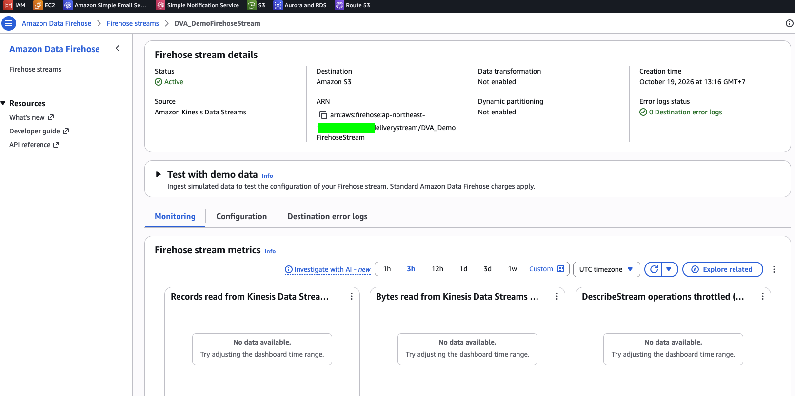
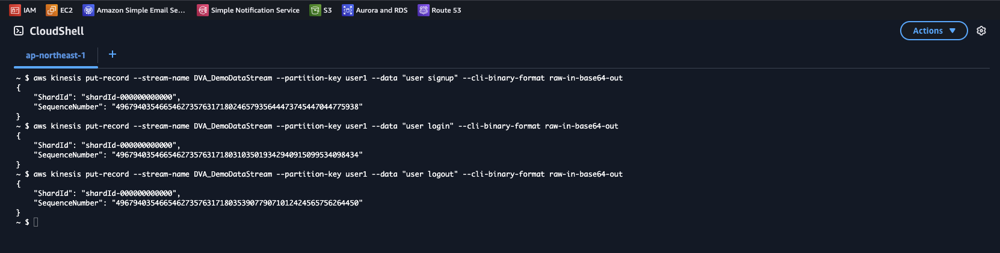
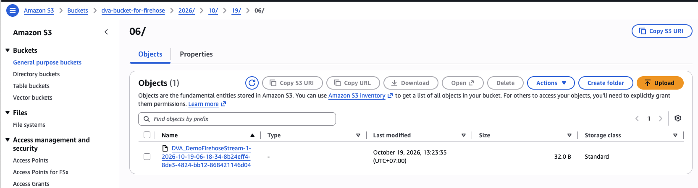
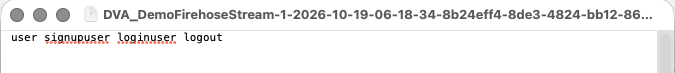

# Data Firehose Lab: Deliver a Kinesis Data Stream to S3

[← Labs index](../README.md) · **Service:** Amazon Data Firehose · **Level:** Beginner · **Est. time:** 25 min · **Est. cost:** ~$0.02 per hour for the data stream — remember to clean up

**Reference:** [Udemy DVA-C01 - Amazon Data Firehose Hands On](https://www.udemy.com/course/aws-certified-developer-associate-dva-c01/learn/lecture/26101804#overview)

## Contents

- [Objectives](#objectives)
- [Prerequisites](#prerequisites)
- [Steps](#steps)
- [Verification](#verification)
- [Troubleshooting](#troubleshooting)
- [Cleanup](#cleanup)
- [References](#references)

## Objectives

- [ ] Create a Firehose stream that reads from a Kinesis data stream and writes to S3.
- [ ] Let the console create the IAM role that Firehose uses.
- [ ] Send records to the data stream from AWS CloudShell.
- [ ] Find the delivered file in S3 after the buffer interval.

## Prerequisites

- An AWS account with Kinesis, Firehose, S3 and IAM permissions.
- The CLI steps of the [Kinesis Data Streams lab](../kinesis/01_data_streams_cli.md)
    are useful background, but this lab creates its own stream.
- Create every resource in the **same region**.

## Steps

### 1. Create the Source Data Stream

1. Open the **Kinesis Console** > **Data streams** and click **Create data stream**.
2. **Data stream name:** `DVA_DemoDataStream`.
3. **Capacity mode:** Provisioned. **Provisioned shards:** `1`.
4. Click **Create data stream** and wait until the status is **Active**.

### 2. Create the Destination Bucket

1. Open the **S3 Console** and click **Create bucket**.
2. **Bucket name:** a globally unique name, e.g. `dva-bucket-for-firehose-<your-initials>`.
3. Leave the other settings at their defaults and click **Create bucket**.

### 3. Create the Firehose Stream

1. Open the **Amazon Data Firehose Console** and click **Create Firehose stream**.
2. **Source:** Amazon Kinesis Data Streams. **Destination:** Amazon S3.
3. Under **Source settings**, click **Browse** and choose `DVA_DemoDataStream`.
4. **Firehose stream name:** `DVA_DemoFirehoseStream`.
5. Under **Destination settings**, click **Browse** and choose your bucket.
6. Leave **Transform and convert records**, the buffer hints and the other settings at
    their defaults.
7. Expand **Advanced settings**. Under **Service access**, make sure
    **Create or update IAM role** is selected. The role is named
    `KinesisFirehoseServiceRole-DVA_Demo-<region>-<number>`.
8. Click **Create Firehose stream** and wait until the status is **Active**.

    

> 💡 The IAM role lets Firehose read from the data stream and write to the bucket.
> Without it, the stream cannot deliver anything.
>
> 💡 Firehose is near real time. It holds records in a buffer and writes one S3 object
> when the buffer is full (**buffer size**, default 5 MiB) or when the
> **buffer interval** runs out (default 300 seconds), whichever comes first.

### 4. Send Records to the Data Stream

1. Open **CloudShell** from the console, in the same region.
2. Send three records:

    ```bash
    aws kinesis put-record --stream-name DVA_DemoDataStream --partition-key user1 \
      --data "user signup" --cli-binary-format raw-in-base64-out
    aws kinesis put-record --stream-name DVA_DemoDataStream --partition-key user1 \
      --data "user login" --cli-binary-format raw-in-base64-out
    aws kinesis put-record --stream-name DVA_DemoDataStream --partition-key user1 \
      --data "user logout" --cli-binary-format raw-in-base64-out
    ```

    Each call returns a `ShardId` and a `SequenceNumber`.

    

### 5. Check the Bucket

1. Wait for the buffer interval (about 5 minutes with the defaults).
2. Open your bucket in the S3 Console. Firehose writes under a
    `YYYY/MM/DD/HH/` prefix, in **UTC**.
3. Open the folders down to the hour. There is one object named
    `DVA_DemoFirehoseStream-1-<date-time>-<id>`.

    

4. Download the object and open it in a text editor. It holds all three records:

    

> 💡 Firehose joins records as they are, with no separator, so the file reads
> `user signupuser loginuser logout`. To get one record per line, end each record
> with a newline in the producer (e.g. `--data $'user signup\n'`), or add a newline
> delimiter with Firehose data transformation.

## Verification

- The Firehose stream status is **Active**, with source **Amazon Kinesis Data
    Streams** and destination **Amazon S3** (step 3).
- After the buffer interval, the bucket has one object under today's UTC date and
    hour (step 5).
- The object is 32 bytes and contains the three records (step 5).
- CLI alternative. List the delivered objects:

    ```bash
    aws s3 ls s3://YOUR-BUCKET --recursive
    ```

    Expected: one key like `2026/10/19/06/DVA_DemoFirehoseStream-1-2026-10-19-06-18-34-…`.

- Print an object's content:

    ```bash
    aws s3 cp s3://YOUR-BUCKET/YOUR-OBJECT-KEY -
    ```

    Expected: `user signupuser loginuser logout`.

## Troubleshooting

| Symptom | Likely cause | Fix |
|---------|--------------|-----|
| The bucket is still empty | The buffer interval has not passed yet | Wait 5 minutes after the last record, then refresh |
| The folder is not under today's local date or hour | The `YYYY/MM/DD/HH/` prefix is in UTC | Look for the UTC hour (e.g. `06/` for 13:00 GMT+7) |
| The data stream or bucket is missing from **Browse** | It is in a different region | Create the stream, bucket and Firehose stream in the same region |
| Nothing arrives and **Destination error logs** shows errors | The IAM role cannot read the stream or write to the bucket | Edit the Firehose stream and choose **Create or update IAM role** again |
| Records sent before the Firehose stream existed are missing | Firehose starts reading at the latest position of the data stream | Send new records after the Firehose stream is **Active** |

## Cleanup

> 💸 The data stream is billed every hour it exists, even with no traffic.

- [ ] Delete `DVA_DemoFirehoseStream` (**Firehose streams** > select it > **Delete**).
- [ ] Delete `DVA_DemoDataStream` (**Kinesis** > **Data streams** > select it > **Delete**).
- [ ] Empty the bucket, then delete it.
- [ ] Delete the IAM role `KinesisFirehoseServiceRole-DVA_Demo-<region>-<number>`, and
    the `KinesisFirehoseServicePolicy-…` policy if one was created with it.

## References

- [What is Amazon Data Firehose? (AWS docs)](https://docs.aws.amazon.com/firehose/latest/dev/what-is-this-service.html)
- [Configure buffering hints (AWS docs)](https://docs.aws.amazon.com/firehose/latest/dev/buffering-concepts.html)
- [Configure the Amazon S3 object name format (AWS docs)](https://docs.aws.amazon.com/firehose/latest/dev/s3-object-name.html)
- [Amazon Data Firehose pricing](https://aws.amazon.com/firehose/pricing/)
