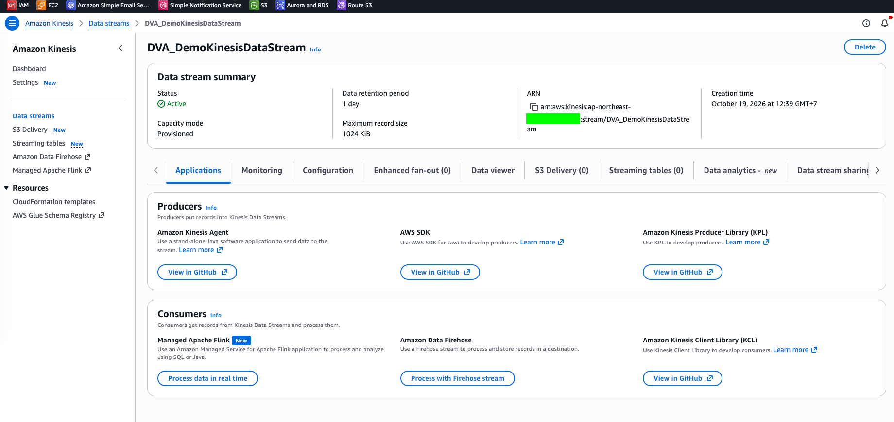
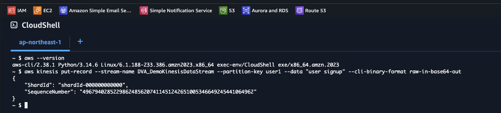
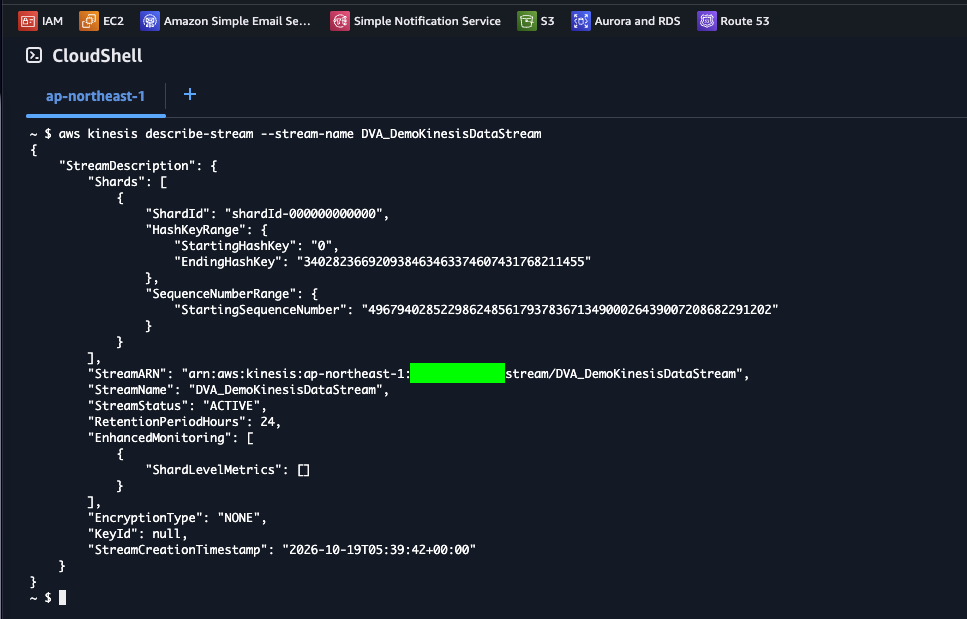
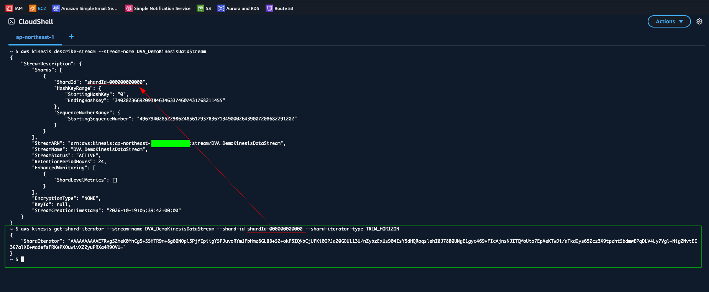
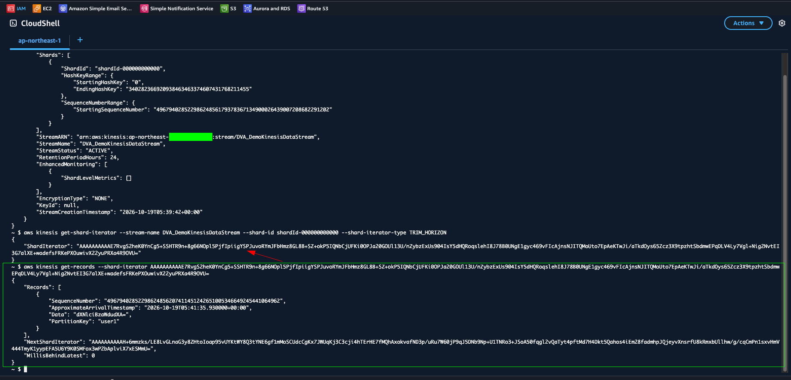

# Kinesis Lab: Produce and Consume Data Streams with the CLI

[← Labs index](../README.md) · **Service:** Kinesis · **Level:** Beginner · **Est. time:** 20 min · **Est. cost:** ~$0.02 per shard-hour — remember to clean up

**Reference:** [Udemy DVA-C01 - Kinesis Data Streams Hands On](https://www.udemy.com/course/aws-certified-developer-associate-dva-c01/learn/lecture/26101790#overview)

## Contents

- [Objectives](#objectives)
- [Prerequisites](#prerequisites)
- [Steps](#steps)
- [Verification](#verification)
- [Troubleshooting](#troubleshooting)
- [Cleanup](#cleanup)
- [References](#references)

## Objectives

- Create a provisioned data stream and act as both **producer** (`put-record`) and **consumer** (`get-records`) from CloudShell.
- Explain how the **partition key** picks the shard and keeps records with the same key in order.
- Read records with a `TRIM_HORIZON` **shard iterator**, and know how it differs from `LATEST`.
- Know why CLI v2 needs `--cli-binary-format raw-in-base64-out` and how to decode the Base64 `Data`.

## Prerequisites

- An AWS account with Kinesis permissions.
- [AWS CloudShell](https://docs.aws.amazon.com/cloudshell/latest/userguide/welcome.html),
    which has AWS CLI v2 preinstalled. Open it in the **same region** as the stream.

## Steps

### 1. Create the Data Stream

1. Open the **Kinesis Console** > **Data streams** and click **Create data stream**.
2. **Data stream name:** `DVA_DemoKinesisDataStream`.
3. **Capacity mode:** Provisioned. **Provisioned shards:** `1`.
4. Leave the other settings at their defaults and click **Create data stream**.
5. Wait until the status is **Active**.

    

> 💡 In provisioned mode each shard takes in up to 1 MB/s or 1,000 records/s and serves
> up to 2 MB/s to consumers. You pay per shard-hour whether or not you send data, so
> delete the stream when you finish.

### 2. Open CloudShell

1. Click the **CloudShell** icon in the console's bottom bar (or the top navigation bar).
2. Check the CLI version:

    ```bash
    aws --version
    ```

    The output starts with `aws-cli/2.`. The commands below are for CLI v2.

### 3. Produce Records

1. Send a record with the partition key `user1`:

    ```bash
    aws kinesis put-record --stream-name DVA_DemoKinesisDataStream \
      --partition-key user1 --data "user signup" \
      --cli-binary-format raw-in-base64-out
    ```

    The response shows the shard that stored the record and its sequence number.

    

2. Send a few more records with the same partition key:

    ```bash
    aws kinesis put-record --stream-name DVA_DemoKinesisDataStream \
      --partition-key user1 --data "user login" \
      --cli-binary-format raw-in-base64-out
    aws kinesis put-record --stream-name DVA_DemoKinesisDataStream \
      --partition-key user1 --data "user logout" \
      --cli-binary-format raw-in-base64-out
    ```

> 💡 CLI v2 expects binary parameters such as `--data` to be Base64 by default.
> `--cli-binary-format raw-in-base64-out` tells it to take the plain text and encode it
> for you. Without the flag, `"user signup"` is rejected as invalid Base64.
>
> 💡 Records with the same partition key always go to the same shard, so their order is
> kept. The CLI calls the same `PutRecord` API that an AWS SDK producer would.

### 4. Find the Shard ID

1. Describe the stream:

    ```bash
    aws kinesis describe-stream --stream-name DVA_DemoKinesisDataStream
    ```

2. Note the `ShardId` under `Shards`. With 1 shard it is `shardId-000000000000`.

    

### 5. Consume Records

1. Get a shard iterator that starts at the oldest record in the shard:

    ```bash
    aws kinesis get-shard-iterator --stream-name DVA_DemoKinesisDataStream \
      --shard-id shardId-000000000000 --shard-iterator-type TRIM_HORIZON
    ```

    

2. Copy the `ShardIterator` value and read the records:

    ```bash
    aws kinesis get-records --shard-iterator YOUR-SHARD-ITERATOR
    ```

    

3. To skip the copy and paste, save the iterator in a variable:

    ```bash
    ITERATOR=$(aws kinesis get-shard-iterator --stream-name DVA_DemoKinesisDataStream \
      --shard-id shardId-000000000000 --shard-iterator-type TRIM_HORIZON \
      --query ShardIterator --output text)
    aws kinesis get-records --shard-iterator "$ITERATOR"
    ```

> 💡 `TRIM_HORIZON` starts at the oldest record still in the stream. `LATEST` starts
> after the newest record, so it only returns records sent after you get the iterator.
> `AT_SEQUENCE_NUMBER`, `AFTER_SEQUENCE_NUMBER` and `AT_TIMESTAMP` start from a given
> point.
>
> 💡 Each response has a `NextShardIterator`. A consumer passes it to the next
> `get-records` call to keep reading. `MillisBehindLatest: 0` means it has caught up.

### 6. Decode the Data

1. The `Data` field is Base64. Decode the first record:

    ```bash
    echo "dXNlciBzaWdudXA=" | base64 --decode
    ```

    Output: `user signup`.

2. Decode every record returned by `get-records` at once:

    ```bash
    for d in $(aws kinesis get-records --shard-iterator "$ITERATOR" \
      --query 'Records[].Data' --output text); do
      echo "$d" | base64 --decode; echo
    done
    ```

    Get a fresh iterator first if more than 5 minutes have passed since step 5.

## Verification

- The stream status is **Active** with 1 shard (step 1).
- Each `put-record` call returns `"ShardId": "shardId-000000000000"` and a
    `SequenceNumber` (step 3).
- `get-records` returns your records in the order you sent them, each with
    `"PartitionKey": "user1"` (step 5).
- The decoded data reads `user signup`, `user login` and `user logout` (step 6).
- Console alternative: open the stream > **Data viewer**, choose the shard, set
    **Starting position** to **Trim horizon** and click **Get records**.

## Troubleshooting

| Symptom | Likely cause | Fix |
|---------|--------------|-----|
| `Invalid base64` error on `put-record` | CLI v2 expects Base64 for `--data` | Add `--cli-binary-format raw-in-base64-out` |
| `ResourceNotFoundException` | CloudShell is in a different region from the stream | Switch the console region to the stream's region, then reopen CloudShell |
| `ExpiredIteratorException` | A shard iterator is valid for only 5 minutes | Run `get-shard-iterator` again |
| `get-records` returns an empty `Records` list | The iterator type was `LATEST`, or the first call returned no data yet | Use `TRIM_HORIZON`, or call `get-records` again with the `NextShardIterator` |
| `ResourceInUseException` when putting records | The stream is still being created | Wait until the status is **Active** |

## Cleanup

> 💸 A provisioned stream is billed every hour it exists, even with no traffic.

- [ ] Delete `DVA_DemoKinesisDataStream`: open the stream > **Delete** and confirm.
    Or run:

    ```bash
    aws kinesis delete-stream --stream-name DVA_DemoKinesisDataStream
    ```

## References

- [Tutorial: Get started with Kinesis Data Streams using the AWS CLI (AWS docs)](https://docs.aws.amazon.com/streams/latest/dev/fundamental-stream.html)
- [Kinesis Data Streams terminology and concepts (AWS docs)](https://docs.aws.amazon.com/streams/latest/dev/key-concepts.html)
- [Choose the data stream capacity mode (AWS docs)](https://docs.aws.amazon.com/streams/latest/dev/how-do-i-size-a-stream.html)
- [AWS CLI `kinesis` command reference](https://awscli.amazonaws.com/v2/documentation/api/latest/reference/kinesis/index.html)
- [Amazon Kinesis Data Streams pricing](https://aws.amazon.com/kinesis/data-streams/pricing/)
