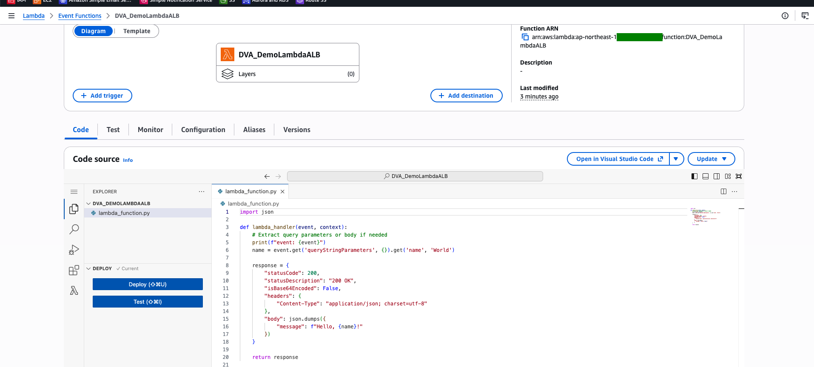
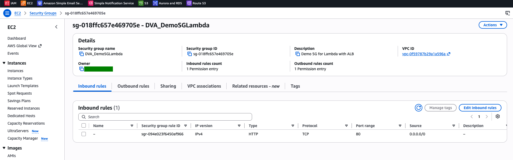
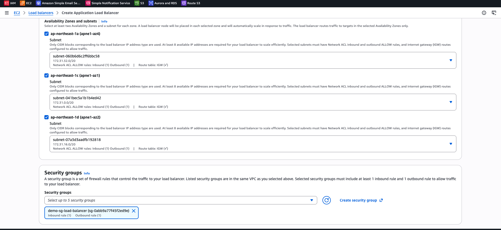
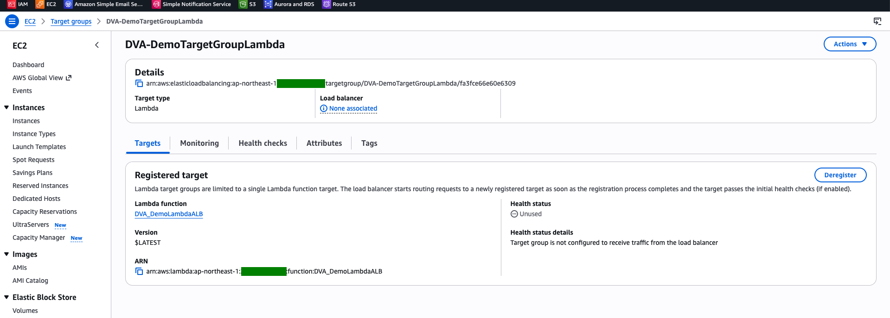
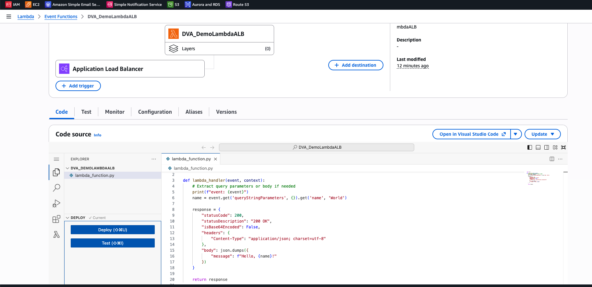
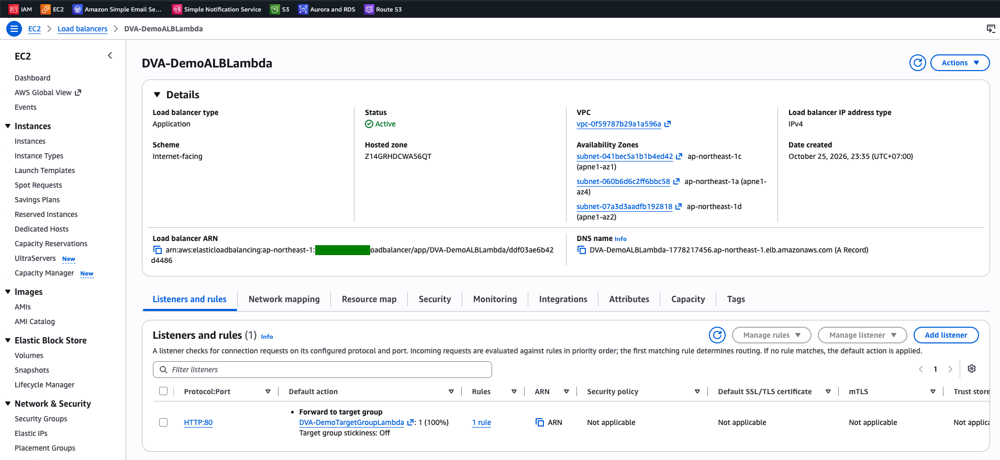
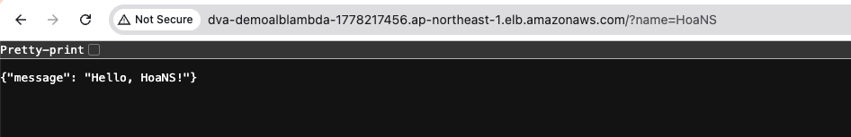

# Lambda Lab: Invoke a Function Behind an Application Load Balancer

[← Labs index](../README.md) · **Service:** Lambda · **Level:** Beginner · **Est. time:** 25 min · **Est. cost:** ~$0.03 per hour for the ALB — remember to clean up

**Reference:** [AWS docs - Using Lambda with an Application Load Balancer](https://docs.aws.amazon.com/lambda/latest/dg/services-alb.html)

## Contents

- [Objectives](#objectives)
- [Prerequisites](#prerequisites)
- [Steps](#steps)
- [Verification](#verification)
- [Troubleshooting](#troubleshooting)
- [Cleanup](#cleanup)
- [References](#references)

## Objectives

- Expose a **Lambda** function over HTTP with an **Application Load Balancer** (ALB) and a **Lambda target group**.
- Explain how the ALB turns an HTTP request into a JSON **event** and the function's return value back into an HTTP **response**.
- Know that a Lambda target group holds a **single** function.

## Prerequisites

- An AWS account with Lambda, EC2 (security groups) and Elastic Load Balancing permissions.
- A VPC with public subnets in at least **two** Availability Zones (the default VPC works; this lab uses three).

## Steps

### 1. Create the Lambda Function

1. Open the **Lambda Console** > **Create function** > **Author from scratch**.
2. **Function name:** `DVA_DemoLambdaALB`. **Runtime:** Python 3.x. Keep the default execution role.
3. Replace the code with the handler below and click **Deploy**.

    ```python
    import json


    def lambda_handler(event, context):
        # Extract query parameters or body if needed
        print(f"event: {event}")
        name = event.get('queryStringParameters', {}).get('name', 'World')

        response = {
            "statusCode": 200,
            "statusDescription": "200 OK",
            "isBase64Encoded": False,
            "headers": {
                "Content-Type": "application/json; charset=utf-8"
            },
            "body": json.dumps({
                "message": f"Hello, {name}!"
            })
        }

        return response
    ```

    

> 💡 The ALB expects this response shape: `statusCode`, `statusDescription`, `headers`,
> `body` (a string) and `isBase64Encoded`. The query string arrives in
> `event["queryStringParameters"]`.

### 2. Create a Security Group for the ALB

1. Open the **EC2 Console** > **Security Groups** > **Create security group**.
2. **Name:** `DVA_DemoSGLambda`. **Description:** `Demo SG for Lambda with ALB`. **VPC:** your VPC.
3. Add an inbound rule: **Type** HTTP, **Port** 80, **Source** `0.0.0.0/0`. Keep the default outbound rule.

    

### 3. Create the Load Balancer

1. **EC2 Console** > **Load balancers** > **Create load balancer** > **Application Load Balancer**.
2. **Name:** `DVA-DemoALBLambda`. **Scheme:** Internet-facing. **IP address type:** IPv4.
3. **Network mapping:** select your VPC and tick **three** Availability Zones, one public subnet each.
4. **Security groups:** remove `default` and select `DVA_DemoSGLambda`.

    

5. Under **Listeners and routing**, keep **HTTP:80** and click **Create target group** (opens a new tab).

### 4. Create a Lambda Target Group

1. **Target type:** Lambda function. **Name:** `DVA-DemoTargetGroupLambda`.
2. Click **Next**, choose the function `DVA_DemoLambdaALB` (version `$LATEST`) and click **Create target group**.

    

3. Back on the ALB page, refresh the target group list, choose `DVA-DemoTargetGroupLambda` as the
    listener's default action and click **Create load balancer**.
4. Wait until the ALB **Status** is **Active**.

> 💡 When you register the function, the console adds a resource-based policy that lets
> `elasticloadbalancing.amazonaws.com` invoke it. The Lambda page now shows the ALB as a trigger.



### 5. Call the Function Through the ALB

1. Open the ALB and check the listener: **HTTP:80** forwards 100% to `DVA-DemoTargetGroupLambda`.

    

2. Copy the **DNS name** and open `http://<DNS name>/?name=YourName` in a browser.

    

## Verification

- The browser shows `{"message": "Hello, YourName!"}`; without `?name=` it shows `Hello, World!`.
- The function's log group `/aws/lambda/DVA_DemoLambdaALB` contains the printed `event`, with
    `httpMethod`, `path`, `queryStringParameters`, `headers` and the target group ARN under
    `requestContext.elb`.
- CLI alternative:

    ```bash
    curl -s "http://YOUR-ALB-DNS-NAME/?name=YourName"
    ```

## Troubleshooting

| Symptom | Likely cause | Fix |
|---------|--------------|-----|
| The request times out | The ALB security group does not allow HTTP 80, or the ALB is still provisioning | Check the inbound rule of `DVA_DemoSGLambda`; wait for **Active** |
| `502 Bad Gateway` | The response does not match the ALB format (e.g. `body` is not a string) or the function failed | Return the fields shown in step 1; check the function logs |
| `503 Service Unavailable` | The listener has no target group, or the function is not registered | Check the listener default action and the target group's registered target |
| The response always says `World` | The `name` query parameter is missing or misspelled | Call `/?name=YourName` |

## Cleanup

> 💸 The load balancer is billed per hour even with no traffic.

- [ ] Delete the load balancer `DVA-DemoALBLambda`.
- [ ] Delete the target group `DVA-DemoTargetGroupLambda`.
- [ ] Delete the security group `DVA_DemoSGLambda`.
- [ ] Delete the function `DVA_DemoLambdaALB`, its log group and its execution role.

## References

- [Using AWS Lambda with an Application Load Balancer (AWS docs)](https://docs.aws.amazon.com/lambda/latest/dg/services-alb.html)
- [Lambda functions as targets (ELB docs)](https://docs.aws.amazon.com/elasticloadbalancing/latest/application/lambda-functions.html)
