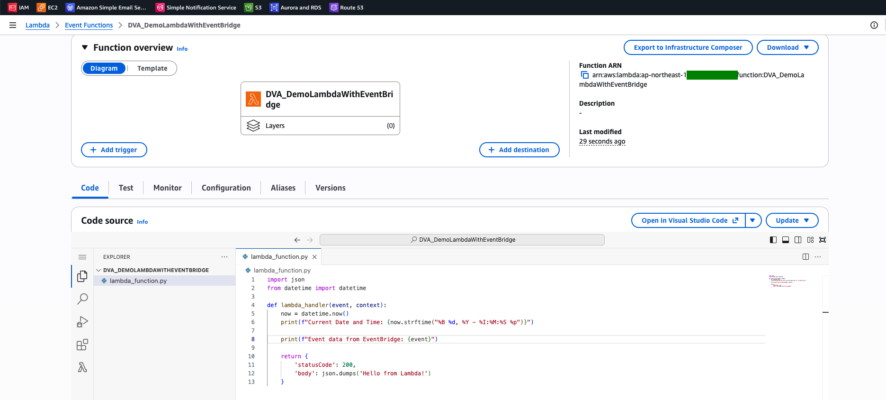
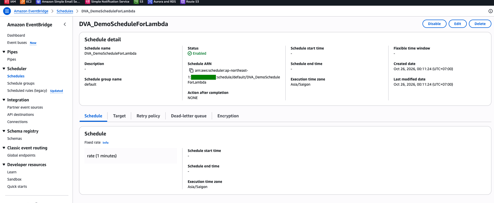
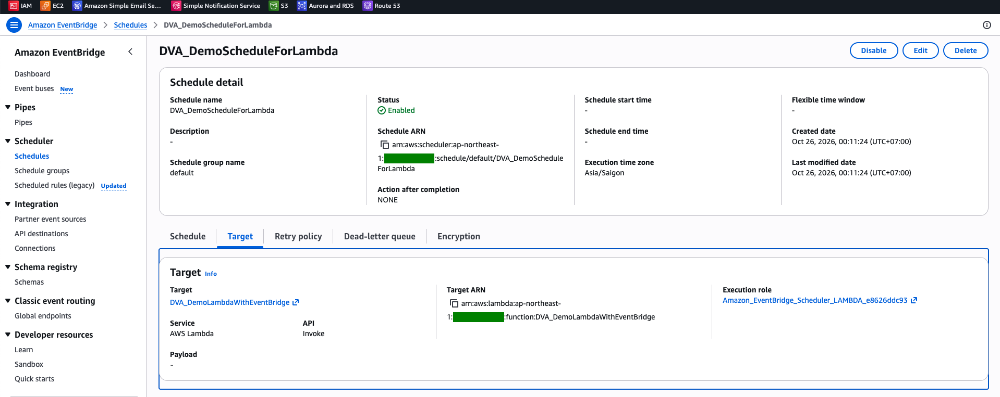
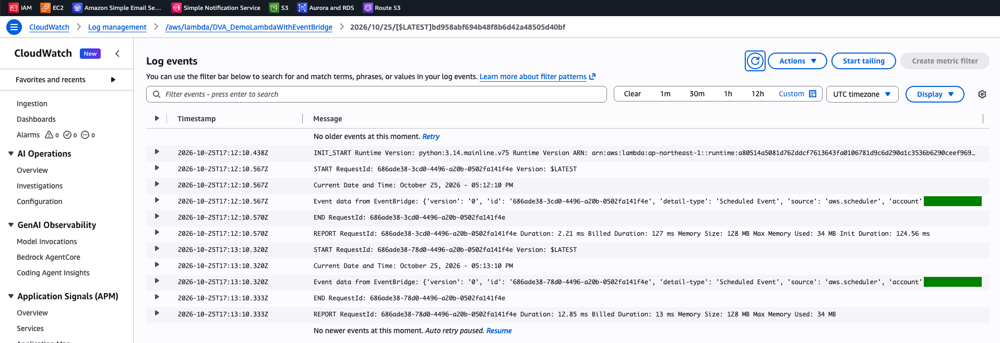

# Lambda Lab: Run a Function Every Minute with EventBridge Scheduler

[← Labs index](../README.md) · **Service:** Lambda · **Level:** Beginner · **Est. time:** 15 min · **Est. cost:** Free tier

**Reference:** [Udemy DVA-C01 - Lambda and EventBridge](https://www.udemy.com/course/aws-certified-developer-associate-dva-c01/learn/lecture/26623360#overview)

## Contents

- [Objectives](#objectives)
- [Prerequisites](#prerequisites)
- [Steps](#steps)
- [Verification](#verification)
- [Troubleshooting](#troubleshooting)
- [Cleanup](#cleanup)
- [References](#references)

## Objectives

- Invoke a **Lambda** function on a fixed rate with an **EventBridge Scheduler** schedule.
- Read the event that the scheduler sends (`source: aws.scheduler`, `detail-type: Scheduled Event`) in **CloudWatch Logs**.
- Explain that the scheduler uses its own **execution role** to invoke the function (asynchronous invocation).

## Prerequisites

- An AWS account with Lambda, EventBridge Scheduler, IAM and CloudWatch Logs permissions.

## Steps

### 1. Create the Lambda Function

1. Open the **Lambda Console** > **Create function** > **Author from scratch**.
2. **Function name:** `DVA_DemoLambdaWithEventBridge`. **Runtime:** Python 3.x. Keep the default execution role.
3. Replace the code with the handler below and click **Deploy**.

    ```python
    import json
    from datetime import datetime


    def lambda_handler(event, context):
        now = datetime.now()
        print(f"Current Date and Time: {now.strftime('%B %d, %Y - %I:%M:%S %p')}")

        print(f"Event data from EventBridge: {event}")

        return {
            'statusCode': 200,
            'body': json.dumps('Hello from Lambda!')
        }
    ```

    

> 💡 Lambda runs in UTC, so `datetime.now()` prints UTC time, whatever time zone the schedule uses.

### 2. Create the Schedule

1. Open the **Amazon EventBridge Console** > **Scheduler** > **Schedules** > **Create schedule**.
2. **Schedule name:** `DVA_DemoScheduleForLambda`. **Schedule group:** `default`.
3. **Schedule pattern:** **Recurring schedule** > **Rate-based schedule**, `1` **minutes**.
    **Flexible time window:** Off. Pick your time zone, then click **Next**.
4. **Target:** **AWS Lambda** > **Invoke**, choose `DVA_DemoLambdaWithEventBridge`. Leave the payload
    empty and click **Next**.
5. Keep the defaults on **Settings**: schedule **Enabled**, **Action after completion** NONE, and
    **Create new role for this schedule**. Click **Next**, then **Create schedule**.

    

6. Open the **Target** tab to check the function and the execution role the console created
    (`Amazon_EventBridge_Scheduler_LAMBDA_...`).

    

> 💡 The schedule starts right away because there is no start time. A rate of `1 minutes`
> invokes the function about once per minute.

### 3. Check the Invocations

1. Wait two or three minutes.
2. Open the **CloudWatch Console** > **Log management** > `/aws/lambda/DVA_DemoLambdaWithEventBridge`
    and open the latest log stream.
3. Each minute shows a `START` line, the current time, the event data and the `END` / `REPORT` lines.

    

## Verification

- A new invocation appears in the logs about every minute (step 3).
- The event contains `'source': 'aws.scheduler'` and `'detail-type': 'Scheduled Event'`.
- On the function's **Monitor** tab, the **Invocations** graph shows about one call per minute.
- CLI alternative:

    ```bash
    aws scheduler get-schedule --name DVA_DemoScheduleForLambda \
      --query "{state:State,expr:ScheduleExpression,target:Target.Arn}"
    aws logs tail /aws/lambda/DVA_DemoLambdaWithEventBridge --since 5m
    ```

## Troubleshooting

| Symptom | Likely cause | Fix |
|---------|--------------|-----|
| No log group or no new log streams | The schedule is disabled, or its start time is in the future | Check the schedule **Status** is **Enabled** and the start time is empty or past |
| The schedule runs but the function is not invoked | The scheduler's execution role cannot call `lambda:InvokeFunction` | Recreate the role with **Create new role for this schedule**, or add the permission |
| The function fails with a `SyntaxError` | An older Python runtime and nested double quotes in the f-string | Use single quotes inside the f-string, as in step 1 |
| The time in the log differs from your clock | Lambda prints UTC | Expected; the schedule time zone applies to cron and one-time expressions and to start and end times |

## Cleanup

> 💸 The schedule keeps invoking the function every minute until you delete it.

- [ ] Delete the schedule `DVA_DemoScheduleForLambda` (or click **Disable** first).
- [ ] Delete the IAM role `Amazon_EventBridge_Scheduler_LAMBDA_...`.
- [ ] Delete the function `DVA_DemoLambdaWithEventBridge`, its log group and its execution role.

## References

- [What is Amazon EventBridge Scheduler? (AWS docs)](https://docs.aws.amazon.com/scheduler/latest/UserGuide/what-is-scheduler.html)
- [Schedule types: rate and cron expressions (AWS docs)](https://docs.aws.amazon.com/scheduler/latest/UserGuide/schedule-types.html)
- [Invoke a Lambda function on a schedule (AWS docs)](https://docs.aws.amazon.com/lambda/latest/dg/with-eventbridge-scheduler.html)
