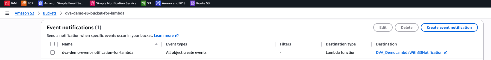
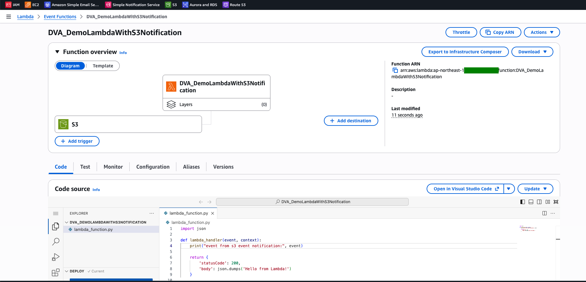
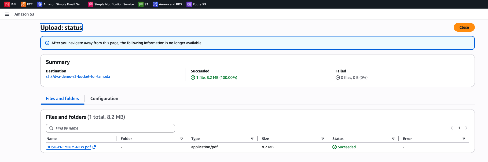
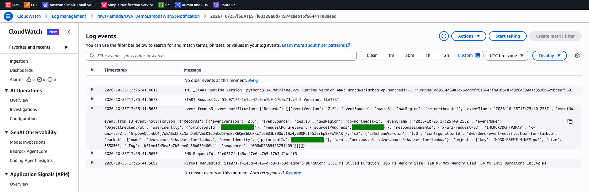

# Lambda Lab: Trigger a Function from an S3 Event Notification

[← Labs index](../README.md) · **Service:** Lambda · **Level:** Beginner · **Est. time:** 15 min · **Est. cost:** Free tier

**Reference:** [Udemy DVA-C01 - Lambda and S3 Event Notifications](https://www.udemy.com/course/aws-certified-developer-associate-dva-c01/learn/lecture/26623368#overview)

## Contents

- [Objectives](#objectives)
- [Prerequisites](#prerequisites)
- [Steps](#steps)
- [Verification](#verification)
- [Troubleshooting](#troubleshooting)
- [Cleanup](#cleanup)
- [References](#references)

## Objectives

- Configure an **S3 event notification** that invokes a **Lambda** function when an object is created.
- Read the S3 event in **CloudWatch Logs**: bucket name, object key, size and event name (`ObjectCreated:Put`).
- Explain that S3 invokes the function **asynchronously** and that the console adds the permission for S3 to call it.

## Prerequisites

- An AWS account with Lambda, S3 and CloudWatch Logs permissions.
- A small file to upload (any type).
- Related lab: [S3 Lab 06 - Event Notifications to SQS](../s3/06_event_notification.md) uses the same feature with an SQS destination.

## Steps

### 1. Create the Lambda Function

1. Open the **Lambda Console** > **Create function** > **Author from scratch**.
2. **Function name:** `DVA_DemoLambdaWithS3Notification`. **Runtime:** Python 3.x. Keep the default execution role.
3. Replace the code with the handler below and click **Deploy**.

    ```python
    import json


    def lambda_handler(event, context):
        print("event from s3 event notification:", event)

        return {
            'statusCode': 200,
            'body': json.dumps('Hello from Lambda!')
        }
    ```

### 2. Create the S3 Bucket

1. Open the **S3 Console** > **Create bucket**.
2. **Bucket name:** a globally unique name, e.g. `dva-demo-s3-bucket-for-lambda-<suffix>`.
    Use the **same region** as the function.
3. Keep the other settings at their defaults and click **Create bucket**.

### 3. Create the Event Notification

1. Open the bucket > **Properties** > **Event notifications** > **Create event notification**.
2. **Event name:** `dva-demo-event-notification-for-lambda`. Leave **Prefix** and **Suffix** empty.
3. **Event types:** tick **All object create events** (`s3:ObjectCreated:*`).
4. **Destination:** **Lambda function** > choose `DVA_DemoLambdaWithS3Notification`, then click **Save changes**.

    

5. Open the function: **S3** now appears as its trigger.

    

> 💡 Saving the notification adds a statement to the function's **resource-based policy** that
> lets `s3.amazonaws.com` invoke it for this bucket (see **Configuration** > **Permissions**).

### 4. Upload a File

1. Open the bucket > **Upload** > **Add files**, pick any file and click **Upload**.

    

### 5. Read the Event in CloudWatch Logs

1. Open the **CloudWatch Console** > **Log management** > `/aws/lambda/DVA_DemoLambdaWithS3Notification`
    and open the latest log stream.
2. Expand the `event from s3 event notification` line. The event has one entry in `Records` with
    `eventSource: aws:s3`, `eventName: ObjectCreated:Put`, the bucket name and the object `key` and `size`.

    

## Verification

- The bucket shows one event notification with destination **Lambda function** (step 3).
- Each upload creates one invocation whose event contains the uploaded object's key (step 5).
- CLI alternative:

    ```bash
    aws s3 cp ./test.txt s3://YOUR-BUCKET-NAME/test.txt
    aws logs tail /aws/lambda/DVA_DemoLambdaWithS3Notification --since 5m
    ```

## Troubleshooting

| Symptom | Likely cause | Fix |
|---------|--------------|-----|
| Saving the notification fails with `Unable to validate the following destination configurations` | S3 cannot get permission to invoke the function | Save it again from the S3 console, or add a resource-based policy for `s3.amazonaws.com` |
| The function is not listed as a destination | The function is in another region | Create the function in the bucket's region |
| No logs after an upload | The event type or the prefix/suffix filter does not match | Use **All object create events** with empty filters |
| The function is invoked again and again | The function writes objects back to the same bucket and triggers itself | Write to another bucket or use a prefix filter that excludes the output |

## Cleanup

> 💸 Stored objects and logs are billed beyond the free tier.

- [ ] Delete the event notification (or keep it until the bucket is deleted).
- [ ] Empty and delete the bucket.
- [ ] Delete the function `DVA_DemoLambdaWithS3Notification`, its log group and its execution role.

## References

- [Amazon S3 event notifications (AWS docs)](https://docs.aws.amazon.com/AmazonS3/latest/userguide/EventNotifications.html)
- [Process Amazon S3 event notifications with Lambda (AWS docs)](https://docs.aws.amazon.com/lambda/latest/dg/with-s3.html)
- [Event message structure (AWS docs)](https://docs.aws.amazon.com/AmazonS3/latest/userguide/notification-content-structure.html)
