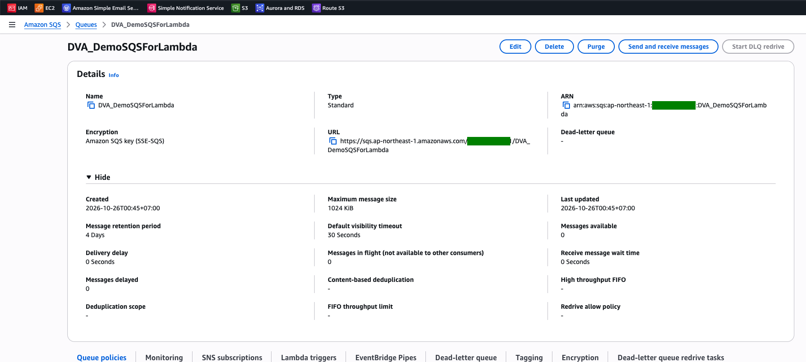
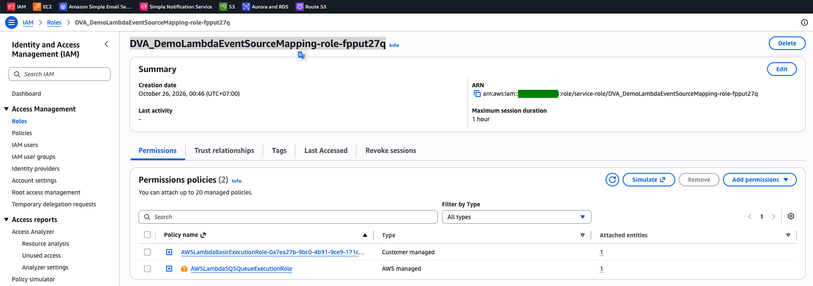
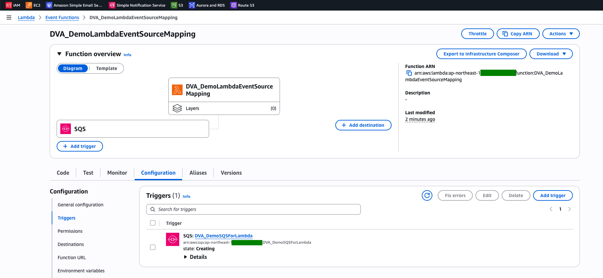
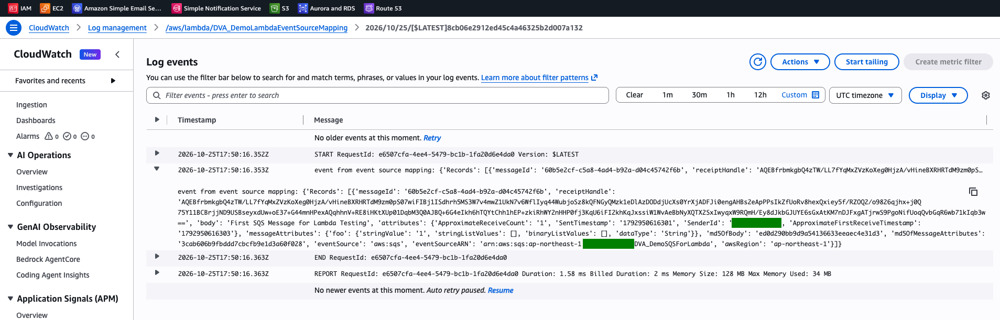

# Lambda Lab: Event Source Mapping with an SQS Queue

[← Labs index](../README.md) · **Service:** Lambda · **Level:** Beginner · **Est. time:** 20 min · **Est. cost:** Free tier

**Reference:** [Udemy DVA-C01 - Lambda Event Source Mapping with SQS](https://www.udemy.com/course/aws-certified-developer-associate-dva-c01/learn/lecture/19730528#overview)

## Contents

- [Objectives](#objectives)
- [Prerequisites](#prerequisites)
- [Steps](#steps)
- [Verification](#verification)
- [Troubleshooting](#troubleshooting)
- [Cleanup](#cleanup)
- [References](#references)

## Objectives

- Add an **SQS queue** as a Lambda trigger, which creates an **event source mapping** that polls the queue.
- Give the function's execution role the permissions to read and delete messages (`AWSLambdaSQSQueueExecutionRole`).
- Send a message and read the SQS event in **CloudWatch Logs**; see that Lambda deletes the message after a successful run.

## Prerequisites

- An AWS account with SQS, Lambda, IAM and CloudWatch Logs permissions.
- Theory: [Event Source Mapping in the Serverless mind map](../../mind_maps/markdown/ServerlessArchitecture.md).

## Steps

### 1. Create the SQS Queue

1. Open the **SQS Console** > **Create queue**.
2. **Type:** Standard. **Name:** `DVA_DemoSQSForLambda`. Keep the defaults (visibility timeout 30 seconds)
    and click **Create queue**.

    

### 2. Create the Lambda Function

1. Open the **Lambda Console** > **Create function** > **Author from scratch**.
2. **Function name:** `DVA_DemoLambdaEventSourceMapping`. **Runtime:** Python 3.x. Keep
    **Create a new role with basic Lambda permissions**.
3. Replace the code with a handler that prints the event, then click **Deploy**:

    ```python
    import json


    def lambda_handler(event, context):
        print("event from event source mapping:", event)

        return {
            'statusCode': 200,
            'body': json.dumps('Hello from Lambda!')
        }
    ```

### 3. Allow the Role to Read the Queue

1. Open the function > **Configuration** > **Permissions** and click the role name
    (`DVA_DemoLambdaEventSourceMapping-role-...`).
2. **Add permissions** > **Attach policies**, select `AWSLambdaSQSQueueExecutionRole` and click **Add permissions**.

    

> 💡 The event source mapping polls the queue **with the function's execution role**, so the role
> needs `sqs:ReceiveMessage`, `sqs:DeleteMessage` and `sqs:GetQueueAttributes`. Without them,
> adding the trigger fails.

### 4. Add the Queue as a Trigger

1. On the function page, click **Add trigger** > **SQS**.
2. **SQS queue:** `DVA_DemoSQSForLambda`. Keep **Batch size** 10 and **Activate trigger** ticked.
    Click **Add**.
3. Open **Configuration** > **Triggers**. The state is **Creating**, then **Enabled** after a few seconds.

    

> 💡 The queue's visibility timeout (30 s) should be at least **6x the function timeout**
> (default 3 s), so a message is not handed to another invocation while it is still being processed.

### 5. Send a Message and Read the Event

1. Open the queue > **Send and receive messages**.
2. **Message body:** `First SQS Message for Lambda Testing`. Optionally add a message attribute
    (e.g. `foo` = `1`, type String). Click **Send message**.
3. Open the **CloudWatch Console** > **Log management** > `/aws/lambda/DVA_DemoLambdaEventSourceMapping`
    and open the latest log stream.
4. Expand the `event from event source mapping` line. `Records` holds the message with its `body`,
    `attributes`, `messageAttributes` and `eventSource: aws:sqs`.

    

## Verification

- The trigger state is **Enabled** (step 4).
- One log entry per message, with your message `body` (step 5).
- The queue's **Messages available** stays `0`: Lambda deleted the message after the function succeeded.
- CLI alternative:

    ```bash
    aws sqs send-message --queue-url YOUR-QUEUE-URL --message-body "Hello from the CLI"
    aws logs tail /aws/lambda/DVA_DemoLambdaEventSourceMapping --since 5m
    aws lambda list-event-source-mappings --function-name DVA_DemoLambdaEventSourceMapping \
      --query "EventSourceMappings[].{state:State,batch:BatchSize,source:EventSourceArn}"
    ```

## Troubleshooting

| Symptom | Likely cause | Fix |
|---------|--------------|-----|
| Adding the trigger fails with a permissions error | The execution role cannot receive messages from the queue | Attach `AWSLambdaSQSQueueExecutionRole` to the role (step 3) |
| The trigger fails because of the visibility timeout | The queue visibility timeout is shorter than the function timeout | Raise the visibility timeout (ideally 6x the function timeout) |
| The message is processed again and again | The function raises an error, so the message returns to the queue | Fix the function; configure a DLQ **on the SQS queue** for messages that keep failing |
| No logs after sending | The trigger is still **Creating** or is disabled | Wait for **Enabled**, or enable the trigger |

## Cleanup

> 💸 An enabled trigger keeps polling the queue. Remove it when you are done.

- [ ] Delete the SQS trigger (or disable it) on the function.
- [ ] Delete the queue `DVA_DemoSQSForLambda`.
- [ ] Delete the function `DVA_DemoLambdaEventSourceMapping`, its log group and its execution role.

## References

- [Using Lambda with Amazon SQS (AWS docs)](https://docs.aws.amazon.com/lambda/latest/dg/with-sqs.html)
- [Lambda event source mappings (AWS docs)](https://docs.aws.amazon.com/lambda/latest/dg/invocation-eventsourcemapping.html)
- [AWSLambdaSQSQueueExecutionRole (AWS managed policy reference)](https://docs.aws.amazon.com/aws-managed-policy/latest/reference/AWSLambdaSQSQueueExecutionRole.html)
