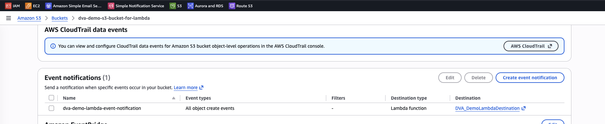
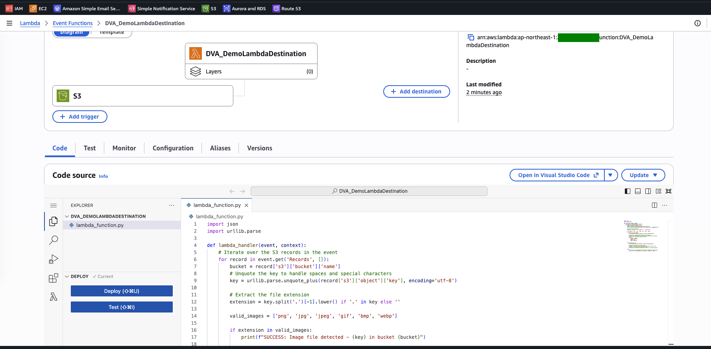
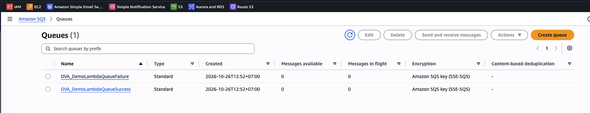
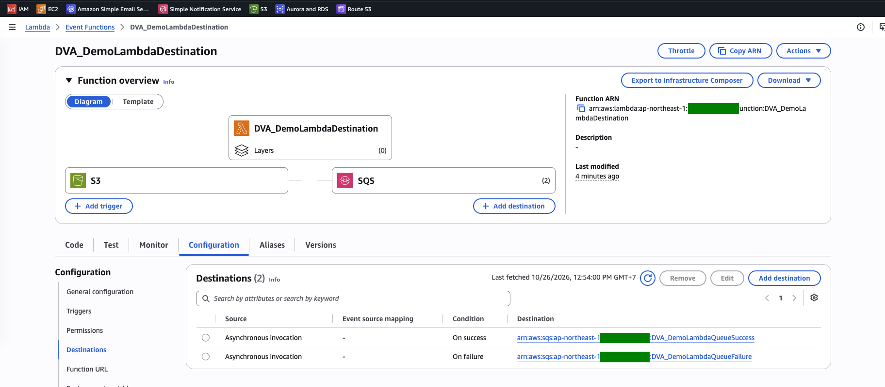
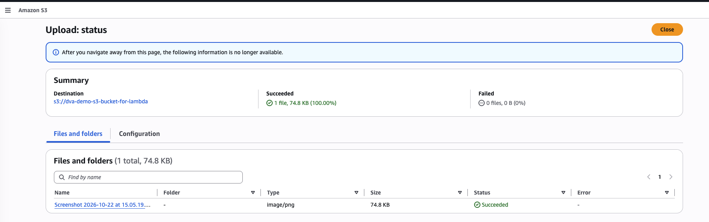
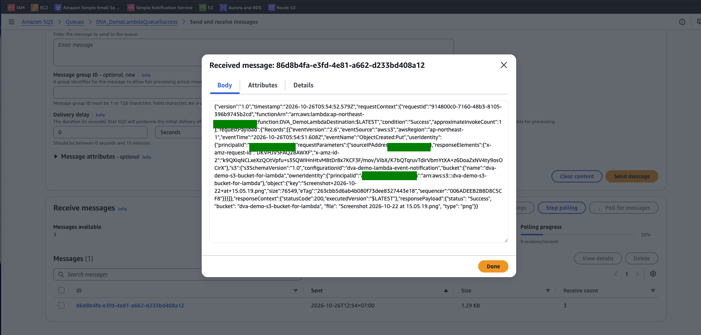
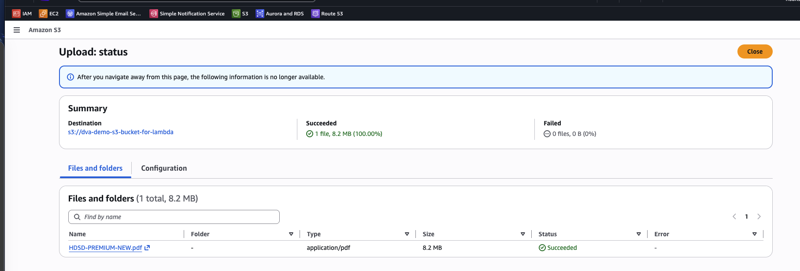
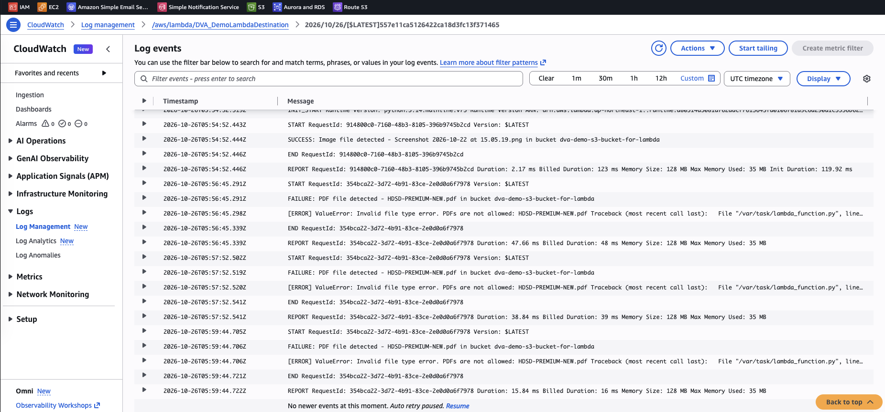
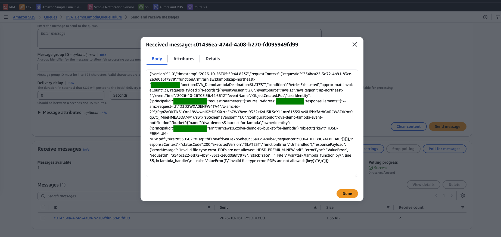
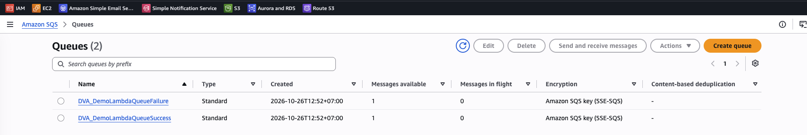

# Lambda Lab: Destinations for Asynchronous Invocations

[← Labs index](../README.md) · **Service:** Lambda · **Level:** Beginner · **Est. time:** 25 min · **Est. cost:** Free tier

**Reference:** [Udemy DVA-C01 - Lambda Destinations](https://www.udemy.com/course/aws-certified-developer-associate-dva-c01/learn/lecture/19730538#overview)

## Contents

- [Objectives](#objectives)
- [Prerequisites](#prerequisites)
- [Steps](#steps)
- [Verification](#verification)
- [Troubleshooting](#troubleshooting)
- [Cleanup](#cleanup)
- [References](#references)

## Objectives

- Send the result of an **asynchronous** invocation to an **on-success** and an **on-failure** SQS destination.
- Observe that a failed async invocation is **retried twice** (3 attempts) before the event goes to the on-failure destination.
- Read a destination record: the original event (`requestPayload`), the result or error (`responsePayload`) and the `condition` (`Success` or `RetriesExhausted`).
- Explain why destinations are preferred over a Lambda **dead-letter queue**.

## Prerequisites

- An AWS account with Lambda, S3, SQS and CloudWatch Logs permissions.
- A `.png` file and a `.pdf` file to upload.
- Related lab: [Lambda Lab 03 - Trigger a Function from an S3 Event Notification](03_lambda_with_s3_event_notification.md)
    sets up the same S3 trigger.

## Steps

### 1. Create the Lambda Function

1. Open the **Lambda Console** > **Create function** > **Author from scratch**.
2. **Function name:** `DVA_DemoLambdaDestination`. **Runtime:** Python 3.x. Keep the default execution role.
3. Replace the code with the handler below and click **Deploy**. It **returns** a result for
    images and **raises an error** for PDFs and any other file type.

    ```python
    import json
    import urllib.parse

    def lambda_handler(event, context):
        # Iterate over the S3 records in the event
        for record in event.get('Records', []):
            bucket = record['s3']['bucket']['name']
            # Unquote the key to handle spaces and special characters
            key = urllib.parse.unquote_plus(record['s3']['object']['key'], encoding='utf-8')

            # Extract the file extension
            extension = key.split('.')[-1].lower() if '.' in key else ''

            valid_images = ['png', 'jpg', 'jpeg', 'gif', 'bmp', 'webp']

            if extension in valid_images:
                print(f"SUCCESS: Image file detected - {key} in bucket {bucket}")

                # Returning a value completes the execution successfully.
                # Lambda will automatically forward this return payload and the original
                # event to your Success SQS queue destination.
                return {
                    "status": "Success",
                    "bucket": bucket,
                    "file": key,
                    "type": extension
                }

            elif extension == 'pdf':
                print(f"FAILURE: PDF file detected - {key} in bucket {bucket}")

                # Raising an exception fails the execution.
                # Lambda will automatically forward the original event and this error
                # message to your Failure SQS queue destination.
                raise ValueError(f"Invalid file type error. PDFs are not allowed: {key}")

            else:
                # Catch-all for other unsupported file types to trigger the failure queue
                raise ValueError(f"Unsupported file extension '{extension}': {key}")
    ```

### 2. Create the S3 Bucket and Event Notification

1. Open the **S3 Console** > **Create bucket**. Use a globally unique name, e.g.
    `dva-demo-s3-bucket-for-lambda-<suffix>`, in the **same region** as the function.
2. Open the bucket > **Properties** > **Event notifications** > **Create event notification**.
3. **Event name:** `dva-demo-lambda-event-notification`. **Event types:** **All object create events**.
4. **Destination:** **Lambda function** > `DVA_DemoLambdaDestination`, then click **Save changes**.

    

5. Open the function: **S3** now appears as its trigger.

    

> 💡 S3 invokes Lambda **asynchronously**: Lambda queues the event, returns right away, and
> runs the function later. Destinations only apply to asynchronous invocations (and to
> on-failure records of event source mappings), never to synchronous calls.

### 3. Create the Two Destination Queues

1. Open the **SQS Console** > **Create queue**. **Type:** Standard. **Name:** `DVA_DemoLambdaQueueSuccess`.
    Keep the defaults and click **Create queue**.
2. Create a second standard queue named `DVA_DemoLambdaQueueFailure`.

    

### 4. Add the Destinations

1. Open the function > **Configuration** > **Destinations** > **Add destination**.
2. **Source:** Asynchronous invocation. **Condition:** On success.
    **Destination type:** SQS queue. **Destination:** `DVA_DemoLambdaQueueSuccess`. Click **Save**.
3. Click **Add destination** again. **Condition:** On failure. **Destination:** `DVA_DemoLambdaQueueFailure`. Click **Save**.

    

4. The function overview now shows **SQS (2)** as destinations next to the **S3** trigger.

> 💡 When you add a destination, the console tries to add `sqs:SendMessage` for that queue to the
> function's **execution role**. Without that permission, Lambda cannot deliver the record.

### 5. Test the Success Path

1. Upload a `.png` file to the bucket.

    

2. Open `DVA_DemoLambdaQueueSuccess` > **Send and receive messages** > **Poll for messages**,
    and open the message. It is a JSON record with:
    - `requestContext.condition`: `Success`, and `approximateInvokeCount`: `1`.
    - `requestPayload`: the original S3 event (bucket, object key, size).
    - `responsePayload`: the value the function returned (`"status": "Success"`, the file and its type).

    

### 6. Test the Failure Path

1. Upload a `.pdf` file to the bucket.

    

2. Open the function's log group `/aws/lambda/DVA_DemoLambdaDestination` in **CloudWatch Logs**.
    The PDF is processed **three times**: the first attempt and two retries, about 1 and 2 minutes
    apart. Each attempt logs `FAILURE: PDF file detected` and the `ValueError`.

    

3. After the last retry fails, poll `DVA_DemoLambdaQueueFailure` and open the message:
    - `requestContext.condition`: `RetriesExhausted`, and `approximateInvokeCount`: `3`.
    - `responseContext.functionError`: `Unhandled`.
    - `responsePayload`: the `errorMessage`, `errorType` (`ValueError`) and stack trace.

    

> 💡 The retry behaviour is set under **Configuration** > **Asynchronous invocation**:
> **Retry attempts** (0–2, default 2) and **Maximum age of event** (up to 6 hours). Set retry
> attempts to `0` to see the failure record right away.
>
> 💡 A Lambda **dead-letter queue** (SQS or SNS) also catches events that failed every retry, but
> it gets only the original event, without the error, and nothing on success. Destinations carry
> the event **and** the result or error, and also handle success, so AWS recommends them instead.

## Verification

- Each queue holds one message: the PNG in the success queue and the PDF in the failure queue.

    

- The logs show one invocation for the PNG and three for the PDF (step 6).
- CLI alternative. Show the function's destination configuration:

    ```bash
    aws lambda get-function-event-invoke-config --function-name DVA_DemoLambdaDestination
    ```

    Expected: `MaximumRetryAttempts` of `2` and a `DestinationConfig` with `OnSuccess` and
    `OnFailure` pointing to the two queue ARNs.

- Read the condition of a destination record:

    ```bash
    aws sqs receive-message --queue-url YOUR-FAILURE-QUEUE-URL \
      --query 'Messages[0].Body' --output text | jq '.requestContext'
    ```

    Expected: `"condition": "RetriesExhausted"` and `"approximateInvokeCount": 3`.

## Troubleshooting

| Symptom | Likely cause | Fix |
|---------|--------------|-----|
| No message in either queue after **Test** in the Lambda console | **Test** invokes the function synchronously, so destinations are skipped | Trigger it asynchronously: upload a file to the bucket |
| The failure queue is still empty after a PDF upload | Lambda is still retrying (about 3 minutes in total) | Wait for the third `FAILURE` log line, then poll again |
| Logs show the error but no record arrives | The execution role has no `sqs:SendMessage` permission for the queue | Add the permission to the execution role, or remove and add the destination again in the console |
| The queue is not listed under **Destination** | The queue is in another region | Create the queues in the function's region |
| A file with another extension lands in the failure queue | The handler raises an error for every non-image, non-PDF file | Expected: only image extensions succeed |

## Cleanup

> 💸 Stored objects, messages and logs are billed beyond the free tier.

- [ ] Delete the event notification, then empty and delete the bucket.
- [ ] Delete the queues `DVA_DemoLambdaQueueSuccess` and `DVA_DemoLambdaQueueFailure`.
- [ ] Delete the function `DVA_DemoLambdaDestination`, its log group and its execution role.

## References

- [Capturing records of Lambda asynchronous invocations (AWS docs)](https://docs.aws.amazon.com/lambda/latest/dg/invocation-async-retain-records.html)
- [Configuring error handling for asynchronous invocation (AWS docs)](https://docs.aws.amazon.com/lambda/latest/dg/invocation-async-error-handling.html)
- [How Lambda handles asynchronous invocations (AWS docs)](https://docs.aws.amazon.com/lambda/latest/dg/invocation-async.html)
