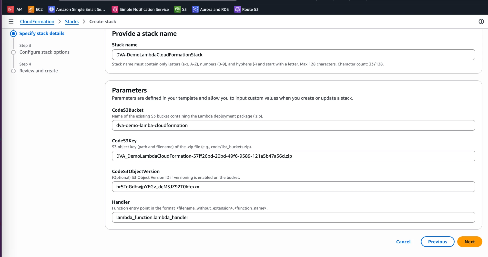
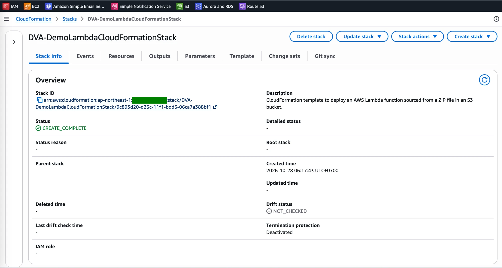
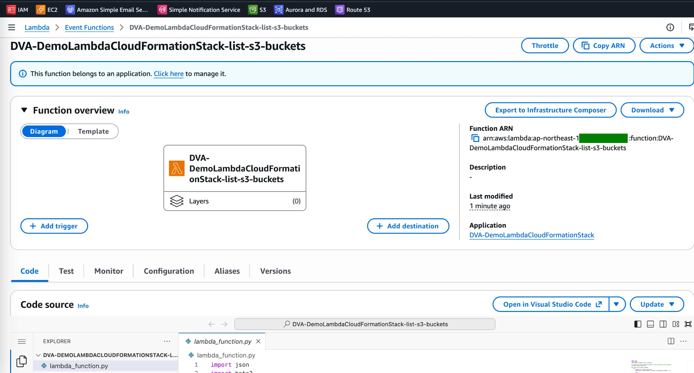
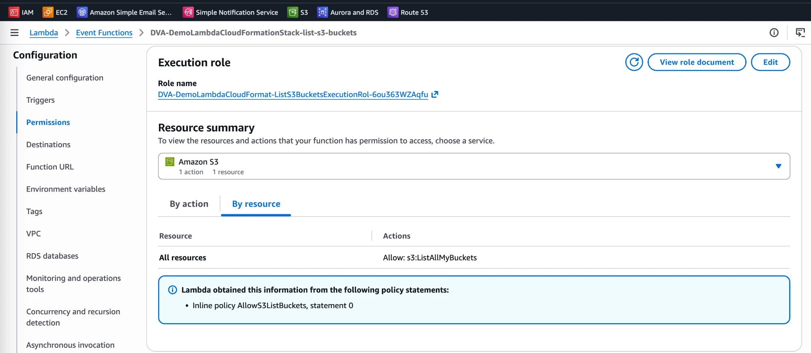
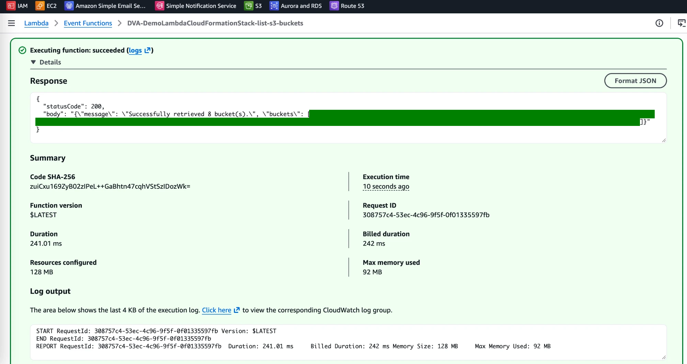

# Lambda Lab: Deploy a Function from S3 with CloudFormation

[← Labs index](../README.md) · **Service:** Lambda · **Level:** Intermediate · **Est. time:** 25 min · **Est. cost:** Free tier

**Reference:** [Udemy DVA-C01 - Lambda and CloudFormation](https://www.udemy.com/course/aws-certified-developer-associate-dva-c01/learn/lecture/26101828#overview)

## Contents

- [Objectives](#objectives)
- [Prerequisites](#prerequisites)
- [Steps](#steps)
- [Verification](#verification)
- [Troubleshooting](#troubleshooting)
- [Cleanup](#cleanup)
- [References](#references)

## Objectives

- Package a Python function as a **.zip**, store it in a **versioned S3 bucket** and deploy it with a **CloudFormation** stack (`Code: S3Bucket / S3Key / S3ObjectVersion`).
- Let the stack create the **execution role** with a least-privilege inline policy (`s3:ListAllMyBuckets`).
- Explain why the **object version** matters: CloudFormation only redeploys the code when the bucket, key or version changes.

## Prerequisites

- An AWS account with S3, CloudFormation, Lambda and IAM permissions.
- The lab files in this repo:
    - Function code: [`code/list_s3_buckets/lambda_function.py`](code/list_s3_buckets/lambda_function.py)
    - Template: [`templates/lambda-from-s3-zip.yaml`](templates/lambda-from-s3-zip.yaml)
- Related lab: [CloudFormation - Infrastructure as Code](../cloud_formation/README.md).

## Steps

### 1. Create a Versioned S3 Bucket

1. Open the **S3 Console** > **Create bucket**.
2. **Bucket name:** a globally unique name, e.g. `dva-demo-lambda-cloudformation-<suffix>`.
    Use the **same region** as the stack.
3. Under **Bucket Versioning**, choose **Enable**. Keep the other defaults and click **Create bucket**.

### 2. Upload the Function Code

1. Zip the code so that `lambda_function.py` sits at the **root** of the archive:

    ```bash
    cd labs/lambda/code/list_s3_buckets
    zip list_s3_buckets.zip lambda_function.py
    ```

2. Upload `list_s3_buckets.zip` to the bucket.
3. Open the object > **Versions** tab (or **Properties**) and copy its **Version ID**.

> 💡 The handler `lambda_function.lambda_handler` means file `lambda_function.py`, function
> `lambda_handler`. If the file is inside a folder in the zip, Lambda cannot find it.

### 3. Create the Stack

1. Open the **CloudFormation Console** > **Create stack** > **With new resources (standard)**.
2. **Upload a template file** > `lambda-from-s3-zip.yaml` > **Next**.
3. **Stack name:** `DVA-DemoLambdaCloudFormationStack`. Fill in the parameters:
    - **CodeS3Bucket:** your bucket name.
    - **CodeS3Key:** the object key of the zip (e.g. `list_s3_buckets.zip`).
    - **CodeS3ObjectVersion:** the Version ID from step 2 (optional, but recommended).
    - **Handler:** keep `lambda_function.lambda_handler`.

    

4. Click **Next** twice. On the review page, tick **I acknowledge that AWS CloudFormation might
    create IAM resources**, then click **Submit**.
5. Wait until the status is **CREATE_COMPLETE**.

    

### 4. Inspect the Function and Its Role

1. Open the **Lambda Console** > `DVA-DemoLambdaCloudFormationStack-list-s3-buckets`. The banner says
    the function belongs to an application (the stack).

    

2. Open **Configuration** > **Permissions**. The execution role allows only `s3:ListAllMyBuckets`
    (inline policy `AllowS3ListBuckets`), plus the CloudWatch Logs permissions of
    `AWSLambdaBasicExecutionRole`.

    

### 5. Test the Function

1. Open the **Test** tab, create a test event with the default JSON and click **Test**.
2. The response has `statusCode` 200 and a body with the number and names of your buckets.

    

> 💡 To ship new code: zip and upload it again (S3 creates a **new version**), then **Update stack**
> with the new `CodeS3ObjectVersion`. With the same bucket, key and version, CloudFormation sees no
> change and keeps the old code.

## Verification

- The stack is **CREATE_COMPLETE** and its **Outputs** show the function name and ARN and the role ARN (step 3).
- The test returns `statusCode` 200 and lists your buckets (step 5).
- CLI alternative:

    ```bash
    aws cloudformation describe-stacks --stack-name DVA-DemoLambdaCloudFormationStack \
      --query "Stacks[0].Outputs"
    aws lambda invoke --function-name DVA-DemoLambdaCloudFormationStack-list-s3-buckets out.json \
      && cat out.json
    ```

## Troubleshooting

| Symptom | Likely cause | Fix |
|---------|--------------|-----|
| `InsufficientCapabilities` when creating the stack | The IAM acknowledgement was not ticked | Tick the checkbox on the review page, or pass `--capabilities CAPABILITY_IAM` in the CLI |
| The stack fails: S3 error when creating the function | Wrong bucket, key or version, or the bucket is in another region | Copy the values from the S3 object page; use a bucket in the stack's region |
| The test fails with `Unable to import module 'lambda_function'` | The file is in a folder inside the zip, or the handler name is wrong | Zip `lambda_function.py` at the root; keep the handler `lambda_function.lambda_handler` |
| The test returns `statusCode` 500 with `Access Denied` | The role does not allow `s3:ListAllMyBuckets` | Check the inline policy in the template |
| **Update stack** does not deploy new code | The bucket, key and version did not change | Upload the new zip and pass its new Version ID |

## Cleanup

> 💸 Deleting the stack removes the function and its role; the bucket is not part of the stack.

- [ ] Delete the stack `DVA-DemoLambdaCloudFormationStack`.
- [ ] Delete the function's log group `/aws/lambda/DVA-DemoLambdaCloudFormationStack-list-s3-buckets`.
- [ ] Empty the bucket (including all object versions) and delete it.

## References

- [AWS::Lambda::Function Code (CloudFormation docs)](https://docs.aws.amazon.com/AWSCloudFormation/latest/UserGuide/aws-properties-lambda-function-code.html)
- [Deploy Python Lambda functions with .zip file archives (AWS docs)](https://docs.aws.amazon.com/lambda/latest/dg/python-package.html)
- [Using versioning in S3 buckets (AWS docs)](https://docs.aws.amazon.com/AmazonS3/latest/userguide/Versioning.html)
