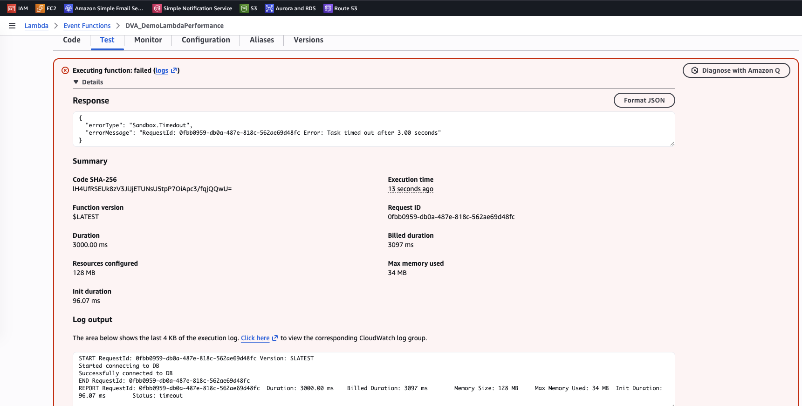
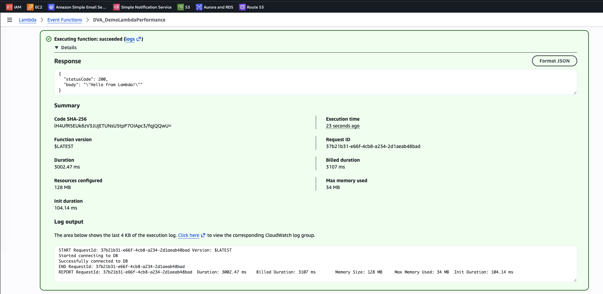
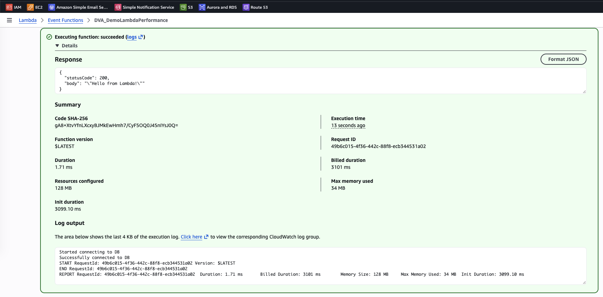
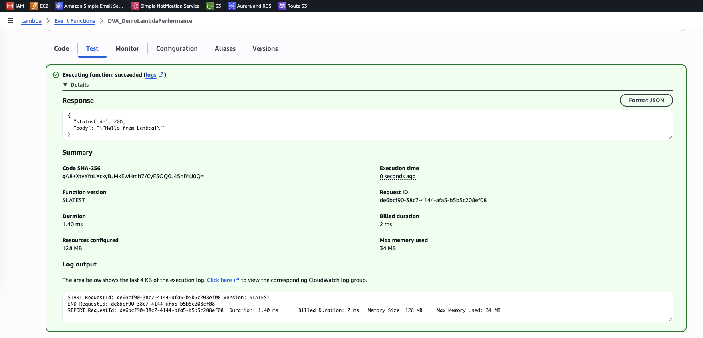

# Lambda Lab: Timeout and Initialization Outside the Handler

[← Labs index](../README.md) · **Service:** Lambda · **Level:** Beginner · **Est. time:** 15 min · **Est. cost:** Free tier

**Reference:** [Udemy DVA-C01 - Lambda Function Performance Hands On](https://www.udemy.com/course/aws-certified-developer-associate-dva-c01/learn/lecture/26623416#overview)

## Contents

- [Objectives](#objectives)
- [Prerequisites](#prerequisites)
- [Steps](#steps)
- [Verification](#verification)
- [Troubleshooting](#troubleshooting)
- [Cleanup](#cleanup)
- [References](#references)

## Objectives

- Hit the default **3-second timeout**, then raise it in the function configuration.
- Move slow setup code (a simulated DB connection) **outside the handler** so it runs once per execution environment.
- Observe a **cold start** (`Init Duration` in the `REPORT` line) versus a **warm start** that reuses the initialized environment.
- Explain why SDK clients and DB connections belong in the initialization code, not in the handler.

## Prerequisites

- An AWS account with Lambda and CloudWatch Logs permissions.

## Steps

### 1. Create the Function with Slow Code in the Handler

1. Open the **Lambda Console** > **Create function** > **Author from scratch**.
2. **Function name:** `DVA_DemoLambdaPerformance`. **Runtime:** Python 3.x. Keep the default execution role.
3. Replace the code with the snippet below and click **Deploy**. `connect_to_db()` stands in for a
    slow setup step and sleeps for 3 seconds on **every** invocation, because it is called inside the handler.

    ```python
    import json
    import time

    def connect_to_db():
        print("Started connecting to DB")
        time.sleep(3)
        print("Successfully connected to DB")


    def lambda_handler(event, context):
        connect_to_db()
        return {
            'statusCode': 200,
            'body': json.dumps('Hello from Lambda!')
        }
    ```

### 2. Hit the Default Timeout

1. Open the **Test** tab, keep the default event and click **Test**.
2. The execution **fails**: `errorType` is `Sandbox.Timedout` and the message reads
    `Task timed out after 3.00 seconds`. The `REPORT` line ends with `Status: timeout`.

    

> 💡 The default timeout is **3 seconds** and the maximum is **900 seconds (15 minutes)**. A
> timeout is reported as a function error, so async invocations retry it like any other error.

### 3. Increase the Timeout

1. Open **Configuration** > **General configuration** > **Edit**.
2. Set **Timeout** to `5` seconds (or more) and click **Save**.
3. Back on the **Test** tab, click **Test** three or four times.
4. Every run **succeeds** but takes about **3 seconds** (`Duration` ≈ 3000 ms), because the
    connection is made again on every invocation.

    

### 4. Move the Setup Outside the Handler

1. Update the code so that `connect_to_db()` is called at **module level**, then click **Deploy**.
    Code outside `lambda_handler` runs once, when Lambda initializes a new execution environment.

    ```python
    import json
    import time

    def connect_to_db():
        print("Started connecting to DB")
        time.sleep(3)
        print("Successfully connected to DB")

    connect_to_db()

    def lambda_handler(event, context):
        return {
            'statusCode': 200,
            'body': json.dumps('Hello from Lambda!')
        }
    ```

2. Click **Test**. The first run is a **cold start**: the 3 seconds now show up as
    `Init duration` (≈ 3100 ms), while `Duration` is only about 2 ms. The `connect_to_db` log lines
    appear **before** the `START` line, because they run in the init phase.

    

3. Click **Test** again a few times. These are **warm starts**: Lambda reuses the environment, so there is
    no `Init duration`, no DB log lines, and each run takes about **1–2 ms**.

    

> 💡 Deploying new code or changing the configuration replaces the execution environments, so the next
> invocation is a cold start again. Idle environments are also recycled after a while. To remove the
> cold start for latency-sensitive functions, use **Provisioned Concurrency** or **SnapStart**.
>
> 💡 In the cold-start run, **Billed duration** (3101 ms) includes the init phase. Moving setup outside
> the handler pays that cost once per environment instead of on every invocation.

## Verification

- With the setup inside the handler, every invocation takes about 3 seconds (step 3).
- With the setup outside the handler, only the first invocation after a deploy has an `Init duration`,
  and later invocations take a few milliseconds (step 4).
- CLI alternative. Check the configured timeout:

    ```bash
    aws lambda get-function-configuration --function-name DVA_DemoLambdaPerformance \
      --query '{Timeout: Timeout, MemorySize: MemorySize}'
    ```

    Expected: `Timeout` of `5` (or the value you set) and `MemorySize` of `128`.

- Find the cold starts in the logs: only `REPORT` lines of cold starts contain `Init Duration`.

    ```bash
    aws logs filter-log-events --log-group-name /aws/lambda/DVA_DemoLambdaPerformance \
      --filter-pattern '"Init Duration"' --query 'events[].message' --output text
    ```

## Troubleshooting

| Symptom | Likely cause | Fix |
|---------|--------------|-----|
| `Task timed out after 3.00 seconds` | The default timeout is 3 seconds and the function sleeps for 3 | Raise **Timeout** under **Configuration** > **General configuration** |
| Every run still takes about 3 seconds after the update | The new code was not deployed, or `connect_to_db()` is still called in the handler | Click **Deploy** and check the call is at module level |
| Every test is a cold start | The code or configuration changed between tests | Click **Test** again without changing anything |
| The init phase fails or times out | Init code that runs for more than about 10 seconds is cut off and retried in the invocation | Keep init code short, or move very slow work into the handler with a higher timeout |

## Cleanup

> 💸 Logs are billed beyond the free tier.

- [ ] Delete the function `DVA_DemoLambdaPerformance`, its log group `/aws/lambda/DVA_DemoLambdaPerformance` and its execution role.

## References

- [Lambda execution environment lifecycle (AWS docs)](https://docs.aws.amazon.com/lambda/latest/dg/lambda-runtime-environment.html)
- [Best practices for working with Lambda functions (AWS docs)](https://docs.aws.amazon.com/lambda/latest/dg/best-practices.html)
- [Configure Lambda function timeout (AWS docs)](https://docs.aws.amazon.com/lambda/latest/dg/configuration-timeout.html)
