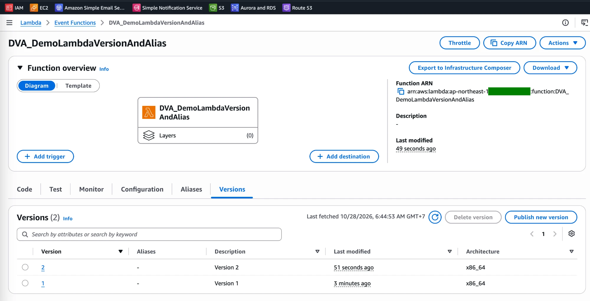
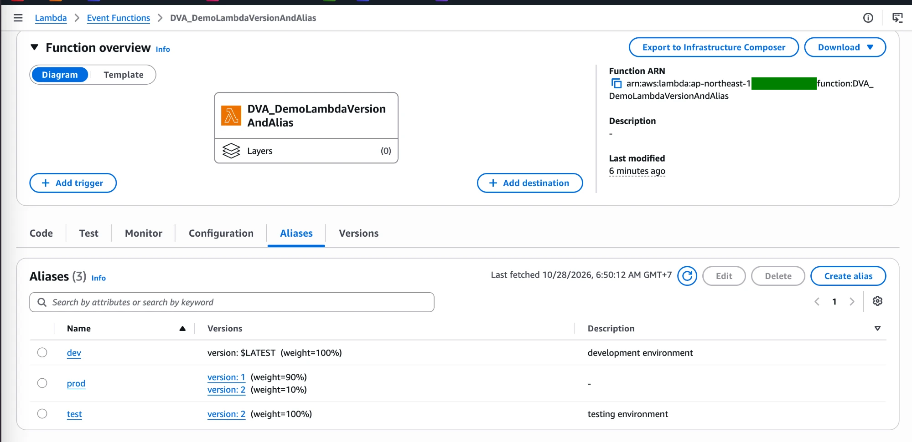

# Lambda Lab: Versions and Aliases with a Weighted Canary

[← Labs index](../README.md) · **Service:** Lambda · **Level:** Beginner · **Est. time:** 20 min · **Est. cost:** Free tier

**Reference:** [Udemy DVA-C01 - Lambda Versions and Aliases](https://www.udemy.com/course/aws-certified-developer-associate-dva-c01/learn/lecture/26623446#overview)

## Contents

- [Objectives](#objectives)
- [Prerequisites](#prerequisites)
- [Steps](#steps)
- [Verification](#verification)
- [Troubleshooting](#troubleshooting)
- [Cleanup](#cleanup)
- [References](#references)

## Objectives

- Publish two immutable **versions** of a function and see that `$LATEST` stays editable.
- Create **dev**, **test** and **prod** **aliases** that point to `$LATEST`, version 2 and version 1.
- Shift 10% of the `prod` traffic to version 2 with a **weighted alias**, like a canary deployment.

## Prerequisites

- An AWS account with Lambda permissions.

## Steps

### 1. Create the Function and Publish Version 1

1. Open the **Lambda Console** > **Create function** > **Author from scratch**.
2. **Function name:** `DVA_DemoLambdaVersionAndAlias`. **Runtime:** Python 3.x.
3. Replace the code and click **Deploy**:

    ```python
    import json

    def lambda_handler(event, context):
        version = {
            "current_version": 1
        }
        return {
            'statusCode': 200,
            'body': json.dumps(version)
        }
    ```

4. Open the **Versions** tab > **Publish new version**, **Description:** `Version 1` > **Publish**.

> 💡 A published version is a **snapshot** of the code and configuration: it cannot be changed
> and has its own ARN ending in `:1`. Only `$LATEST` can be edited.

### 2. Publish Version 2

1. Go back to `$LATEST` (**Code** tab) and change the value to `"current_version": 2`. Click **Deploy**.
2. **Versions** > **Publish new version**, **Description:** `Version 2` > **Publish**.

    

### 3. Create the Aliases

Open the **Aliases** tab > **Create alias** three times:

| Alias | Version | Weighted routing | Description |
|-------|---------|------------------|-------------|
| `dev` | `$LATEST` | — | `development environment` |
| `test` | `2` | — | `testing environment` |
| `prod` | `1` | Additional version `2`, weight **10%** | — |

For `prod`, open **Weighted alias**, choose additional version `2` and set its weight to `10`.
Version 1 keeps the other 90%.



> 💡 An alias is a **stable name** (ARN ending in `:prod`) that callers use instead of a version
> number. To release, you move the alias, not the callers. A weighted alias points to **two
> published versions** at most and cannot use `$LATEST`.

### 4. Test the Canary on `prod`

1. Open the `prod` alias > **Test** tab and click **Test** about 20 times.
2. Most responses contain `{"current_version": 1}`; roughly 1 in 10 contains `{"current_version": 2}`.
3. To finish the rollout, edit `prod` to point to version `2` (weight 100%). To roll back, remove the
    additional version.

## Verification

- **Versions** lists `1` and `2`; each has its own ARN (step 2).
- **Aliases** shows `dev` → `$LATEST`, `test` → `2`, `prod` → `1` (90%) and `2` (10%) (step 3).
- Invoking `test` always returns version 2; invoking `prod` mostly returns version 1 (step 4).
- CLI alternative (the response metadata shows which version ran in `ExecutedVersion`):

    ```bash
    for i in $(seq 1 20); do
      aws lambda invoke --function-name DVA_DemoLambdaVersionAndAlias:prod \
        --query ExecutedVersion --output text /dev/null
    done | sort | uniq -c
    ```

## Troubleshooting

| Symptom | Likely cause | Fix |
|---------|--------------|-----|
| **Publish new version** does nothing new | `$LATEST` did not change since the last version, so Lambda returns the existing one | Deploy a code or configuration change first |
| Weighted routing does not offer `$LATEST` | Weighted aliases only accept published versions | Publish a version and use it |
| `prod` always returns the same version | 10% is a probability; a few tests may not hit version 2 | Invoke more times, e.g. with the CLI loop |
| Callers still get the old code after an update | They call a version number or an alias that was not moved | Point callers to an alias and update the alias |

## Cleanup

> 💸 Versions and aliases cost nothing, but delete the demo function when you are done.

- [ ] Delete the function `DVA_DemoLambdaVersionAndAlias` (this removes its versions and aliases).
- [ ] Delete its log group and execution role.

## References

- [Lambda function versions (AWS docs)](https://docs.aws.amazon.com/lambda/latest/dg/configuration-versions.html)
- [Lambda function aliases (AWS docs)](https://docs.aws.amazon.com/lambda/latest/dg/configuration-aliases.html)
- [Implement Lambda canary deployments using a weighted alias (AWS docs)](https://docs.aws.amazon.com/lambda/latest/dg/configuring-alias-routing.html)
