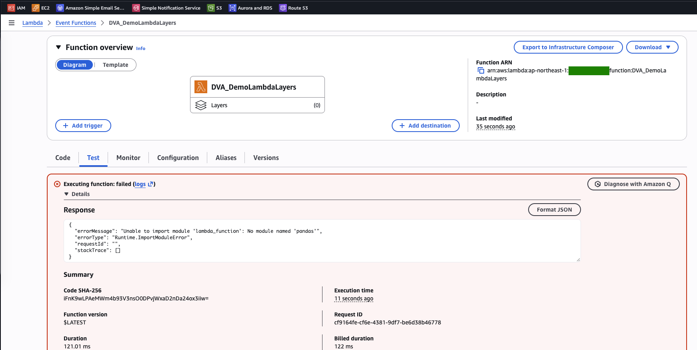
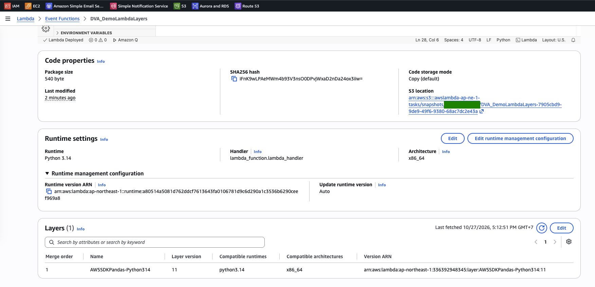
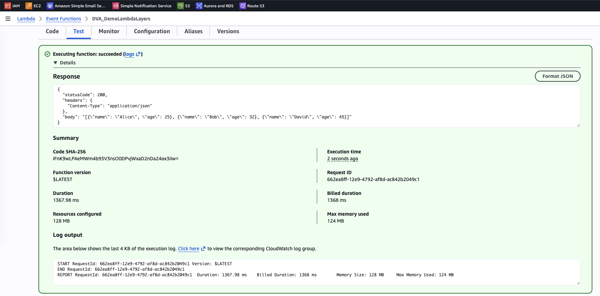

# Lambda Lab: Add a Library with a Layer

[← Labs index](../README.md) · **Service:** Lambda · **Level:** Beginner · **Est. time:** 15 min · **Est. cost:** Free tier

**Reference:** [Udemy DVA-C01 - Lambda Layers](https://www.udemy.com/course/aws-certified-developer-associate-dva-c01/learn/lecture/26623440#overview)

## Contents

- [Objectives](#objectives)
- [Prerequisites](#prerequisites)
- [Steps](#steps)
- [Verification](#verification)
- [Troubleshooting](#troubleshooting)
- [Cleanup](#cleanup)
- [References](#references)

## Objectives

- Create a Python function that imports `pandas` and observe the `Runtime.ImportModuleError` when the library is missing.
- Add the AWS-managed **AWS SDK for pandas** layer and run the same code successfully, without packaging the library yourself.
- Explain what a layer is for: sharing dependencies across functions and keeping the deployment package small.

## Prerequisites

- An AWS account with Lambda and CloudWatch Logs permissions.

## Steps

### 1. Create the Function

1. Open the **Lambda Console** > **Create function** > **Author from scratch**.
2. **Function name:** `DVA_DemoLambdaLayers`. **Runtime:** Python 3.14. **Architecture:** x86_64.
    Keep the default execution role.
3. Replace the code with the handler below and click **Deploy**. It builds a pandas `DataFrame` from
    `data` and keeps the records whose `age` is at least `min_age` (default 18).

    ```python
    import json
    import pandas as pd


    def lambda_handler(event, context):
        # Support both API Gateway (event['body']) and direct invocation payloads
        payload = event.get("body", event)
        if isinstance(payload, str):
            payload = json.loads(payload)

        # Extract data and filter criteria
        records = payload.get("data", [])
        min_age = payload.get("min_age", 18)

        # Build DataFrame and apply filter
        df = pd.DataFrame(records)

        if not df.empty and "age" in df.columns:
            filtered_df = df[df["age"] >= min_age]
            result = filtered_df.to_dict(orient="records")
        else:
            result = []

        return {
            "statusCode": 200,
            "headers": {"Content-Type": "application/json"},
            "body": json.dumps(result),
        }
    ```

### 2. Test Without the Library

1. Open the **Test** tab and create a test event with this JSON:

    ```json
    {
      "data": [
        {"name": "Alice", "age": 25},
        {"name": "Bob", "age": 32},
        {"name": "Charlie", "age": 17},
        {"name": "David", "age": 45}
      ],
      "min_age": 18
    }
    ```

2. Click **Test**. The execution **fails** before the handler runs: `errorType` is
    `Runtime.ImportModuleError` and the message is `No module named 'pandas'`. The Python runtime
    only includes the standard library and `boto3`.

    

### 3. Add the AWS SDK for Pandas Layer

1. On the function page, scroll down to **Layers** and click **Add a layer**.
2. **Layer source:** **AWS layers**. **AWS layers:** `AWSSDKPandas-Python314`. Pick the latest
    **Version** and click **Add**.
3. The **Layers** table now lists the layer with its compatible runtime (`python3.14`),
    architecture (`x86_64`) and version ARN. The function's own package stays at a few hundred bytes.

    

> 💡 The layer's runtime and architecture must match the function's. The managed layer is published
> per Python version (`AWSSDKPandas-Python314`, `-Python313`, …), so pick the one for your runtime.

### 4. Test Again with the Layer

1. Run the same test event again. The execution **succeeds** and the `body` contains Alice, Bob and
    David. Charlie (17) is filtered out.

    

> 💡 Lambda extracts each layer into `/opt` in the execution environment, and the Python runtime adds
> `/opt/python` to the import path, so `import pandas` just works. A function can use up to
> **5 layers**, and the function plus all its layers must stay under **250 MB unzipped**.
>
> 💡 **Max memory used** is 124 MB of the 128 MB configured, because pandas is a heavy import. Raise the
> memory (for example to 256 MB) for real workloads: it also gives the function more CPU.

## Verification

- The test without the layer fails with `No module named 'pandas'` (step 2), and the same test
  succeeds once the layer is attached (step 4).
- CLI alternative. List the layers attached to the function:

    ```bash
    aws lambda get-function-configuration --function-name DVA_DemoLambdaLayers \
      --query 'Layers[].Arn'
    ```

    Expected: one ARN ending in `:layer:AWSSDKPandas-Python314:<version>`.

- Invoke it from the CLI with the test event saved as `event.json`:

    ```bash
    aws lambda invoke --function-name DVA_DemoLambdaLayers \
      --cli-binary-format raw-in-base64-out --payload file://event.json out.json && cat out.json
    ```

    Expected: `"statusCode": 200` and a `body` with three records.

## Troubleshooting

| Symptom | Likely cause | Fix |
|---------|--------------|-----|
| `No module named 'pandas'` after adding a layer | The layer was built for another Python version | Use the `AWSSDKPandas-PythonXYZ` layer that matches the function's runtime |
| The layer is not offered under **AWS layers** | The runtime or architecture has no matching layer version | Check the function's runtime and architecture, or use **Specify an ARN** with the ARN from the AWS SDK for pandas docs |
| `Task timed out after 3.00 seconds` | Importing pandas on a cold start is slow at 128 MB | Raise the memory and the timeout under **General configuration** |
| `Runtime.OutOfMemory` | pandas and the data do not fit in 128 MB | Raise the memory |
| The response `body` is `[]` | The event has no `data`, or no record has `age` ≥ `min_age` | Use the sample test event from step 2 |

## Cleanup

> 💸 Logs are billed beyond the free tier. The AWS-managed layer is owned by AWS and is not deleted.

- [ ] Delete the function `DVA_DemoLambdaLayers`, its log group `/aws/lambda/DVA_DemoLambdaLayers` and its execution role.

## References

- [Managing Lambda dependencies with layers (AWS docs)](https://docs.aws.amazon.com/lambda/latest/dg/chapter-layers.html)
- [Working with layers for Python Lambda functions (AWS docs)](https://docs.aws.amazon.com/lambda/latest/dg/python-layers.html)
- [AWS SDK for pandas: install as a Lambda layer](https://aws-sdk-pandas.readthedocs.io/en/stable/install.html#aws-lambda-layer)
