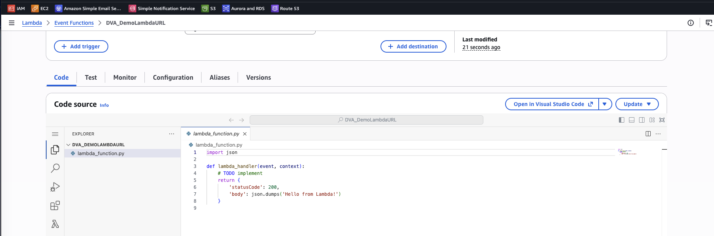
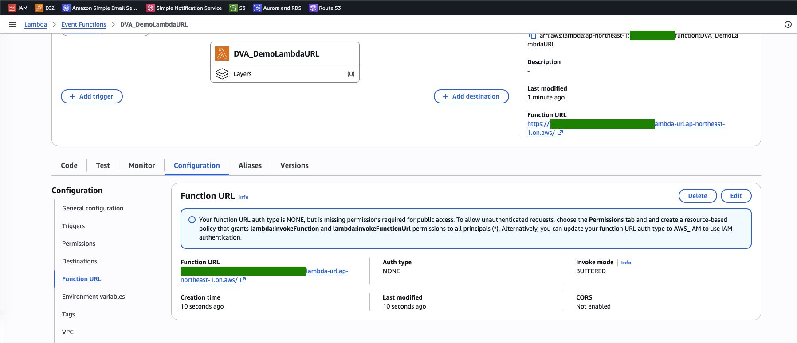
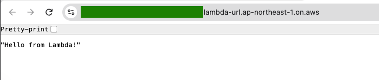

# Lambda Lab: Call a Function with a Function URL

[← Labs index](../README.md) · **Service:** Lambda · **Level:** Beginner · **Est. time:** 10 min · **Est. cost:** Free tier

**Reference:** [Udemy DVA-C01 - Lambda Function URL](https://www.udemy.com/course/aws-certified-developer-associate-dva-c01/learn/lecture/36527780#overview)

## Contents

- [Objectives](#objectives)
- [Prerequisites](#prerequisites)
- [Steps](#steps)
- [Verification](#verification)
- [Troubleshooting](#troubleshooting)
- [Cleanup](#cleanup)
- [References](#references)

## Objectives

- Create a **function URL** with auth type `NONE` and call the function from a browser, without API Gateway or a load balancer.
- Observe that a public URL still needs a **resource-based policy** that allows everyone (`*`) to invoke the function.
- Explain the two auth types (`NONE` and `AWS_IAM`) and when to choose API Gateway instead.

## Prerequisites

- An AWS account with Lambda permissions.
- A browser, or `curl`.

## Steps

### 1. Create the Function

1. Open the **Lambda Console** > **Create function** > **Author from scratch**.
2. **Function name:** `DVA_DemoLambdaURL`. **Runtime:** Python 3.x. Keep the default execution role.
3. Keep the default code: it returns status `200` and the body `"Hello from Lambda!"`.

    

### 2. Create the Function URL

1. Open **Configuration** > **Function URL** > **Create function URL**.
2. **Auth type:** `NONE`. Under **Additional settings**, keep **Invoke mode** `BUFFERED` and leave
    **CORS** off. Click **Save**.
3. The function overview and the **Function URL** panel now show the URL,
    `https://<url-id>.lambda-url.<region>.on.aws/`, with **Auth type** `NONE`.

    

4. With auth type `NONE`, the console normally adds the public-access statements to the function's
    resource-based policy for you. If the panel shows the blue banner about **missing permissions**
    instead, add both statements yourself, for example from CloudShell:

    ```bash
    aws lambda add-permission --function-name DVA_DemoLambdaURL \
      --statement-id FunctionURLAllowPublicAccess \
      --action lambda:InvokeFunctionUrl --principal "*" \
      --function-url-auth-type NONE

    aws lambda add-permission --function-name DVA_DemoLambdaURL \
      --statement-id FunctionURLInvokeAllowPublicAccess \
      --action lambda:InvokeFunction --principal "*" \
      --invoked-via-function-url
    ```

    `--invoked-via-function-url` limits the second statement to calls made through the URL.

> 💡 Auth type `NONE` does not mean "no policy": Lambda still checks the function's
> **resource-based policy**, which must allow `*` to invoke it. With `AWS_IAM`, callers must sign
> requests with SigV4 and be allowed `lambda:InvokeFunctionUrl` and `lambda:InvokeFunction`. Since
> October 2025, new function URLs need **both** actions, for either auth type.

### 3. Call the Function

1. Open the function URL in a browser. The response is `"Hello from Lambda!"`.

    

2. Or call it with `curl`:

    ```bash
    curl -i https://YOUR-URL-ID.lambda-url.YOUR-REGION.on.aws/
    ```

    Expected: `HTTP/1.1 200 OK` and the body `"Hello from Lambda!"`. Lambda turns the `statusCode` and
    `body` the function returns into the HTTP response.

> 💡 A function URL can point to `$LATEST` or to an **alias**, never to a numbered version. It is a
> simple HTTPS endpoint: for usage plans, API keys, request validation, caching or custom authorizers,
> put **API Gateway** in front instead. Use **reserved concurrency** to cap how often a public URL can
> run the function.

## Verification

- The URL returns `"Hello from Lambda!"` with HTTP status `200` (step 3).
- CLI alternative. Show the URL configuration:

    ```bash
    aws lambda get-function-url-config --function-name DVA_DemoLambdaURL
    ```

    Expected: the `FunctionUrl`, `"AuthType": "NONE"` and `"InvokeMode": "BUFFERED"`.

- Show the resource-based policy that allows public access:

    ```bash
    aws lambda get-policy --function-name DVA_DemoLambdaURL \
      --query Policy --output text | jq '.Statement[] | {Action, Principal, Condition}'
    ```

    Expected: statements that allow `"Principal": "*"` the actions `lambda:InvokeFunctionUrl` and
    `lambda:InvokeFunction`.

## Troubleshooting

| Symptom | Likely cause | Fix |
|---------|--------------|-----|
| `{"Message":"Forbidden"}` with HTTP `403` | The resource-based policy does not allow public access | Add the permissions from the banner in step 2 and check them with `get-policy` |
| `403` with auth type `AWS_IAM` | The request is not signed with SigV4 | Sign the request (for example `curl --aws-sigv4`), or use auth type `NONE` for this lab |
| A browser on another site cannot call the URL | CORS is not enabled | Enable **CORS** on the function URL and list the allowed origins |
| `Internal Server Error` with HTTP `502` | The function raised an error or returned an invalid response | Check the function's logs in CloudWatch |

## Cleanup

> 💸 A public URL can be called by anyone, and every call is billed. Delete it when you are done.

- [ ] Delete the function URL: **Configuration** > **Function URL** > **Delete**.
- [ ] Delete the function `DVA_DemoLambdaURL`, its log group and its execution role.

## References

- [Lambda function URLs (AWS docs)](https://docs.aws.amazon.com/lambda/latest/dg/urls-configuration.html)
- [Control access to Lambda function URLs (AWS docs)](https://docs.aws.amazon.com/lambda/latest/dg/urls-auth.html)
- [Invoking Lambda function URLs (AWS docs)](https://docs.aws.amazon.com/lambda/latest/dg/urls-invocation.html)
