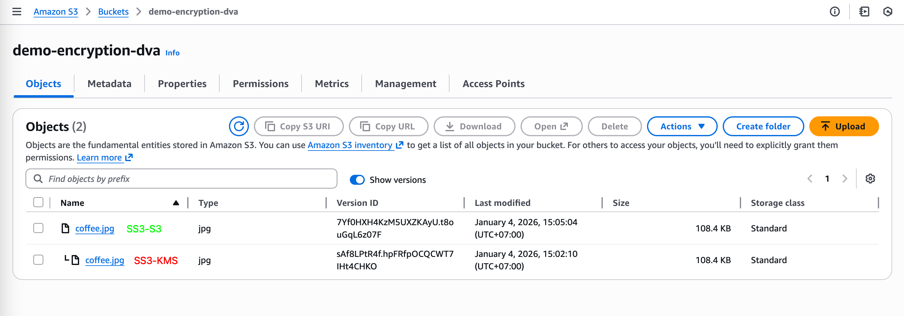

# S3 Lab: Encryption (SSE-S3 and SSE-KMS)

[← Labs index](../README.md) · **Service:** S3 · **Level:** Beginner · **Est. time:** 15 min · **Est. cost:** Free tier (KMS requests beyond the free tier are billed)

**Reference:** [Udemy DVA-C01 - S3 Encryption](https://www.udemy.com/course/aws-certified-developer-associate-dva-c01/learn/lecture/23743656#lecture-article)

## Contents

- [Objectives](#objectives)
- [Prerequisites](#prerequisites)
- [Steps](#steps)
- [Verification](#verification)
- [Troubleshooting](#troubleshooting)
- [Cleanup](#cleanup)
- [References](#references)

## Objectives

- [ ] Create a bucket with **Versioning** and default **SSE-S3** encryption.
- [ ] Confirm a new object is encrypted with SSE-S3.
- [ ] Change the object's encryption to **SSE-KMS** and see the effect on versions.

## Prerequisites

- An AWS account with S3 and KMS permissions.
- AWS CLI configured (`aws configure`) for the verification commands.

## Steps

### 1. Create the Bucket

1. In the **S3 Console**, click **Create bucket** and enter a unique name.
2. Set **Bucket Versioning** to **Enable**.
3. Under **Default encryption**, keep **Server-side encryption with Amazon S3 managed keys
    (SSE-S3)**.
4. Click **Create bucket**.



### 2. Upload an Object

1. Open the bucket and **Upload** a test file. Leave **Server-side encryption** as
    **Use bucket settings for default encryption**.
2. Open the object > **Properties** > **Server-side encryption settings** shows **SSE-S3**.

### 3. Switch the Object to SSE-KMS

1. In the object's **Properties**, under **Server-side encryption settings**, click **Edit**.
2. Select **Server-side encryption with AWS Key Management Service keys (SSE-KMS)**.
3. Choose **AWS managed key (aws/s3)** and click **Save changes**.

S3 cannot re-encrypt an object in place: it writes a **new copy** of the object. Because
versioning is on, the SSE-S3 copy remains as a previous version.

> 🔒 Before sharing screenshots, redact your account ID and KMS key ARNs.

## Verification

- Check the encryption of the current version:

    ```bash
    aws s3api head-object --bucket YOUR-BUCKET-NAME --key YOUR-FILE \
      --query '{SSE: ServerSideEncryption, KeyId: SSEKMSKeyId}'
    # Expected after step 2: "SSE": "AES256", "KeyId": null
    # Expected after step 3: "SSE": "aws:kms", "KeyId": "arn:aws:kms:..."
    ```

- Confirm the object now has two versions:

    ```bash
    aws s3api list-object-versions --bucket YOUR-BUCKET-NAME --prefix YOUR-FILE \
      --query 'length(Versions)'
    # Expected: 2
    ```

- Confirm the bucket default:

    ```bash
    aws s3api get-bucket-encryption --bucket YOUR-BUCKET-NAME \
      --query 'ServerSideEncryptionConfiguration.Rules[0].ApplyServerSideEncryptionByDefault'
    # Expected: "SSEAlgorithm": "AES256"
    ```

## Troubleshooting

| Symptom | Likely cause | Fix |
|---------|--------------|-----|
| `AccessDenied` reading an SSE-KMS object | The caller lacks `kms:Decrypt` on the key | Grant `kms:Decrypt` (the `aws/s3` key allows principals in your account that can use S3) |
| Throttling errors on heavy SSE-KMS workloads | KMS request quota | Enable an **S3 Bucket Key** to cut KMS calls |
| Only one version after switching encryption | Versioning was not enabled | Enable versioning before step 3 |

## Cleanup

> 💸 Delete billable resources to avoid surprise charges.

- [ ] **Empty** the bucket (removes every version), then delete it.

## References

- [Protecting data with server-side encryption (AWS docs)](https://docs.aws.amazon.com/AmazonS3/latest/userguide/serv-side-encryption.html)
- [Using SSE-KMS (AWS docs)](https://docs.aws.amazon.com/AmazonS3/latest/userguide/UsingKMSEncryption.html)
- [Reducing the cost of SSE-KMS with S3 Bucket Keys (AWS docs)](https://docs.aws.amazon.com/AmazonS3/latest/userguide/bucket-key.html)
