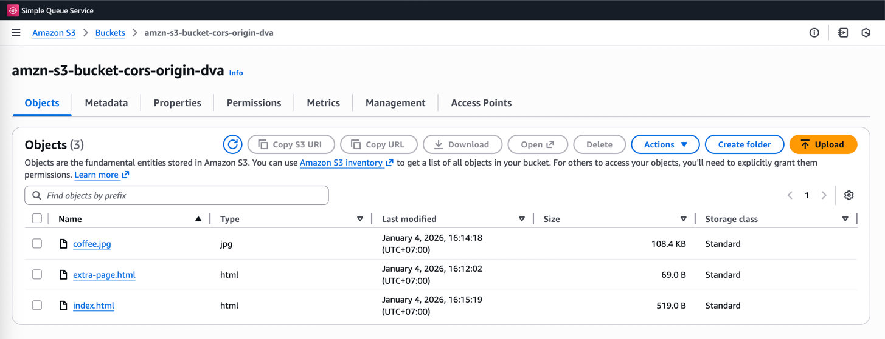
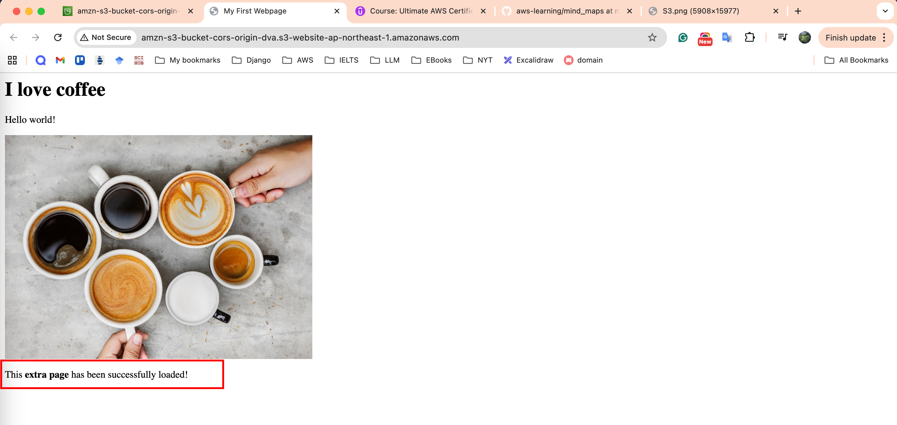
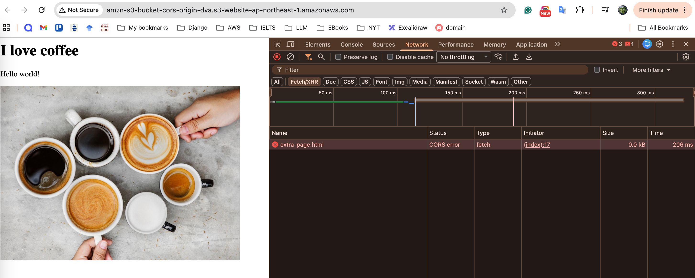
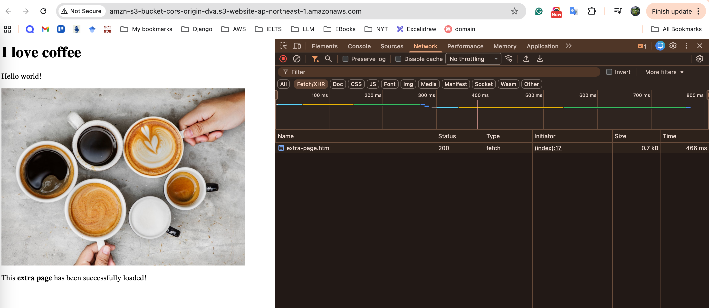

# S3 Lab: Cross-Origin Resource Sharing (CORS)

[← Labs index](../README.md) · **Service:** S3 · **Level:** Intermediate · **Est. time:** 30 min · **Est. cost:** Free tier

**Reference:** [Udemy DVA-C01 - S3 CORS](https://www.udemy.com/course/aws-certified-developer-associate-dva-c01/learn/lecture/19729172#lecture-article)

## Contents

- [Objectives](#objectives)
- [Prerequisites](#prerequisites)
- [Steps](#steps)
- [Verification](#verification)
- [Troubleshooting](#troubleshooting)
- [Cleanup](#cleanup)
- [References](#references)

## Objectives

- [ ] Host a static website in two buckets (two different origins).
- [ ] Trigger a CORS error with a cross-origin `fetch`.
- [ ] Fix it with a CORS configuration on the bucket being fetched from.

## Prerequisites

- An AWS account with S3 permissions.
- Familiarity with the [Static Website Hosting lab](02_static_website_hosting.md): both
    buckets in this lab are set up the same way.
- AWS CLI configured (`aws configure`) and `curl` for the verification commands.

## Steps

### 1. Set Up the Primary Bucket (the page)

1. Create a bucket, for example `bucket-primary` in `us-east-1`.
2. Enable **Static website hosting** with index document `index.html`, turn off
    **Block all public access**, and add a public-read bucket policy (see the
    [Static Website Hosting lab](02_static_website_hosting.md), steps 1–3).
3. Create a local `extra-page.html` containing any HTML fragment, for example
    `<p>This came from extra-page.html</p>`.
4. Create a local `index.html` that fetches it with a **relative** path:

    ```html
    <!doctype html>
    <html>
      <body>
        <h1>Primary bucket</h1>
        <div id="extra">Loading...</div>
        <script>
          fetch("extra-page.html")
            .then((response) => response.text())
            .then((html) => { document.getElementById("extra").innerHTML = html; })
            .catch((error) => { console.error(error); });
        </script>
      </body>
    </html>
    ```

5. Upload both files and open the primary **Bucket website endpoint**. The extra page
    content appears, because the request is same-origin.





### 2. Set Up the Secondary Bucket (the other origin)

1. Create a second bucket, for example `bucket-secondary` in `us-west-2`.
2. Enable **Static website hosting**, turn off **Block all public access**, and add a
    public-read bucket policy, exactly as for the primary bucket.
3. Upload `extra-page.html` only.
4. Copy the secondary **Bucket website endpoint**.

### 3. Trigger the CORS Error

1. In your local `index.html`, change the fetch URL to the full secondary URL:
    `fetch("http://bucket-secondary.s3-website-us-west-2.amazonaws.com/extra-page.html")`.
2. Upload the updated `index.html` to the **primary** bucket.
3. Reload the primary website endpoint and open the browser **Developer Tools** (F12)
    > **Console**. You see: *Access to fetch at ... has been blocked by CORS policy*.



### 4. Add a CORS Configuration

CORS is configured on the bucket **being requested** (secondary), not on the page's bucket.

1. Open the **secondary** bucket > **Permissions** > **Cross-origin resource sharing
    (CORS)** > **Edit**.
2. Paste the following, replacing the origin with your **primary** website endpoint
    (scheme + host, no path and no trailing slash):

    ```json
    [
      {
        "AllowedHeaders": ["*"],
        "AllowedMethods": ["GET"],
        "AllowedOrigins": ["http://bucket-primary.s3-website-us-east-1.amazonaws.com"],
        "ExposeHeaders": [],
        "MaxAgeSeconds": 3000
      }
    ]
    ```

3. Click **Save changes**.
4. Hard-refresh the primary website (Ctrl+Shift+R / Cmd+Shift+R). The fetch succeeds.



> 🔒 Before sharing screenshots, redact your account ID and any bucket names that contain
> personal identifiers.

## Verification

- Ask the secondary bucket for the page while presenting the primary origin, the way a
    browser does:

    ```bash
    curl -sI -H "Origin: http://bucket-primary.s3-website-us-east-1.amazonaws.com" \
      http://bucket-secondary.s3-website-us-west-2.amazonaws.com/extra-page.html \
      | grep -i '^access-control-allow-origin'
    # Before step 4: no output
    # After step 4:  Access-Control-Allow-Origin: http://bucket-primary.s3-website-us-east-1.amazonaws.com
    ```

- Confirm the saved rules:

    ```bash
    aws s3api get-bucket-cors --bucket bucket-secondary
    ```

## Troubleshooting

| Symptom | Likely cause | Fix |
|---------|--------------|-----|
| CORS error persists after saving | `AllowedOrigins` does not exactly match the page origin (scheme, host, trailing slash) | Copy the origin from the browser's error message into `AllowedOrigins` |
| Still failing after fixing the origin | The browser cached the failed preflight/response | Hard-refresh, or test in a private window |
| `403` instead of a CORS error | The secondary bucket is not public | Add the public-read policy and turn off Block Public Access on it |
| CORS configuration added to the primary bucket has no effect | CORS belongs on the bucket serving the requested resource | Move it to the secondary bucket |

## Cleanup

> 💸 Delete billable resources to avoid surprise charges.

- [ ] Delete the objects and both buckets (one in each region).

## References

- [Using cross-origin resource sharing (CORS) (AWS docs)](https://docs.aws.amazon.com/AmazonS3/latest/userguide/cors.html)
- [CORS configuration elements (AWS docs)](https://docs.aws.amazon.com/AmazonS3/latest/userguide/ManageCorsUsing.html)
