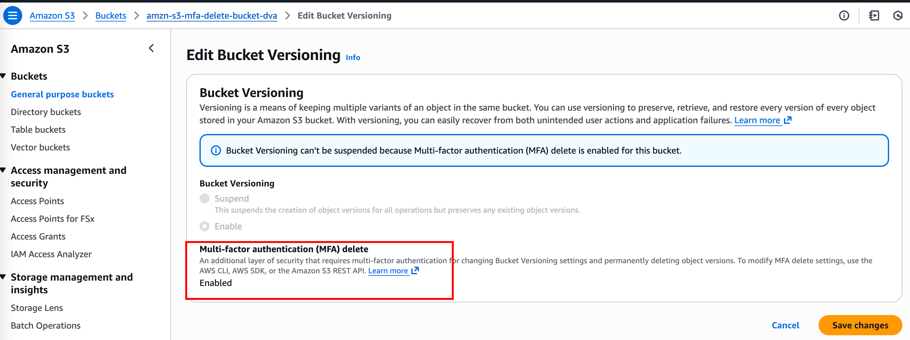
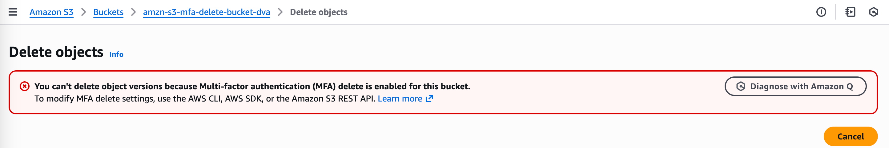

# S3 Lab: MFA Delete

[← Labs index](../README.md) · **Service:** S3 · **Level:** Intermediate · **Est. time:** 20 min · **Est. cost:** Free tier

**Reference:** [Udemy DVA-C01 - MFA Delete](https://www.udemy.com/course/aws-certified-developer-associate-dva-c01/learn/lecture/23743660#lecture-article)

## Contents

- [Objectives](#objectives)
- [Prerequisites](#prerequisites)
- [Steps](#steps)
- [Verification](#verification)
- [Troubleshooting](#troubleshooting)
- [Cleanup](#cleanup)
- [References](#references)

## Objectives

- Enable and disable **MFA Delete** with the CLI as the root user.
- Observe that permanently deleting a version fails without an MFA code, while a normal delete still works.
- Explain what MFA Delete protects (permanent deletes, suspending versioning) and why only the root user can change it.

## Prerequisites

- Access to the **root user** of an AWS account, with an **MFA device** already assigned to
    it. Only the root user can change MFA Delete.
- AWS CLI installed.

> ⚠️ This lab creates a **root access key**, which AWS strongly advises against keeping.
> Create it only for this lab and delete it in [Cleanup](#cleanup) straight away.

## Steps

### 1. Prepare a Versioned Bucket

1. In the **S3 Console**, click **Create bucket** and enter a unique name.
2. Set **Bucket Versioning** to **Enable** and click **Create bucket**.
3. Upload a test file, for example `test.txt`.

### 2. Configure the CLI as Root

1. Signed in as root, open the account menu (top right) > **Security credentials**.
2. Under **Access keys**, click **Create access key** and copy the key pair.
3. On the same page, note the **MFA device ARN** (identifier), for example
    `arn:aws:iam::123456789012:mfa/root-account-mfa-device`.
4. Configure a dedicated profile:

    ```bash
    aws configure --profile root-mfa
    ```

### 3. Enable MFA Delete

MFA Delete cannot be enabled from the console. Run the following, where `123456` is the
current code from your MFA device:

```bash
aws s3api put-bucket-versioning \
  --bucket YOUR-BUCKET-NAME \
  --versioning-configuration Status=Enabled,MFADelete=Enabled \
  --mfa "YOUR-MFA-DEVICE-ARN 123456" \
  --profile root-mfa
```



### 4. Test the Restriction

1. Get the version ID of the test file:

    ```bash
    aws s3api list-object-versions --bucket YOUR-BUCKET-NAME --prefix test.txt \
      --query 'Versions[0].VersionId' --output text --profile root-mfa
    ```

2. Try to **permanently delete** that version without MFA. It fails:

    ```bash
    aws s3api delete-object --bucket YOUR-BUCKET-NAME --key test.txt \
      --version-id YOUR-VERSION-ID --profile root-mfa
    # Expected: An error occurred (AccessDenied) ... MFA Authentication must be used for this request
    ```

3. A **normal delete** (no version ID) still works and only adds a delete marker. MFA Delete
    protects against *permanent* deletion and against suspending versioning.
4. In the console, try to permanently delete the version or suspend versioning. Both are
    blocked, because the console cannot send MFA codes.



### 5. Disable MFA Delete

```bash
aws s3api put-bucket-versioning \
  --bucket YOUR-BUCKET-NAME \
  --versioning-configuration Status=Enabled,MFADelete=Disabled \
  --mfa "YOUR-MFA-DEVICE-ARN 123456" \
  --profile root-mfa
```

Repeat the `delete-object --version-id` command from step 4.2: it now succeeds.

> 🔒 Before sharing screenshots, redact the root access key, account ID, MFA device ARN and
> MFA codes.

## Verification

- Check the bucket's MFA Delete status:

    ```bash
    aws s3api get-bucket-versioning --bucket YOUR-BUCKET-NAME --profile root-mfa
    # After step 3: "Status": "Enabled", "MFADelete": "Enabled"
    # After step 5: "Status": "Enabled", "MFADelete": "Disabled"
    ```

## Troubleshooting

| Symptom | Likely cause | Fix |
|---------|--------------|-----|
| `AccessDenied` when enabling MFA Delete | The command is not using root credentials | Use the `root-mfa` profile; IAM users, even admins, cannot change MFA Delete |
| "The MFA token is invalid" / "MultiFactorAuthentication failed" | Wrong device ARN or an expired code | Copy the ARN from **Security credentials** and use a fresh code |
| `delete-object` succeeds without MFA | No `--version-id`, so it only created a delete marker | Pass `--version-id` to test a permanent delete |

## Cleanup

> ⚠️ Do the access key step even if you skip the others.

- [ ] Make sure MFA Delete is **Disabled** (step 5), then empty and delete the bucket.
- [ ] **Deactivate and delete the root access key** (account menu > **Security credentials**).
- [ ] Remove the `root-mfa` profile from `~/.aws/credentials` and `~/.aws/config`.

## References

- [Configuring MFA delete (AWS docs)](https://docs.aws.amazon.com/AmazonS3/latest/userguide/MultiFactorAuthenticationDelete.html)
- [Root user best practices (AWS docs)](https://docs.aws.amazon.com/IAM/latest/UserGuide/root-user-best-practices.html)
