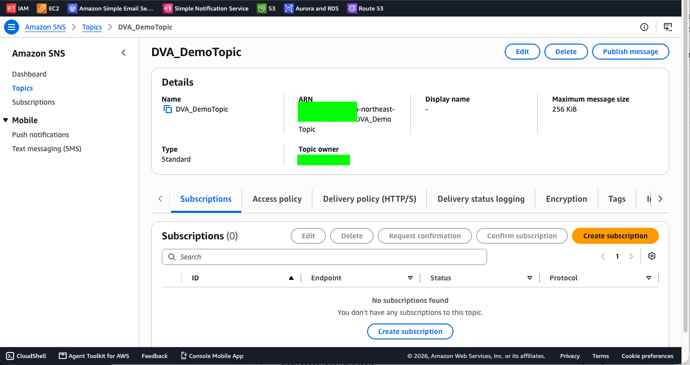
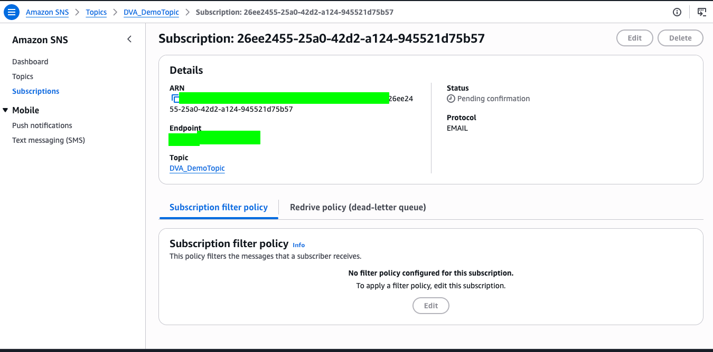
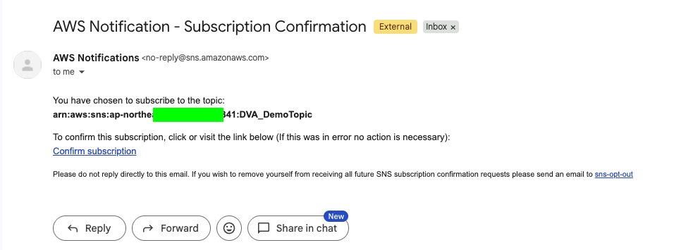
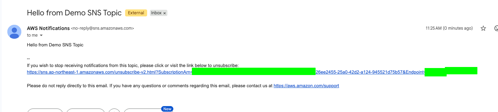

# SNS Lab: Topic with an Email Subscription

[← Labs index](../README.md) · **Service:** SNS · **Level:** Beginner · **Est. time:** 15 min · **Est. cost:** Free tier

**Reference:** [Getting started with Amazon SNS (AWS docs)](https://docs.aws.amazon.com/sns/latest/dg/sns-getting-started.html)

## Contents

- [Objectives](#objectives)
- [Prerequisites](#prerequisites)
- [Steps](#steps)
- [Verification](#verification)
- [Troubleshooting](#troubleshooting)
- [Cleanup](#cleanup)
- [References](#references)

## Objectives

- [ ] Create a standard SNS topic with the default settings.
- [ ] Subscribe an email address to the topic.
- [ ] Confirm the subscription from the confirmation email.
- [ ] Publish a test message and receive it by email.

## Prerequisites

- An AWS account with SNS permissions.
- An email inbox you can open during the lab.

## Steps

### 1. Create a Standard Topic

1. Open the **SNS Console** > **Topics** and click **Create topic**.
2. **Type:** Standard. **Name:** `DVA_DemoTopic`.
3. Leave the other settings at their defaults and click **Create topic**.

    

> 💡 A standard topic gives best-effort ordering and at-least-once delivery, and supports
> every protocol (email, SMS, HTTP/S, SQS, Lambda, …). A FIFO topic keeps strict order
> but only delivers to SQS queues.

### 2. Create an Email Subscription

1. On the `DVA_DemoTopic` page, open the **Subscriptions** tab and click
    **Create subscription**.
2. **Topic ARN:** keep the ARN of `DVA_DemoTopic`.
3. **Protocol:** Email. **Endpoint:** your email address.
4. Click **Create subscription**. The status is **Pending confirmation**.

    

### 3. Confirm the Subscription

1. Open your inbox. SNS sends an email titled **AWS Notification - Subscription
    Confirmation** from `no-reply@sns.amazonaws.com`.

    

2. If the email does not arrive, select the subscription in the console and click
    **Request confirmation** to send it again.
3. Click **Confirm subscription** in the email. A page opens saying the subscription
    is confirmed.
4. Back in the console, refresh the topic's **Subscriptions** tab. The status is now
    **Confirmed**.

> 💡 SNS only delivers to an email endpoint after its owner confirms it. This stops a
> topic from sending mail to an address that never asked for it.

### 4. Publish a Test Message

1. On the `DVA_DemoTopic` page, click **Publish message**.
2. **Subject:** `Hello from Demo SNS Topic`.
3. **Message structure:** Identical payload for all delivery protocols.
    **Message body:** `Hello from Demo SNS Topic`.
4. Click **Publish message**. A banner shows the message ID.

### 5. Check the Email

1. Open your inbox. A new email from **AWS Notifications** arrives with the subject and
    body you published.

    

> 💡 Each notification email ends with an unsubscribe link. Anyone who clicks it
> removes the subscription, so do not forward these emails.

## Verification

- The subscription status is **Confirmed** (step 3).
- The test message arrives in your inbox (step 5).
- CLI alternative. List the topic's subscriptions:

    ```bash
    aws sns list-subscriptions-by-topic --topic-arn YOUR-TOPIC-ARN \
      --query 'Subscriptions[].[Protocol,Endpoint,SubscriptionArn]' --output table
    ```

    Expected: one `email` row. Its `SubscriptionArn` is `PendingConfirmation` before you
    confirm, and a full ARN ending in the subscription ID after.

- Publish a message from the CLI:

    ```bash
    aws sns publish --topic-arn YOUR-TOPIC-ARN \
      --subject "Hello from the CLI" --message "Hello from Demo SNS Topic"
    ```

    Expected: a JSON response with a `MessageId`, and a second email in your inbox.

## Troubleshooting

| Symptom | Likely cause | Fix |
|---------|--------------|-----|
| No confirmation email | It went to spam, or the address has a typo | Check spam, then **Request confirmation**; if the address is wrong, create a new subscription |
| The status stays **Pending confirmation** | The confirmation link was not clicked, or the console was not refreshed | Click **Confirm subscription** in the email and refresh the console |
| The published message never arrives | The subscription is not confirmed yet | SNS skips pending subscriptions; confirm first, then publish again |
| **Edit** and **Delete** are greyed out on the subscription | Pending subscriptions cannot be edited or deleted | Confirm it first, or delete the topic, which removes its subscriptions |
| The subscription disappeared | Someone clicked the unsubscribe link in a notification email | Create the subscription again |

## Cleanup

> 💸 Delete billable resources to avoid surprise charges.

- [ ] Delete the email subscription (**Subscriptions** > select it > **Delete**).
- [ ] Delete `DVA_DemoTopic` (**Topics** > select it > **Delete**, then type
    `delete me` to confirm).

## References

- [Getting started with Amazon SNS (AWS docs)](https://docs.aws.amazon.com/sns/latest/dg/sns-getting-started.html)
- [Email notifications with Amazon SNS (AWS docs)](https://docs.aws.amazon.com/sns/latest/dg/sns-email-notifications.html)
- [Amazon SNS message publishing (AWS docs)](https://docs.aws.amazon.com/sns/latest/dg/sns-publishing.html)
