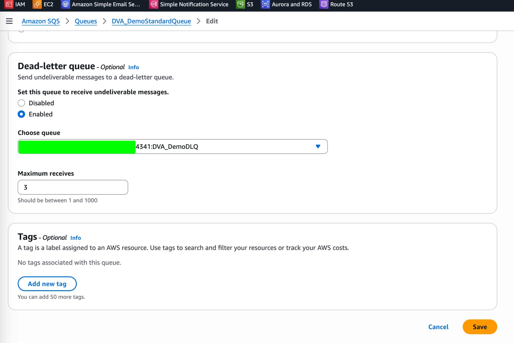
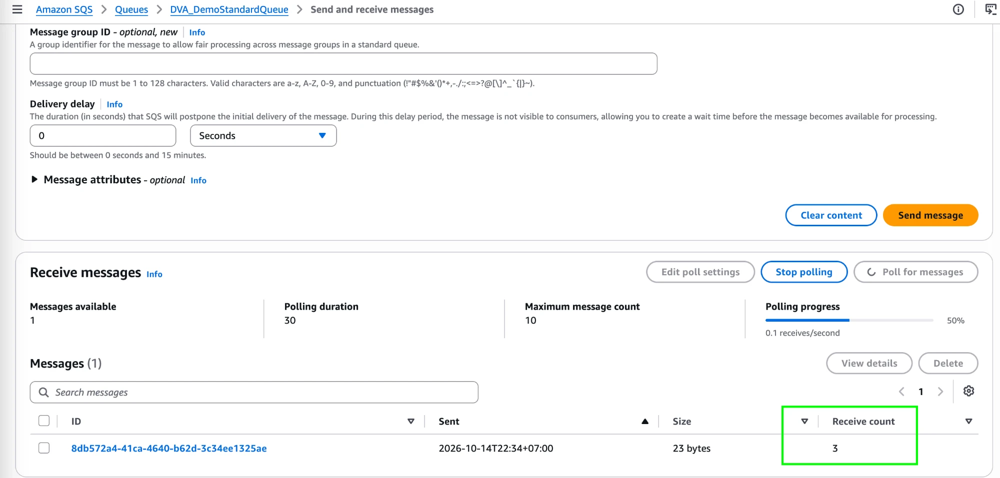
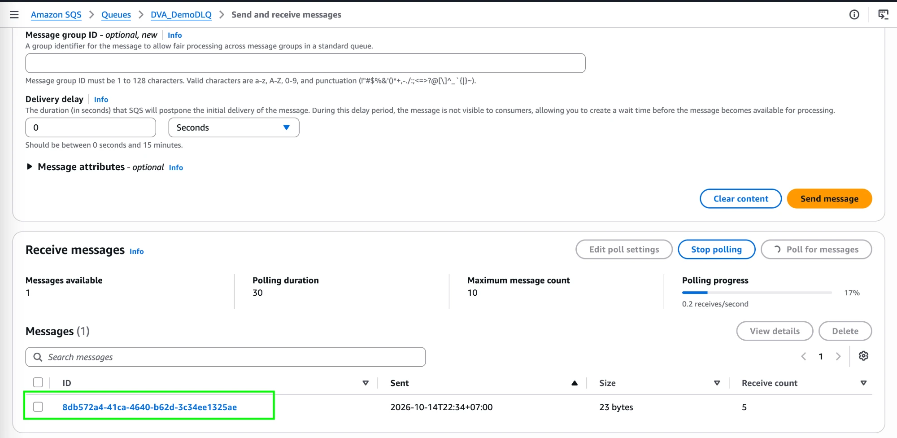
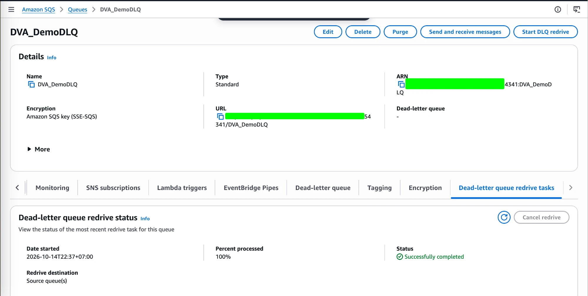

# SQS Lab: Dead-Letter Queue & DLQ Redrive

[← Labs index](../README.md) · **Service:** SQS · **Level:** Beginner · **Est. time:** 15 min · **Est. cost:** Free tier

**Reference:** [Udemy DVA-C01 - SQS Dead Letter Queue](https://www.udemy.com/course/aws-certified-developer-associate-dva-c01/learn/lecture/35748710#overview)

## Contents

- [Objectives](#objectives)
- [Prerequisites](#prerequisites)
- [Steps](#steps)
- [Verification](#verification)
- [Troubleshooting](#troubleshooting)
- [Cleanup](#cleanup)
- [References](#references)

## Objectives

- [ ] Create a dead-letter queue (DLQ) and a source (standard) queue.
- [ ] Attach the DLQ to the source queue with **Maximum receives = 3**.
- [ ] Watch a message that is received too many times move into the DLQ.
- [ ] Use **Start DLQ redrive** to send the message back to the source queue.

## Prerequisites

- An AWS account with SQS permissions.
- A region of your choice. Create **both queues in the same region**.

## Steps

### 1. Create the Dead-Letter Queue

1. Open the **SQS Console** and click **Create queue**.
2. **Type:** Standard. **Name:** `DVA_DemoDLQ`.
3. Leave the other settings at their defaults and click **Create queue**.

> 💡 A DLQ is just a normal queue. The DLQ of a standard queue must be a standard
> queue (and FIFO with FIFO).

### 2. Create the Source Queue

1. Click **Create queue**.
2. **Type:** Standard. **Name:** `DVA_DemoStandardQueue`.
3. Under **Configuration**, set **Visibility timeout** to `5` seconds so the test runs
    quickly (the default is 30 seconds).
4. Scroll to **Dead-letter queue**, choose **Enabled**, and select `DVA_DemoDLQ` as the
    queue.
5. Set **Maximum receives** to `3`, then click **Create queue**.

    If the queue already exists, open it > **Edit** and change the same settings.

    

> 💡 **Maximum receives** is the number of times a message can be received without being
> deleted. When the count exceeds it, SQS moves the message to the DLQ.

### 3. Send a Message and Let It Fail

1. Open `DVA_DemoStandardQueue` > **Send and receive messages**.
2. Enter any message body and click **Send message**.
3. Click **Poll for messages** to receive the message. **Do not delete it.**
4. After the 5-second visibility timeout expires, poll again. Repeat until the
    **Receive count** is greater than `3`.

    

    The message is never deleted, which simulates a consumer that keeps failing.

### 4. Check the Dead-Letter Queue

1. Open `DVA_DemoDLQ` > **Send and receive messages** > **Poll for messages**.
2. The message from step 3 is now here, with the same message ID.

    

### 5. Redrive the Message to the Source Queue

1. Open `DVA_DemoDLQ` and click **Start DLQ redrive**.
2. **Redrive destination:** keep **Redrive to source queue(s)**.
3. Leave the velocity at the default (**System optimized**) and click **DLQ redrive**.
4. Open the **Dead-letter queue redrive tasks** tab and wait for the task to finish.

    

## Verification

- In the DLQ, the message appears after exceeding **Maximum receives** (step 4).
- The redrive task status is **Successfully completed** with **100%** processed (step 5).
- Open `DVA_DemoStandardQueue` > **Send and receive messages** > **Poll for messages**.
    The redriven message is back in the source queue.
- CLI alternative:

    ```bash
    aws sqs receive-message --queue-url YOUR-SOURCE-QUEUE-URL \
      --attribute-names ApproximateReceiveCount --max-number-of-messages 1
    ```

## Troubleshooting

| Symptom | Likely cause | Fix |
|---------|--------------|-----|
| The DLQ is not listed in the **Choose queue** dropdown | The DLQ is in another region or is a different queue type | Create the DLQ in the same region and with the same type (standard or FIFO) |
| The message never reaches the DLQ | The message was deleted, or it was received fewer than the maximum receives | Do not delete the message; poll until the receive count exceeds the maximum |
| The message stays hidden after polling | The visibility timeout has not expired yet | Wait for the timeout (5 seconds in this lab) and poll again |
| **Start DLQ redrive** is greyed out | The queue is not used as a DLQ, or it is empty | Check the source queue's DLQ setting and that the DLQ holds messages |

## Cleanup

> 💸 Delete billable resources to avoid surprise charges.

- [ ] Delete `DVA_DemoStandardQueue`.
- [ ] Delete `DVA_DemoDLQ`.

## References

- [Amazon SQS dead-letter queues (AWS docs)](https://docs.aws.amazon.com/AWSSimpleQueueService/latest/SQSDeveloperGuide/sqs-dead-letter-queues.html)
- [Configuring dead-letter queue redrive (AWS docs)](https://docs.aws.amazon.com/AWSSimpleQueueService/latest/SQSDeveloperGuide/sqs-configure-dead-letter-queue-redrive.html)
