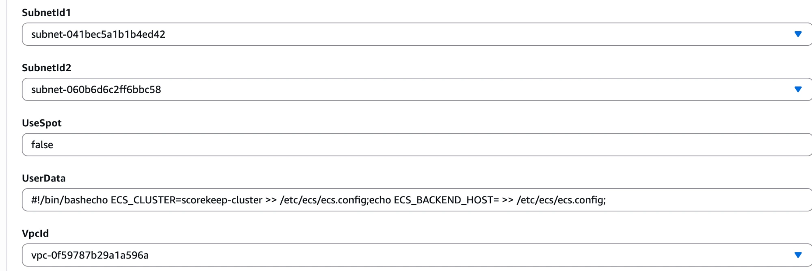
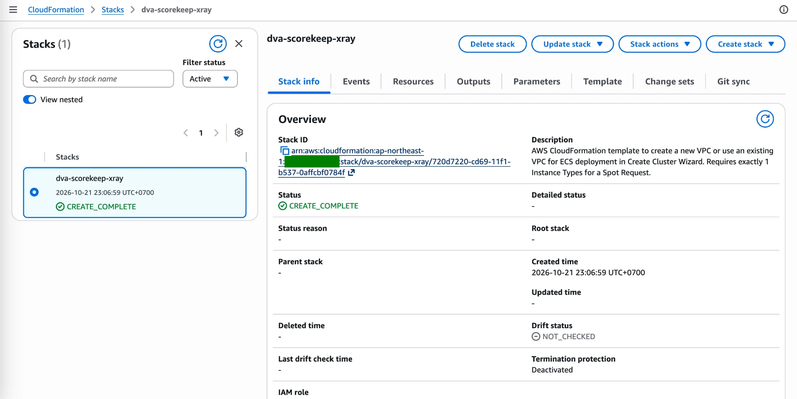
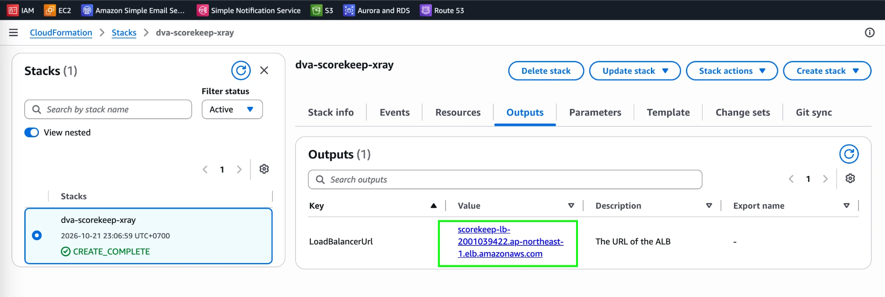
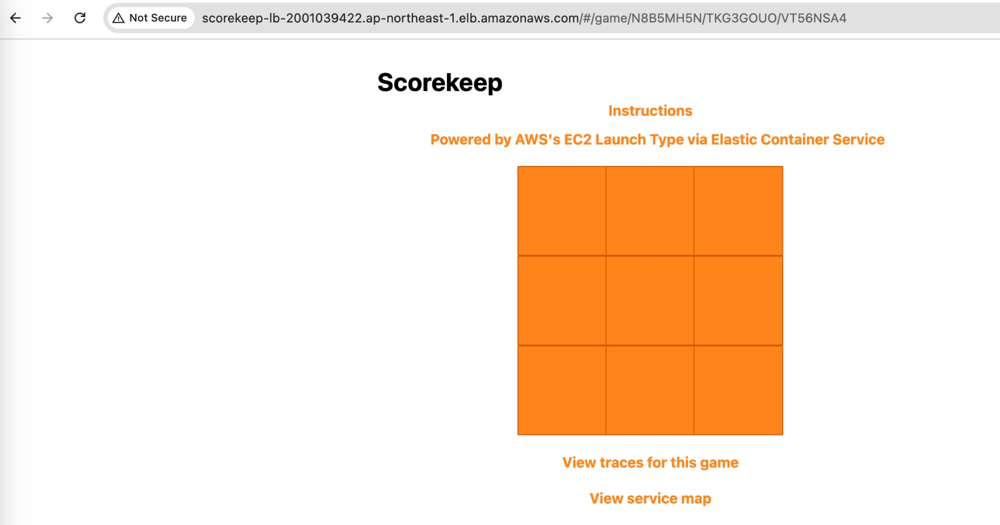
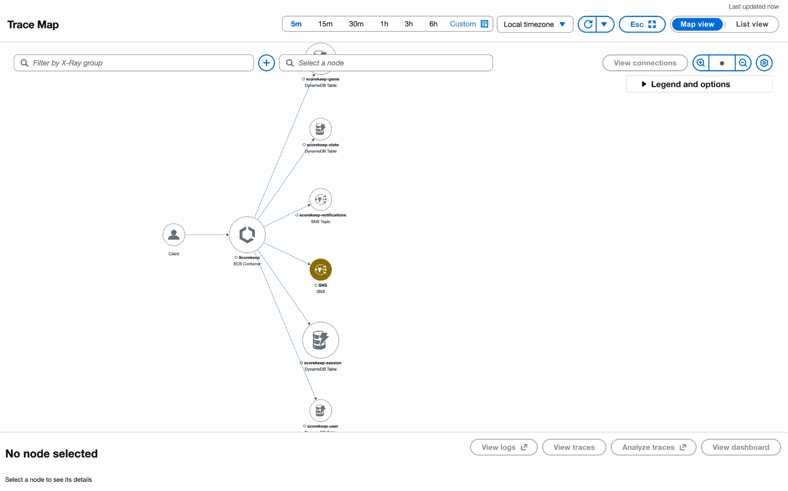
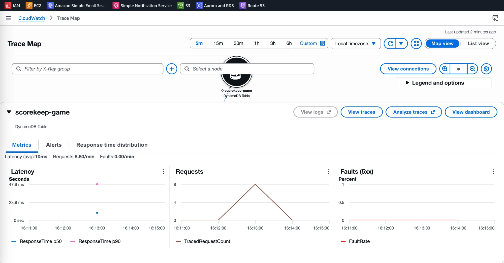
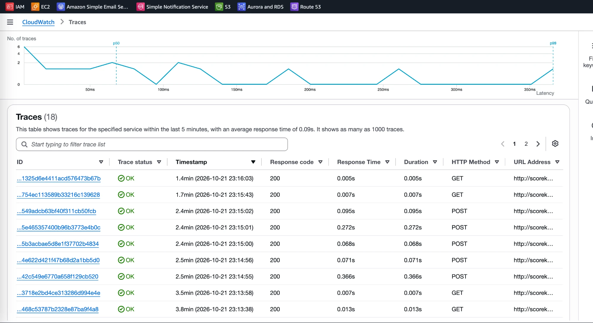

# X-Ray Lab: Trace the Scorekeep App on ECS

[← Labs index](../README.md) · **Service:** X-Ray · **Level:** Intermediate · **Est. time:** 30 min · **Est. cost:** ~$0.05 per hour (ALB and EC2) — remember to clean up

**Reference:** [Udemy DVA-C01 - AWS X-Ray Hands On](https://www.udemy.com/course/aws-certified-developer-associate-dva-c01/learn/lecture/11851360?start=300#overview)

## Contents

- [Objectives](#objectives)
- [Prerequisites](#prerequisites)
- [Steps](#steps)
- [Verification](#verification)
- [Troubleshooting](#troubleshooting)
- [Cleanup](#cleanup)
- [References](#references)

## Objectives

- Deploy the **Scorekeep** sample app (ECS on EC2, DynamoDB, SNS) with a **CloudFormation** stack that runs the **X-Ray daemon** next to the app.
- Generate traffic and read the **trace map** (service map): which services the app calls and their latency, requests and faults.
- Open the **traces** list and explain how X-Ray shows each request end to end.

## Prerequisites

- An AWS account with permissions for CloudFormation, ECS, EC2, ELB, DynamoDB, SNS, IAM and X-Ray.
- The course template `x-ray/eb-java-scorekeep-xray-simplified.yaml` (from the course code
    download). It is not stored in this repo.
- A VPC with **two public subnets in different Availability Zones** (the default VPC works).
    The load balancer needs two AZs, and the instance needs a public IP to pull the container images.

## Steps

### 1. Create the Stack

1. Open the **CloudFormation Console** > **Create stack** > **With new resources (standard)**.
2. Choose **Upload a template file**, select `eb-java-scorekeep-xray-simplified.yaml` and click **Next**.
3. **Stack name:** `dva-scorekeep-xray`.
4. Leave every parameter at its default **except**:
    - **VpcId:** your VPC (e.g. the default VPC).
    - **SubnetId1** and **SubnetId2:** two public subnets of that VPC in different AZs.

    

5. Click **Next** twice. On the review page, tick **I acknowledge that AWS CloudFormation
    might create IAM resources with custom names**, then click **Submit**.
6. Wait until the status is **CREATE_COMPLETE**.

    

> 💡 The stack creates an ECS cluster `scorekeep-cluster` with one `t3.micro` container
> instance, a task with three containers (`scorekeep-frontend`, `scorekeep-api` and
> `xray-daemon` on UDP port 2000), five DynamoDB tables `scorekeep-*`, the SNS topic
> `scorekeep-notifications`, an Application Load Balancer and IAM roles. The task role
> `scorekeepRole` has `AWSXrayFullAccess` so the daemon can send traces to X-Ray.

### 2. Open the App and Play

1. Open the **Outputs** tab and copy the **LoadBalancerUrl** value.

    

2. Open `http://<LoadBalancerUrl>` in a browser (the app uses HTTP, so the browser shows
    **Not Secure**).
3. Create a session and a game, then play a few moves of tic-tac-toe. Every click calls the
    API, which reads and writes DynamoDB and publishes to SNS.

    

> 💡 The API is instrumented with the **X-Ray SDK**. The SDK sends segments to the
> **X-Ray daemon** container over UDP, and the daemon batches them to the X-Ray service.

### 3. Explore the Trace Map

1. In the app, click **View service map**, or open the **CloudWatch Console** > **X-Ray traces** >
    **Trace Map**.
2. The map shows **Client** → **Scorekeep** (ECS Container) → the DynamoDB tables
    (`scorekeep-game`, `scorekeep-state`, `scorekeep-session`, `scorekeep-user`) and SNS
    (`scorekeep-notifications`).

    

3. Click a node, e.g. `scorekeep-game`, to see its **Latency**, **Requests** and
    **Faults (5xx)** for the selected time range.

    

> 💡 Node colors show health: green for OK, yellow for client errors (4xx), red for
> faults (5xx) and purple for throttling.

### 4. Look at the Traces

1. On a node, click **View traces** (or open **X-Ray traces** > **Traces**).
2. The list shows each traced request with its status, response code, response time,
    HTTP method and URL.

    

3. Open a trace ID to see its **timeline**: the segment of the Scorekeep API and a
    subsegment for each DynamoDB and SNS call.

## Verification

- The stack status is **CREATE_COMPLETE** and **LoadBalancerUrl** opens the Scorekeep app (steps 1 and 2).
- The trace map shows Scorekeep calling DynamoDB and SNS after you play (step 3).
- The traces list has entries with response code `200` (step 4).
- CLI alternative (traces from the last 10 minutes):

    ```bash
    aws xray get-trace-summaries --start-time $(date -u -v-10M +%s) --end-time $(date -u +%s) \
      --query "TraceSummaries[].{id:Id,status:Http.HttpStatus,url:Http.HttpURL}"
    ```

    On Linux or CloudShell, use `date -u -d '-10 min' +%s` for the start time.

## Troubleshooting

| Symptom | Likely cause | Fix |
|---------|--------------|-----|
| The stack fails with `InsufficientCapabilities` | The IAM acknowledgement was not ticked | Create the stack again and tick the IAM checkbox on the review page |
| The stack fails because a role, table or topic already exists | A previous `scorekeep` stack or its leftovers exist (the names are fixed) | Delete the old stack or the leftover resources, then retry |
| The load balancer URL returns `503` | The ECS task is not running yet, or the instance has no public IP to pull images | Wait a few minutes; check that both subnets are public |
| The trace map is empty | No requests yet, or the time range is too short | Play a game, then refresh with **5m** or **15m** selected |
| The SNS node is yellow | The `Email` parameter was left as `UPDATE_ME`, so the email subscription call fails | Harmless for the lab; to get notifications, set a real email when creating the stack |

## Cleanup

> 💸 The load balancer and the EC2 instance are billed by the hour. Delete them when you are done.

- [ ] Delete the stack `dva-scorekeep-xray` and wait for **DELETE_COMPLETE**.
- [ ] Check that no `scorekeep-*` DynamoDB table, `scorekeep-notifications` topic or
    `scorekeep-lb` load balancer is left.

## References

- [What is AWS X-Ray? (AWS docs)](https://docs.aws.amazon.com/xray/latest/devguide/aws-xray.html)
- [Scorekeep sample application (AWS docs)](https://docs.aws.amazon.com/xray/latest/devguide/xray-scorekeep.html)
- [AWS X-Ray daemon (AWS docs)](https://docs.aws.amazon.com/xray/latest/devguide/xray-daemon.html)
