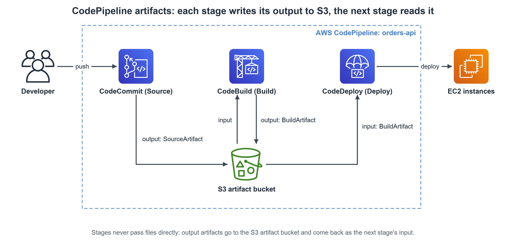

# CI/CD on AWS

## Introduction

### Why CI/CD

- So far: create resources **by hand** (console), call AWS **programmatically** (CLI, SDK), deploy with **Elastic Beanstalk**.
- Every manual step is a chance to **make a mistake** → automate the path from code to AWS.
- Goal: code lives **in a repository** and is deployed to AWS:
    - **Automatically**, the same way every time.
    - **Tested** before it is deployed.
    - Through several **stages / environments** (dev → test → staging → prod).
    - With a **manual approval** where needed (e.g. before prod).

### Continuous Integration (CI)

- 
- Developers **push code often** to a shared repository (CodeCommit, GitHub, Bitbucket…).
- A **build / test server** checks every push automatically (CodeBuild, Jenkins…).
- The developer gets **fast feedback**: which tests and checks passed or failed.
- Benefits:
    - **Find bugs early** → small changes are easy to fix.
    - **Deliver faster**, because the code is always tested.
    - Deploy often; developers are not blocked by big merges.
- Output: a **tested build artifact** (zip, container image…) ready to deploy.

### Continuous Delivery (CD)

- 
- Software can be **released reliably whenever needed**.
- Deployments are **frequent and quick**: from "one release every 3 months" to "many releases a day".
- In practice this means **automated deployment** (CodeDeploy, Jenkins, Spinnaker…).
- **Continuous delivery** vs **continuous deployment** (not on the slides):
    - Delivery: every build is *ready* for prod; a **person approves** the prod release.
    - Deployment: every build that passes the tests goes to prod **automatically**.

### CI/CD Services on AWS

- 
- **Code** → **AWS CodeCommit**: managed Git repositories (details below).
    - Or any 3rd-party repository: **GitHub**, **Bitbucket**…
    - CodeCommit was closed to new customers in July 2024 and reopened in November 2025.
- **Build + test** → **AWS CodeBuild**: managed build containers, pay per build minute.
    - Or any 3rd-party CI server, e.g. **Jenkins**.
- **Deploy + provision** → **AWS Elastic Beanstalk**: deploys the code **and** creates the environment.
- **Deploy only** → **AWS CodeDeploy**: to **EC2** instances, **on-premises** servers, **Lambda** functions and **ECS** services you already run.
- **Orchestrate** → **AWS CodePipeline**: chains source → build → test → (approval) → deploy, triggered by each push.

## AWS CodeCommit

### Version Control & Git

- **Version control**: see every change made to the code over time, and **roll back** if needed.
- **Git** is the standard version control system.
    - Each developer has a **local copy** of the repository, synced with a **central online repository**.
- Benefits of a central repository:
    - **Collaborate** with other developers.
    - The code is **backed up** somewhere.
    - Every change is **visible and auditable** (who changed what, when).
- Hosted Git options: **GitHub**, **GitLab**, **Bitbucket**… and **AWS CodeCommit**.

### Features

- **Private Git repositories**, fully managed and highly available.
- **No limit on repository size**: it scales seamlessly.
    - Per-file limits: 6 MB in the console / API / CLI, 2 GB per Git blob.
- Code stays **in your AWS account** → easier security and compliance.
- **Security** built in: encryption, IAM access control (see below).
- **Integrates** with CodeBuild, CodePipeline, Jenkins and other CI tools.
- Pull requests with **approval rules** for code review.

### Security

- 
- Interactions use **standard Git** commands.
- **Authentication** (who you are):
    - **SSH keys**: IAM users upload their SSH public key in the **IAM console**.
    - **HTTPS**: **Git credentials** (user name + password) generated in IAM for an IAM user, or the **AWS CLI credential helper**.
    - **git-remote-codecommit** (`codecommit://` URLs): for **roles, federated / SSO** users and other **temporary credentials** (not on the slides).
- **Authorization** (what you can do): **IAM policies** on users / roles, e.g. allow `codecommit:GitPull` and `codecommit:GitPush` on one repository ARN.
- **Encryption**:
    - **At rest**: automatic, with **AWS KMS** (AWS managed key or your own customer managed key).
    - **In transit**: only **HTTPS** or **SSH**, both encrypted.
- **Cross-account access**:
    - **Never share** SSH keys or AWS credentials.
    - Create an **IAM role** in the repository's account and let the other account assume it with **AWS STS `AssumeRole`**.

### CodeCommit vs GitHub

- 
- **Both**: pull requests / code review, CodeBuild integration, SSH + HTTPS.
- **Users**: CodeCommit → **IAM users & roles**; GitHub → **GitHub accounts**.
- **Hosting**: CodeCommit → **managed by AWS**; GitHub → github.com, or **GitHub Enterprise Server** on your own servers.
- **UI**: CodeCommit → **minimal**; GitHub → **full featured**.

## AWS CodePipeline

### Overview

- **Visual workflow** that **orchestrates** the whole CI/CD process (where it fits: see "CI/CD Services on AWS" above).
- 
- A pipeline is made of **stages**, run **in order**, e.g. Build → Test → Deploy → Load testing.
    - Each stage has one or more **actions**, run **in sequence and / or in parallel**.
    - A **manual approval** action can be added to any stage.
- Action categories and example providers:
    - **Source**: CodeCommit, ECR, S3, GitHub, GitLab, Bitbucket (GitHub / GitLab / Bitbucket through a connection).
    - **Build**: CodeBuild, Jenkins, CloudBees, TeamCity.
    - **Test**: CodeBuild, AWS Device Farm, 3rd-party tools.
    - **Deploy**: CodeDeploy, Elastic Beanstalk, CloudFormation, ECS, S3…
    - **Invoke**: Lambda, Step Functions.
    - **Approval**: manual.

### Artifacts

- 
- Each stage can create **artifacts**: its output (source code zip, build output…).
- Artifacts are stored in an **S3 bucket** (the *artifact store*) and passed as **input** to the next stage.
    - Stages never talk to each other directly: they **upload to and download from S3**.
- Artifacts are **encrypted with KMS**; the pipeline's **service role** needs access to the bucket.
- Cross-Region actions use an artifact bucket **in each Region** (not on the slides).

### Troubleshooting

- 
- **Pipeline, stage and action state changes** → events in **Amazon EventBridge** (formerly CloudWatch Events).
    - E.g. rules for **failed** pipelines or **canceled** stages → notify with SNS, run a Lambda.
- A **failed stage stops the pipeline**; the console shows which action failed and why.
- Pipeline **can't perform an action** → check the pipeline's **IAM service role** has the permissions (IAM policy).
- **AWS CloudTrail** audits the CodePipeline **API calls** (who changed or started the pipeline).
