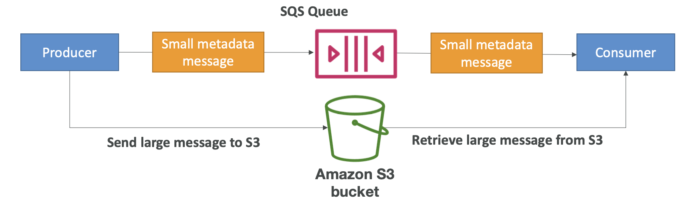

# Decoupling applications: SQS, SNS, Kinesis, Active MQ

## Application Decoupling

### Communication Patterns

- Synchronous (Application-to-Application): Potential issues with traffic spikes
- Asynchronous / Event-Based (Application-to-Queue/Topic-to-Application): Better for handling variable loads

### Benefits of Decoupling

- Services scale independently from the application
- Improved resilience and fault tolerance

### AWS Decoupling Services

- SQS (Queue Model)
- SNS (Pub/Sub Model)
- Kinesis (Real-time Streaming Model)

## Service Comparison Summary (SQS vs SNS vs Kinesis)

### SQS

- Model: Queue (Pull/Poll)
- Persistence: Yes (until deleted)
- Consumers: Many workers polling
- Ordering: Best-effort (Standard), FIFO (FIFO Queue)
- Use Case: Decoupling, work queues, buffering

### SNS

- Model: Pub/Sub (Push)
- Persistence: No (unless using SQS subscriber)
- Consumers: Many subscribers receiving pushes
- Ordering: Best-effort (Standard), FIFO (FIFO Topic)
- Use Case: Fan-out, notifications, event triggering

### Kinesis (Data Streams)

- Model: Stream (Pull - Standard Consumer, Push - Enhanced Fan-Out)
- Persistence: Yes (configurable retention, 1-365 days)
- Consumers: Multiple applications can read the same data (replayable)
- Ordering: Guaranteed per partition key/shard
- Use Case: Real-time data streaming, analytics, log aggregation

## Amazon SQS (Simple Queue Service)

### Overview

- Fully managed message queuing service
- Used to decouple applications
- Oldest AWS offering (>10 years)
- Producers → *send messages* → SQS Queue → *poll messages* → Consumers

### Attributes (Standard Queue)

- Throughput: Unlimited
- Number of Messages: Unlimited
- Message Size Limit: 1 MiB (1,024 KB; previously 256 KB)
- Message Retention: Default 4 days, max 14 days
- Latency: Low (<10 ms publish/receive)
- Delivery: At-least-once (duplicates possible)
- Ordering: Best-effort

### Core Concepts

- **Producers**
    - Messages are sent using the `SendMessage` API.
    - Messages are stored in SQS until consumed and deleted.
    - Retention: default 4 days and up to 14 days
    - Attributes (e.g., order ID, customer ID) can be sent with the message.
- **Consumers**
    - Consumers *poll* the queue, retrieving up to 10 messages at a time.
    - Consumers process the messages and delete them with the `DeleteMessage` API.
    - Multiple consumers can process messages in parallel for higher throughput.
    - Message visibility timeout ensures no message is processed by multiple consumers simultaneously.
    - Example: poll/receive messages → consumer → insert into RDS → `DeleteMessage`

### Features

- **Visibility Timeout**
    - Message becomes invisible after being polled
    - Default: 30 seconds
    - Purpose: Prevent multiple consumers from processing the same message simultaneously
    - Behavior: Message becomes visible again if not deleted within the timeout
    - Risk: Potential for double processing if timeout is too short or consumer crashes
    - Adjustment: Can be changed (`ChangeMessageVisibility` API)
- **Long Polling**
    - Consumer waits for messages if the queue is empty
    - Wait Time: 1 to 20 seconds (20s preferred)
    - Benefits: Reduces API calls, increases efficiency, lowers latency
    - Configuration: Queue level or API level (`WaitTimeSeconds`)
- **Dead-Letter Queues (DLQ)**
    - Handles messages that fail processing multiple times

### Queue Types

- **Standard Queue (Default)**
    - Unlimited throughput
    - At-least-once delivery
    - Best-effort ordering
- **FIFO (First-In, First-Out) Queue**
    - Ordering: Guaranteed First-In, First-Out
    - Delivery: Exactly-once processing (achieved via deduplication)
    - Deduplication ID: Used to prevent duplicate messages
    - Message Group ID: Ensures ordering within a specific group of messages (mandatory)
    - Throughput: Limited (300 msg/s standard, 3000 msg/s with batching)

### Use Cases & Patterns

- Scaling consumers independently using Auto Scaling Groups (ASG) based on queue length (`ApproximateNumberOfMessagesVisible` metric)
    - CloudWatch metric (queue length) → alarm for breach → ASG scales EC2 instances polling the queue
- Decoupling microservices or application tiers
    - Front-end web app → `SendMessage` → SQS queue (infinitely scalable) → `ReceiveMessages` → back-end web app
- Buffering requests (e.g., database writes) to handle load spikes
    - Enqueue → SQS → dequeue → insert into DynamoDB / Aurora / RDS
- Sending large messages (beyond the message size limit, e.g. 1 GB): **SQS Extended Client** (Java library)
    - Producer → send the large payload to an S3 bucket
    - Producer → send a small metadata message (pointer to the S3 object) to the SQS queue
    - Consumer → receive the metadata message → retrieve the large payload from S3
    - 

### Security

- Access Control: IAM policies
- Resource Policies: SQS Access Policies (similar to S3 Bucket Policies) for cross-account access or granting service permissions (e.g., SNS, S3)
- Encryption
    - Encryption In-flight: HTTPS
    - Encryption At-rest: KMS keys
    - Client-Side Encryption: Option for clients

## Amazon SNS (Simple Notification Service)

### Overview

- Fully managed publish/subscribe (Pub/Sub) messaging service
- Enables sending messages to a large number of subscribers
- Example: Buying Service → SNS Topic → Email Notification, Fraud Service, Shipping Service, SQS Queue

### Core Concepts

- Topic: A communication channel where messages are published
- Publisher: An entity (application, service) that sends messages to an SNS topic
- Subscriber: An endpoint (e.g., SQS queue, Lambda function, email address) that receives messages from a topic

### Attributes & Limits

- Subscriptions per Topic: Up to 12,500,000
- Topics per Account: 100,000 limit
- Delivery: Pushes messages to subscribers
- Persistence: Messages are generally not persisted by SNS itself (lost if not delivered)

### Subscribers (Endpoints)

- SQS Queues
- AWS Lambda functions
- Kinesis Data Firehose
- HTTP/HTTPS endpoints
- Email / Email-JSON
- SMS messages
- Mobile Push Notifications (Apple APNS, Google GCM/FCM, Amazon ADM)

### Publishers

- Many AWS Services can send data directly to SNS for notifications
- CloudWatch Alarms
- AWS Budgets
- Lambda
- Auto Scaling Group
- S3 Bucket (Events)
- DynamoDB
- CloudFormation (State Changes)
- … (also DMS new replication, RDS events)

### Publishing Methods

- Topic Publish: Standard method via SDK/API to a specific topic
- Direct Publish: For mobile push notifications, publish to a specific platform endpoint

### Features

- **Fan Out Pattern (SNS + SQS)**
    - Publish once to SNS, deliver to multiple SQS queues
    - Provides decoupling and persistence (via SQS)
    - Allows delayed processing and retries (via SQS)
    - SQS queue policy must allow SNS to write
    - Supports Cross-Region delivery to SQS queues
    - Example: Buying Service → SNS Topic → SQS (Fraud Service) + SQS (Shipping Service)
- **Message Filtering**
    - Subscribers can define a filter policy (JSON format)
    - Receive only messages matching the policy attributes
    - Subscriptions without filters receive all messages
    - Example: new transaction → SNS topic → filter `State: Placed` → SQS (placed orders); `State: Cancelled` → SQS + email (cancelled orders); `State: Declined` → SQS (declined orders); no filter → SQS (all)
- **FIFO Topics**
    - Guarantees First-In, First-Out ordering
    - Requires Message Group ID for ordering
    - Supports content-based or explicit Deduplication ID for exactly-once publishing
    - Throughput limited (same as SQS FIFO)
    - Can have SQS Standard and FIFO queues as subscribers

### Use Cases & Integrations

- Event Notifications: Trigger actions based on events from other AWS services (CloudWatch Alarms, S3 Events, RDS Events, ASG Notifications, etc.)
- Fan Out: Distribute a single event to multiple processing systems (e.g., S3 event to multiple SQS queues)
- Mobile Push Notifications
- Sending data to long-term storage via Kinesis Data Firehose (SNS → Firehose → S3)

### Security

- Access Control: IAM policies
- Resource Policies: SQS Access Policies (similar to S3 Bucket Policies) for cross-account access or granting service permissions (e.g., SNS, S3)
- Encryption
    - Encryption In-flight: HTTPS
    - Encryption At-rest: KMS keys
    - Client-Side Encryption: Option for clients

## Amazon Kinesis

### Overview

- Platform for streaming data on AWS
- Diagram: real-time data (click streams, IoT devices, metrics & logs) → producers (applications, Kinesis Agent) → Kinesis Data Streams → consumers (applications, Lambda, Data Firehose, Managed Service for Apache Flink)

### Kinesis Data Streams

- Purpose: Collect, process, and store real-time data streams
- Data Types: Clickstreams, IoT device data, logs, metrics
- **Core Concepts**
    - Stream: Ordered sequence of data records
    - Shard: Base throughput unit within a stream
    - Partition Key: Determines which shard a data record goes to; guarantees order for records with the same key
    - Producers: Applications, Kinesis Agent, KPL (Kinesis Producer Library), IoT devices
    - Consumers: Applications (using KCL - Kinesis Client Library or API), Lambda, Kinesis Data Firehose, Kinesis Data Analytics (Managed Flink)
- **Attributes & Features**
    - Record Size: Up to 1MB
    - Retention Period: Default 24 hours, max 365 days
    - Replay Capability: Consumers can re-read data from the stream
    - Ordering: Guaranteed within a partition key (shard level)
    - Real-time processing
- **Capacity Modes**
    - **Provisioned Mode**
        - Manually manage number of shards
        - Each shard: 1MB/s or 1000 records/s IN, 2MB/s OUT
        - Pay per shard-hour
    - **On-Demand Mode**
        - Automatic scaling based on usage
        - No shard provisioning
        - Default 4MB/s IN
        - Pay per stream-hour and data GB IN/OUT
- **Security**
    - In-flight (HTTPS)
    - At-rest (KMS)
- **Hands-on lab**: [Kinesis Lab: Produce and Consume Data Streams with the CLI](https://nshoa.github.io/aws-learning/labs/kinesis/01_data_streams_cli/)

### Amazon Data Firehose (Formerly Kinesis Data Firehose)

- Purpose: Easily load streaming data into data stores and analytics tools (ETL focus)
- Diagram: sources (applications, clients, SDK, Kinesis Agent, Kinesis Data Streams, CloudWatch logs & events, AWS IoT) → record up to 1MB → Firehose (optional Lambda data transformation) → batch writes → AWS destinations (S3, Redshift via COPY through S3, OpenSearch), 3rd-party partners, custom HTTP endpoints; all or failed data → S3 backup bucket
- **Core Concepts**
    - Delivery Stream: The Firehose resource that captures, transforms, and loads data
    - Sources: Kinesis Data Streams, Direct PUT (SDK, Agent), CloudWatch Logs/Events, AWS IoT
    - Destinations: Amazon S3, Amazon Redshift (via S3), Amazon OpenSearch Service, Custom HTTP Endpoints, 3rd Party Partners (Splunk, MongoDB, Datadog, NewRelic etc.)
- **Attributes & Features**
    - Fully Managed & Serverless
    - Automatic Scaling
    - Near Real-Time delivery (buffering involved)
    - Buffering: Configurable by size (e.g., 1MB-128MB) or time (e.g., 60s-900s)
    - Data Transformation: Optional, using AWS Lambda functions (e.g., CSV to JSON)
    - Data Format Conversion: Supports converting input (e.g., JSON) to Parquet or ORC for S3 delivery
    - Compression: Supports Gzip, Snappy, ZIP (for S3)
    - S3 Backup: Option to back up all or only failed data to an S3 bucket
    - No Data Storage within Firehose itself
    - No Replay Capability
    - Pay for data ingested

### Comparison: Data Firehose versus Kinesis Data Streams

- **Data Streams**
    - Streaming data collection
    - Real-time
    - Data storage (1-365 days)
    - Replay capability
    - Requires consumer development (KCL/API/Lambda)
    - Manual (provisioned) or auto (on-demand) scaling
- **Data Firehose**
    - Load streaming data into S3 / Redshift / OpenSearch / 3rd party / custom HTTP
    - Near real-time
    - No storage
    - No replay
    - Fully managed loading
    - Automatic scaling

## Amazon Message Broker - MQ

### Overview

- Managed message broker service for migrating traditional applications
- Alternative to re-engineering applications for SQS/SNS

### Supported Protocols/Brokers

- Protocols: MQTT, AMQP, STOMP, OpenWire, WSS
- Brokers: RabbitMQ, Apache ActiveMQ

### Architecture & Features

- Runs on underlying EC2 instances (not serverless like SQS/SNS)
- Supports Multi-AZ deployment with failover for High Availability (HA)
- Uses Amazon EFS for storage in HA configurations
- Provides both Queue (like SQS) and Topic (like SNS) features

### Comparison (vs SQS/SNS)

- Less scalable than SQS/SNS
- Suitable when existing applications rely on open protocols
- Requires broker instance management (updates, sizing) unlike fully managed SQS/SNS
