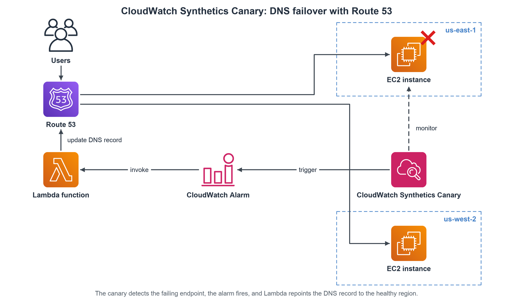
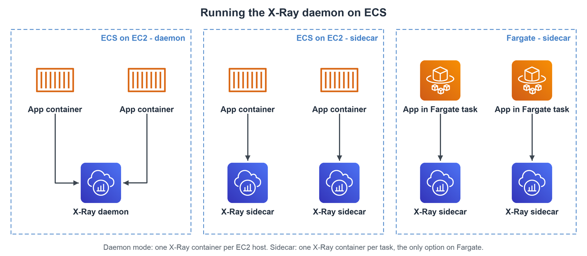

# Monitoring & Audit

## Amazon CloudWatch

### CloudWatch Metrics

- **Overview**
    - Collects and tracks metrics (variables like CPUUtilization, NetworkIn) for AWS services.
    - Metrics exist within Namespaces.
    - Dimensions are attributes of metrics (e.g., InstanceId, Environment) - up to 30 per metric.
    - Metrics have timestamps.
    - Used to create monitoring Dashboards.
    - Supports Custom Metrics (e.g., EC2 RAM pushed via CloudWatch Agent).
- **Custom Metrics**
    - Publish your own metrics (e.g., memory/RAM usage, disk space, number of logged-in users, business KPIs) with the `PutMetricData` API, or via the CloudWatch Agent.
    - Define your own **Namespace** (cannot start with `AWS/`), metric name and **Dimensions**.
    - **Standard resolution**: data points at 1-minute granularity (default).
    - **High resolution** (`StorageResolution=1`): data points down to 1, 5, 10 or 30 seconds, at a higher cost.
    - Accepts data points with timestamps up to **2 weeks in the past** and **2 hours in the future** (make sure the EC2 time is correct).
    - Default metrics from AWS services: every 5 minutes; **EC2 Detailed Monitoring**: every 1 minute (extra cost).
- **Metric Streams**
    - Stream metrics near real-time to destinations.
    - Destinations: Kinesis Data Firehose (then to S3, Redshift, OpenSearch, etc.) or 3rd-party providers (Datadog, Splunk, etc.).
    - Option to filter which metrics are streamed.
    - Flow: CloudWatch Metrics → *stream near-real time* → Kinesis Data Firehose → S3 (→ Athena) / Redshift / OpenSearch

### CloudWatch Logs

- **Overview**: Centralized log collection and monitoring service.
- **Structure**
    - **Log Groups**: Containers for log streams (e.g., representing an application).
    - **Log Streams**: Sequences of log events from a source (e.g., an EC2 instance, Lambda function, container).
- **Features**
    - **Log Retention**: Configurable expiration policies (never to 10 years).
    - **Encryption**: Default encryption at rest, option for KMS CMK.
    - **Log Sources**: SDK, CloudWatch Logs Agent, Unified Agent, Elastic Beanstalk, ECS, Lambda, VPC Flow Logs, API Gateway, CloudTrail, Route53 DNS queries.
    - **Destinations/Integrations**: Amazon S3 (exports), Kinesis Data Streams, Kinesis Data Firehose, AWS Lambda, OpenSearch Service.
- **Logs Insights**
    - Query language to search and analyze log data across log groups.
    - Auto-discovers fields from JSON logs/AWS service logs.
    - Supports filtering, aggregations, sorting, saved queries, dashboard integration. Query across accounts. (Note: Not a real-time engine).
- **Live Tail**
    - Watch log events in near real time as they are ingested, in the console or via the CLI (`aws logs start-live-tail`).
    - Select one or more log groups and filter or highlight events by term.
    - Only shows events that arrive while the session is running; use Logs Insights to search past logs.
    - Useful for debugging (e.g., watching Lambda logs while testing); billed per session minute after a monthly free allowance.
- **S3 Export**
    - Batch export logs to S3 (`CreateExportTask` API).
    - Can take up to 12 hours; not near-real-time.
- **Logs Subscriptions**
    - Stream log events in near real-time.
    - Destinations: Kinesis Data Streams, Kinesis Data Firehose, Lambda.
    - Uses Subscription Filters to select logs.
    - Supports Cross-Account subscriptions (requires IAM Role & destination policy).
    - Flow: CloudWatch Logs → Subscription Filter → Lambda (real-time → OpenSearch) / Kinesis Data Firehose (near real-time → OpenSearch, S3) / Kinesis Data Streams (→ KDF, KDA, EC2, Lambda)
- **Log Aggregation**
    - Use cross-account subscriptions to send logs from multiple accounts/regions to a central destination (e.g., central S3 bucket via Firehose).
    - Flow: Accounts A/B/C (regions 1/2/3) CloudWatch Logs → Subscription Filters → Kinesis Data Streams → Kinesis Data Firehose → *near real-time* → S3

### CloudWatch Agent

- **Why an agent**
    - By default, **no logs** from your EC2 instance go to CloudWatch.
    - Run a CloudWatch agent on the EC2 instance (or on-premises server) to push the log files you want.
    - Make sure the **IAM permissions** are correct (e.g., an instance role that allows writing to CloudWatch).
    - Flow: EC2 instance (agent) / On-premises server (agent) → CloudWatch Logs
- **CloudWatch Logs Agent (Legacy)**
    - Old version of the agent.
    - Can only send to CloudWatch Logs.
- **CloudWatch Unified Agent (Current)**
    - For virtual servers (EC2 instances, on-premises servers).
    - Collects additional system-level metrics (RAM, processes, etc.) *in addition* to logs, and sends logs to CloudWatch Logs.
    - Centralized configuration via SSM Parameter Store.
    - **Metrics** (collected directly on the Linux server / EC2 instance)
        - **CPU**: active, guest, idle, system, user, steal.
        - **Disk**: free, used, total; **Disk IO**: writes, reads, bytes, IOPS.
        - **RAM**: free, inactive, used, total, cached.
        - **Netstat**: number of TCP and UDP connections, net packets, bytes.
        - **Processes**: total, dead, blocked, idle, running, sleep.
        - **Swap Space**: free, used, used %.
    - Reminder: out-of-the-box EC2 metrics are only high level (disk, CPU, network); RAM and processes need the agent.

### CloudWatch Alarms

- **Overview**: Trigger actions based on metric thresholds or log metric filters.
- **States**: OK, ALARM, INSUFFICIENT_DATA.
- **Evaluation Period**: Configurable time window for checking the metric. Supports high-resolution (10s, 30s) for custom metrics.
- **Targets/Actions**
    - **EC2 Actions**: Stop, Terminate, Reboot, Recover instance.
    - **Auto Scaling Actions**: Trigger scaling policies.
    - **SNS Notifications**: Send alerts to an SNS topic (for email, SMS, Lambda triggers, etc.).
- **Composite Alarms**
    - Combine the states of multiple alarms using AND/OR logic to reduce alarm noise.
    - Example: CW Alarm A (monitor CPU) + CW Alarm B (monitor IOPS) on an EC2 instance → composite alarm → trigger SNS
- **EC2 Instance Recovery**
    - Trigger automatic recovery based on System Status Check failures.
    - Flow: CloudWatch Alarm (`StatusCheckFailed_System`) monitors EC2 instance → EC2 Instance Recovery; alert → SNS Topic

### CloudWatch Monitoring Insights

- **Container Insights**: Collects, aggregates, summarizes metrics and logs from container platforms (ECS, EKS, Kubernetes on EC2, Fargate).
- **Lambda Insights**: Provides detailed metrics and diagnostics (e.g., cold starts, memory usage) for Lambda functions via a Lambda Layer.
- **Contributor Insights**: Analyzes log data to identify top contributors (Top-N talkers) impacting performance (e.g., high-traffic IPs, error-prone URLs).
- **Application Insights**: Provides automated dashboards and problem detection for specific application stacks on EC2 (e.g., .NET, SQL Server, Java) and related AWS resources. Integrates with SSM OpsCenter and EventBridge.

### CloudWatch Synthetics Canary

- **Overview**
    - Configurable script that monitors your APIs, URLs, websites, etc.
    - Reproduces what your customers do programmatically, to find issues **before** customers are impacted.
    - Checks the availability and latency of your endpoints; can store load time data and screenshots of the UI.
    - Integration with CloudWatch Alarms.
    - Scripts written in Node.js or Python.
    - Programmatic access to a headless Google Chrome browser.
    - Can run once or on a regular schedule.
- **Use Case: DNS failover**
    - Canary monitors the endpoint (e.g., EC2 in us-east-1); when it fails, the canary triggers a CloudWatch Alarm, which invokes a Lambda function that updates the Route 53 DNS record to point to the endpoint in another region (e.g., us-west-2).
    - Flow: Users → Route 53 → EC2 (us-east-1) / EC2 (us-west-2); CloudWatch Synthetics Canary → *monitor* → EC2 (us-east-1); Canary → *trigger* → CloudWatch Alarm → *invoke* → Lambda Function → *update DNS record* → Route 53
    - 
- **Blueprints**
    - **Heartbeat Monitor**: load a URL, store a screenshot and an HTTP archive file.
    - **API Canary**: test basic read and write functions of REST APIs.
    - **Broken Link Checker**: check all links inside the URL that you are testing.
    - **Visual Monitoring**: compare a screenshot taken during a canary run with a baseline screenshot.
    - **Canary Recorder**: used with CloudWatch Synthetics Recorder (records your actions on a website and automatically generates a script for that).
    - **GUI Workflow Builder**: verifies that actions can be taken on your webpage (e.g., test a webpage with a login form).

## Amazon EventBridge (formerly CloudWatch Events)

### Overview

- Serverless event bus service for integrating applications using events.

### Core Concepts

- **Event Sources**: AWS Services, Custom Applications, SaaS Partners (via Partner Event Buses).
- **Event Buses**: Default (AWS events), Partner, Custom. Supports cross-account access via resource policies.
- **Rules**: Match incoming events based on patterns (filtering) and route them to targets.
- **Targets**: Services to invoke upon matching event (Lambda, SQS, SNS, Step Functions, Kinesis, ECS, EC2 actions, etc.).
- Example sources: EC2 instance (start instance), CodeBuild (build failed), S3 event (upload object), Trusted Advisor (new finding), CloudTrail (any API call), schedule or cron (every 4 hours)
- Example destinations: Compute (Lambda, AWS Batch, ECS Task), Integration (SQS, SNS, Kinesis Data Streams), Orchestration (Step Functions, CodePipeline, CodeBuild), Maintenance (Systems Manager, EC2 Actions)

### Use Cases

- **Scheduling**: Run scheduled tasks (Cron jobs).
    - Event (time-based), e.g. schedule every hour → Lambda
- **Event-Driven Architecture**: React to events from AWS services (e.g., S3 PUT, EC2 state change, CloudTrail API call) or custom applications.
    - Event (event-based), e.g. IAM root user sign-in event → SNS topic (email)

### Features

- **Schema Registry**: Discovers and registers event schemas, allows downloading code bindings.
- **Archive & Replay**: Archive events from a bus to S3, replay them later for testing or recovery.
- **Resource-based Policies**: Control cross-account/region access to event buses.

## AWS X-Ray

### Why X-Ray

- **Pain without it**
    - Debugging production = reproduce locally, add logs everywhere, redeploy.
    - Each service logs in its own format → hard to correlate in CloudWatch.
    - Monolith: one place to look. Microservices: a request crosses many services.
    - Nobody sees the whole architecture in one picture.
- **X-Ray** = distributed tracing + a visual **service map** (trace map) of your app.
- **What it answers**
    - Where is the bottleneck / are we meeting the latency SLA?
    - Which service depends on which?
    - Which service fails, with which errors and exceptions?
    - Where are we being throttled?
    - Which users are affected?
- Visual, so non-developers can help troubleshoot too.
- **Hands-on lab**: [X-Ray Lab: Trace the Scorekeep App on ECS](https://nshoa.github.io/aws-learning/labs/xray/01_scorekeep_tracing/)

### Core Concepts

- **Trace**: one request followed end to end; all its segments together.
- **Segment**: what one service reports about its part of the request.
- **Subsegment**: finer detail inside a segment (an AWS SDK call, HTTP call, SQL query).
- **Annotations**: key-value pairs, **indexed** → search and filter traces with them.
- **Metadata**: key-value pairs, **not indexed** → extra context only, not searchable.
- **Sampling**: trace only part of the requests → less overhead and cost.
- **Service map**: computed from all segments; nodes = services, edges = calls.
- **Security**: IAM controls access; data encrypted at rest with KMS.
- **Cross-account**: the daemon can assume a role to send traces to one central tracing account.

### How It Works

- 
- **1. SDK in the code** (Java, Python, Go, Node.js, .NET)
    - Mostly configuration, little code change.
    - Captures automatically: AWS SDK calls, HTTP/HTTPS calls, database calls (MySQL, PostgreSQL, DynamoDB), SQS calls.
    - Customize what is sent with interceptors, filters, handlers or middleware (e.g. Express: open a segment before routes, close it after).
- **2. Daemon or built-in integration**
    - Daemon = small process listening for UDP segments, runs on Linux, Windows and macOS.
    - Lambda and other AWS services run it for you.
- **3. IAM permission** to write to X-Ray for whoever runs the daemon.

### Enable It By Platform

- **EC2 / on-premises**: install and run the daemon + instance role with X-Ray write access.
- **Lambda**: turn on **Active Tracing** + execution role with `AWSXrayWriteOnlyAccess` + SDK in the code.
- **Elastic Beanstalk**
    - Daemon is included in the platform; switch it on in the console or in `.ebextensions/xray-daemon.config` (`aws:elasticbeanstalk:xray` → `XRayEnabled: true`).
    - Instance profile needs X-Ray write permissions; code still needs the SDK.
    - Not provided for the multicontainer Docker platform.
- **ECS**
    - 
    - **Daemon mode** (EC2 launch type): one X-Ray container per host, shared by all tasks.
    - **Sidecar** (EC2 or Fargate): one X-Ray container next to each app container; the only option on Fargate.
- Also integrates with **ELB** and **API Gateway**.

### Sampling Rules

- Control how much is recorded; change rules in the console **without code changes**.
- **Default**: first request each second (**reservoir** = 1/s) + **5%** of the rest (**rate**).
    - Reservoir guarantees at least one trace per second while traffic flows.
- **Custom rules**: priority, reservoir, rate + match on service name/type, host, HTTP method, URL path, resource ARN.
    - Raise the floor for important calls, e.g. a higher reservoir and rate for all `POST`.
    - Temporary debug rule: top priority, reservoir 1, rate 1 (100%) for one problematic route.

### APIs & IAM

- **Write APIs** (used by the daemon) → managed policy `AWSXrayWriteOnlyAccess`
    - `PutTraceSegments`: upload segment documents.
    - `PutTelemetryRecords`: daemon health (segments received/rejected, backend connection errors).
    - `GetSamplingRules`: learn what to sample.
    - `GetSamplingTargets`, `GetSamplingStatisticSummaries`: advanced sampling.
- **Read APIs** (console, tools)
    - `GetServiceGraph`: the main service map.
    - `GetTraceSummaries` → trace IDs + annotations for a time range (with filter) → `BatchGetTraces` → full traces.
    - `GetTraceGraph`: service map of specific trace IDs.
    - Also `GetGroups` / `GetGroup`, `GetTimeSeriesServiceStatistics` and the sampling reads.

### Troubleshooting

- **No traces from EC2**: check the instance role permissions and that the daemon is running.
- **No traces from Lambda**: execution role has `AWSXrayWriteOnlyAccess`, SDK imported, Active Tracing on.

## AWS CloudTrail

### Overview

- Logs API calls made within an AWS account for governance, compliance, operational auditing, and risk auditing. Enabled by default.
- Flow: SDK / CLI / Console / IAM users & roles → CloudTrail console (inspect & audit) → CloudWatch Logs / S3 bucket

### Key Features

- **Event History**: Records actions taken by users, roles, or AWS services via Console, SDK, CLI. Stored for 90 days.
- **Trails**: Configurations that enable delivery of CloudTrail events to S3 and optionally CloudWatch Logs for long-term storage and analysis. Can be multi-region (default) or single-region.
- **Event Types**
    - **Management Events**: Operations on resources (e.g., `CreateSubnet`, `AttachRolePolicy`). Logged by default. Can separate Read/Write.
    - **Data Events**: High-volume resource operations (e.g., S3 `GetObject`, Lambda `Invoke`). *Not* logged by default.
- **CloudTrail Insights**
    - Uses ML to detect unusual API activity patterns (e.g., spikes in provisioning, IAM actions) based on normal baselines. Analyzes management `write` events. Generates Insights events sent to S3/EventBridge.
    - Flow: Management events → *continuous analysis* → CloudTrail Insights → *generate* → Insight events → CloudTrail console / S3 bucket / EventBridge event
- **Log File Integrity Validation**: Ensures logs haven't been tampered with.
- **EventBridge Integration**
    - CloudTrail events can trigger EventBridge rules for real-time alerting or automation (e.g., notify on `DeleteTable` API call).
    - Flow: User → `DeleteTable` API call → DynamoDB → log API call → CloudTrail → event → EventBridge → alert → SNS

### Use Cases

- Security analysis, resource change tracking, troubleshooting operational issues, compliance verification. Finding "who terminated an EC2 instance".

## AWS Config

### Overview

- Assesses, audits, and evaluates the configurations of AWS resources. Tracks configuration changes over time. Primarily for compliance and configuration history.

### Key Features

- **Configuration Recorder**: Records configuration details of supported resources.
- **Configuration History**: View timeline of configuration changes for resources.
- **Compliance Evaluation (Config Rules)**
    - Evaluate resource configurations against desired policies.
    - Use AWS Managed Rules or create Custom Rules (Lambda).
    - Triggered by configuration changes or scheduled.
    - Does **not** prevent non-compliant actions, only reports them.
- **Remediation Actions**: Automatically remediate non-compliant resources using SSM Automation documents.
- **Notifications**: Send configuration changes or compliance status changes via SNS/EventBridge.
- **Multi-Account Multi-Region Aggregation**: Centralize Config data and compliance status.
- **Resource Relationship View**: Explore how resources are related.

### Use Cases

- Compliance auditing (e.g., "Is SSH unrestricted?", "Are S3 buckets public?"), tracking configuration drift, security analysis, operational troubleshooting.

## Comparison: CloudWatch vs. X-Ray vs. CloudTrail vs. Config

- **CloudWatch**: Focuses on **performance & operation** (Metrics, Logs, Events, Alarms).
- **X-Ray**: Focuses on **request tracing** across microservices (Where is the latency or error?).
- **CloudTrail**: Focuses on **API activity** (Who did what, when?). Audit trail.
- **Config**: Focuses on **resource configuration & compliance** (What did my resource look like? Is it compliant?). Tracks changes over time.
