# Serverless Architecture

## Serverless Overview

### Concept

- Paradigm where developers don't manage servers.
- Deploy code, infrastructure scales automatically.
- Pay-per-use model.
- Includes Function-as-a-Service (FaaS) like Lambda, but also managed services (databases, messaging, storage, etc.).
- Servers still exist, but are abstracted away from the user.

### Key AWS Serverless Services

- AWS Lambda
- Amazon DynamoDB
- Amazon API Gateway
- Amazon S3
- Amazon Cognito
- Amazon SNS & SQS
- AWS Step Functions
- AWS Fargate
- Aurora Serverless
- Kinesis Data Firehose
- Example: Users → static content (S3), REST API (API Gateway → Lambda → DynamoDB), login (Cognito)

## AWS Lambda

### Definition

- Virtual functions, compute service without provisioning/managing servers. Executes code on-demand, scales automatically.

### Lambda vs. EC2

- No server management, time-limited execution, automated scaling (vs. continuous running, RAM/CPU limits, manual scaling for EC2).

### Benefits

- **Easy Pricing**: Pay per request and compute time (GB-seconds), generous free tier.
- **Integrations**: Works with numerous AWS services.
- **Language Support**: Node.js, Python, Java, C#, Ruby, Go, PowerShell, Custom Runtime API.
- **Resource Scaling**: Memory configurable (128MB - 10GB), increasing RAM improves CPU/network.
- **Container Image Support**: Deploy functions packaged as container images (must implement Lambda Runtime API).

### Core Concepts

- **Integrations**: Triggered by or interacts with API Gateway, Kinesis, DynamoDB, S3, CloudFront, EventBridge, CloudWatch Logs, SNS, SQS, Cognito, etc..
- **Pricing**: Per call ($0.2/M after free tier) and per duration (GB-seconds, free tier).
- **Cold Starts**: Initial delay when invoking a function on a new/idle instance while code/dependencies are loaded.
    - Put SDK clients and DB connections **outside the handler**: they run once in the init phase and are reused by warm invocations.
    - Cold start `REPORT` lines show an `Init Duration`; warm starts do not.
- **Provisioned Concurrency**: Keeps function instances initialized and ready, eliminating cold starts for predictable workloads. Can be managed by Application Auto Scaling.
- **Lambda SnapStart**: Reduces cold start latency (up to 10x) for Java/Python/.NET by caching a snapshot of the initialized execution environment.
    - SnapStart enabled: function is pre-initialized → Invoke → Shutdown
    - SnapStart disabled: Init → Invoke → Shutdown
- **Limits (Per Region)**
    - Execution Time: Max 900 seconds (15 minutes). Default timeout 3 seconds.
    - Memory: 128MB - 10GB.
    - Concurrency: 1000 concurrent executions default (soft limit).
    - Deployment Size: 50MB (zipped), 250MB (unzipped).
    - Temp Storage (`/tmp`): 512MB - 10GB.
    - Environment Variables: 4KB.
- **Concurrency & Throttling**
    - Limit applies across all functions in the account/region.
    - Reserved Concurrency: Dedicate a portion of the account limit to a specific function.
    - Throttling
        - Occurs when concurrency limit is exceeded. Sync calls get `ThrottleError (429)`
        - Async calls are retried (up to 6 hrs) then sent to Dead-Letter Queue (DLQ) if configured.
- **Hands-on lab**: [Lambda Lab: Timeout and Initialization Outside the Handler](https://nshoa.github.io/aws-learning/labs/lambda/06_lambda_performance/)

### Layers

- **Definition**: A zip archive of libraries, a custom runtime or other dependencies, shared across functions.
- Extracted to `/opt` in the execution environment; Python imports from `/opt/python`.
- Up to **5 layers** per function; function + layers must stay under **250 MB unzipped**.
- Keeps the deployment package small; AWS publishes managed layers such as **AWS SDK for pandas**.
- **Hands-on lab**: [Lambda Lab: Add a Library with a Layer](https://nshoa.github.io/aws-learning/labs/lambda/07_lambda_layers/)

### Destinations

- Send the **result** of an **asynchronous** invocation to another service: **on success** and/or **on failure**.
- Targets: SQS, SNS, Lambda, EventBridge event bus.
- On failure: the record is sent after the retries are used up (default **2 retries**, 3 attempts).
- The record holds the original event (`requestPayload`), the result or error (`responsePayload`) and the `condition` (`Success`, `RetriesExhausted`).
- Recommended over a Lambda DLQ, which only gets the failed event, without the error.
- **Hands-on lab**: [Lambda Lab: Destinations for Asynchronous Invocations](https://nshoa.github.io/aws-learning/labs/lambda/05_lambda_destinations/)

### Event Source Mapping

- 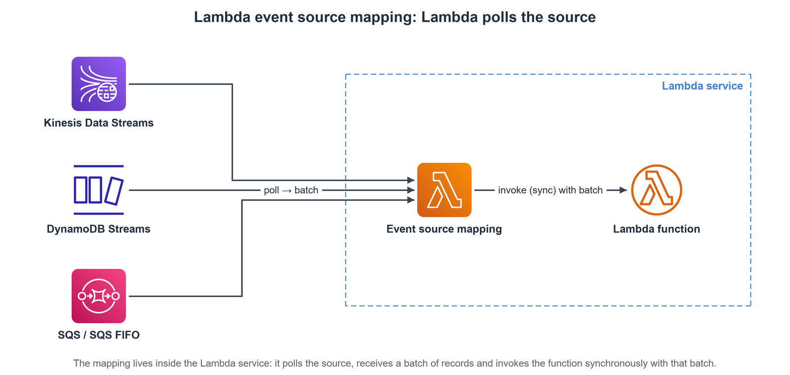
- **What it is**
    - A poller run by Lambda for sources that do not push events: **Kinesis Data Streams**, **DynamoDB Streams**, **SQS** and **SQS FIFO**.
    - Lambda reads records in **batches** and invokes the function **synchronously** with each batch.
    - Compare: S3, SNS and EventBridge push events to Lambda (asynchronous invocation).
- **Streams (Kinesis, DynamoDB Streams)**
    - 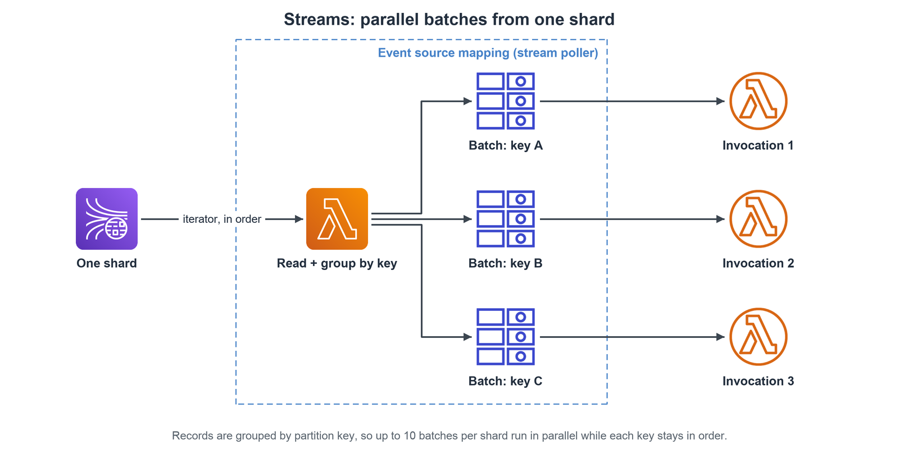
    - One iterator per shard; records are processed in order within the shard.
    - Starting position: only new records, from the beginning of the stream, or from a timestamp.
    - Records stay in the stream after processing, so other consumers can still read them.
    - Low traffic: a **batch window** waits to collect more records before invoking.
    - **Parallelization**: up to **10 batches per shard** at the same time; order is still kept per partition key.
    - **Errors**
        - Default: a failing batch is retried as a whole until it succeeds or its records expire.
        - The shard waits meanwhile, to keep the order.
        - Tune it: discard records older than a max age, cap the retries, or **split the batch on error** (helps with timeouts).
        - Send discarded records to an **on-failure destination**.
- **Queues (SQS, SQS FIFO)**
    - The mapping uses **long polling**; batch size 1-10 messages (standard queues can go higher with a batch window).
    - Set the queue **visibility timeout to 6x the function timeout**.
    - Success → Lambda **deletes** the messages; error → the messages go back to the queue one by one and may be retried in different batches.
    - A message can be delivered twice even without an error → make the processing idempotent.
    - Standard queue: no ordering; FIFO queue: in order within each message group.
    - **DLQ**: set it on the **SQS queue**, not on Lambda (a Lambda DLQ only works for async invocations), or use an on-failure destination.
- **Hands-on lab**: [Lambda Lab: Event Source Mapping with an SQS Queue](https://nshoa.github.io/aws-learning/labs/lambda/04_lambda_event_source_mapping_sqs/)
- **Scaling**
    - Streams: one invocation per shard at a time, up to 10 per shard with parallelization.
    - SQS standard: scales out as fast as possible; course figures are +60 instances per minute and up to 1,000 batches at once (check the AWS docs for the current limits).
    - SQS FIFO: scales up to the number of active message groups; messages with the same group ID are processed in order.

### Versions & Aliases

- 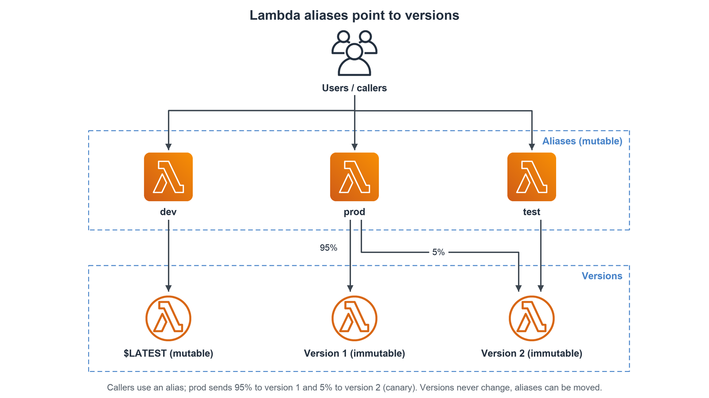
- **Versions**
    - You always edit **`$LATEST`** (the only mutable version).
    - **Publish** → a new numbered version (1, 2, 3, …), a frozen snapshot of code + configuration (**immutable**).
    - Each version has its own ARN (`...:function:my-fn:2`) and can be invoked directly.
- **Aliases**
    - Named **pointers** to a version, e.g. `dev`, `test`, `prod`; each has its own ARN (`...:function:my-fn:prod`).
    - **Mutable**: move the alias to release or roll back; callers keep the same name.
    - Give triggers and destinations a stable target: point them at the alias, not at a version number.
    - An alias cannot point to another alias.
    - **Weighted alias** = canary: split traffic between two published versions (e.g. 95% v1 / 5% v2).
- **Hands-on lab**: [Lambda Lab: Versions and Aliases with a Weighted Canary](https://nshoa.github.io/aws-learning/labs/lambda/06_lambda_versions_and_aliases/)

### Function URL

- **Definition**: A dedicated HTTPS endpoint for one function: `https://<url-id>.lambda-url.<region>.on.aws`.
- Points to `$LATEST` or an **alias**, never to a numbered version.
- **Auth type**
    - `NONE`: public; the resource-based policy must still allow `*` to invoke the function.
    - `AWS_IAM`: callers sign requests with SigV4.
    - New URLs need both `lambda:InvokeFunctionUrl` and `lambda:InvokeFunction`.
- Supports CORS and response streaming; no usage plans, API keys or caching (use API Gateway for those).
- **Hands-on lab**: [Lambda Lab: Call a Function with a Function URL](https://nshoa.github.io/aws-learning/labs/lambda/08_lambda_function_url/)

### Networking

- **Default**: Runs outside your VPC, can access public internet/AWS APIs. Cannot access private VPC resources.
- **Lambda in VPC**: To access private resources (RDS, ElastiCache), deploy Lambda into specific VPC subnets with security groups. Creates Elastic Network Interfaces (ENIs) in your subnets. Needs NAT Gateway/VPC Endpoint for internet access from VPC.
- **RDS Proxy**: Recommended when Lambda connects to RDS. Pools/shares DB connections, improves scalability, availability (faster failover), security (IAM Auth, Secrets Manager). Requires Lambda in VPC.

### Database Interactions

- **Invoking Lambda from RDS**: Trigger Lambda functions from within RDS for PostgreSQL or Aurora MySQL (e.g., on data changes). Requires DB instance outbound network access and permissions.
    - Example: user registers (insert) → RDS → invoke Lambda → send mail via Amazon SES
- **RDS Event Notifications**: Get notified about DB **instance** events (create, stop, failover etc.) via SNS or EventBridge. Does not notify on data changes.

## Amazon DynamoDB

### Definition

- Fully managed, highly available NoSQL key-value and document database. Serverless, multi-AZ replication, scalable, fast/consistent performance (ms latency).
- **Not relational**: no joins; you design the table around how the data is read.
- **Massive scale**: distributed database for millions of requests per second, trillions of items and hundreds of TB.
- **Security**: IAM controls access, authorization and administration (no DB users or passwords).
- **Event driven**: DynamoDB Streams lets changes trigger processing (e.g. Lambda).
- **Cost**: low cost with auto scaling; two **table classes**: **Standard** and **Standard-Infrequent Access (IA)** for rarely read data (cheaper storage, higher read/write cost).

### Core Concepts

- **Tables**: Collections of Items; a table can hold an unlimited number of items.
- **Items**: Rows/records in a table. Max size **400 KB**.
- **Attributes**: Columns/fields within an item; new ones can be added at any time and an item may not have them (null).
- **Data types**
    - **Scalar**: String, Number, Binary, Boolean, Null.
    - **Document**: List, Map.
    - **Set**: String Set, Number Set, Binary Set.
- **Primary Key**: Uniquely identifies items; chosen when the table is created.
    - 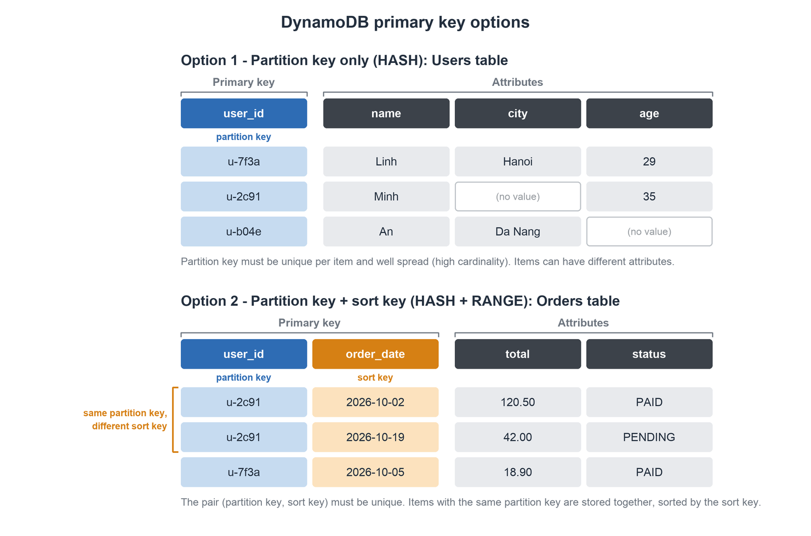
    - **Option 1 - Partition key (HASH)**
        - Must be unique for each item.
        - Must be "diverse" (many distinct values) so data spreads across partitions.
        - Example: `user_id` for a users table.
    - **Option 2 - Partition key + Sort key (HASH + RANGE)**
        - The **combination** must be unique; many items can share a partition key.
        - Items are grouped by partition key and ordered by sort key.
        - Example: `user_id` + `order_date` for an orders table (one user, many orders).

### Read/Write Capacity

- **Capacity modes**: how the table's read/write throughput is managed; you can switch between them (course: once every 24 hours).
    - **Provisioned**
        - You set reads/writes per second up front: **RCU** (reads) and **WCU** (writes); you pay for what you provision.
        - Needs capacity planning; optional **auto scaling** adjusts RCU/WCU to demand. Fits predictable traffic.
        - Short spikes above the limit use **burst capacity**; once it is used up → `ProvisionedThroughputExceededException` → retry with **exponential backoff**.
    - **On-Demand (default)**
        - Scales up and down with the traffic; no RCU/WCU planning, effectively no throttling.
        - Billed per request: **RRU** (read request units, same size rules as RCU) and **WRU** (write request units, same as WCU).
        - Costs more per request (course: about 2.5x provisioned). Fits unknown or spiky traffic.
- **WCU (write capacity unit)**
    - 1 WCU = **1 write per second** for an item up to **1 KB**; item size is rounded **up** to the next KB.
    - Formula: writes per second × ceil(item size in KB).
    - e.g. 8 writes/s of 3 KB → 8 × 3 = **24 WCU**.
    - e.g. 5 writes/s of 2.3 KB → rounded to 3 KB → **15 WCU**.
    - e.g. 300 writes/min of 1 KB → 5 writes/s → **5 WCU**.
- **Read consistency**
    - 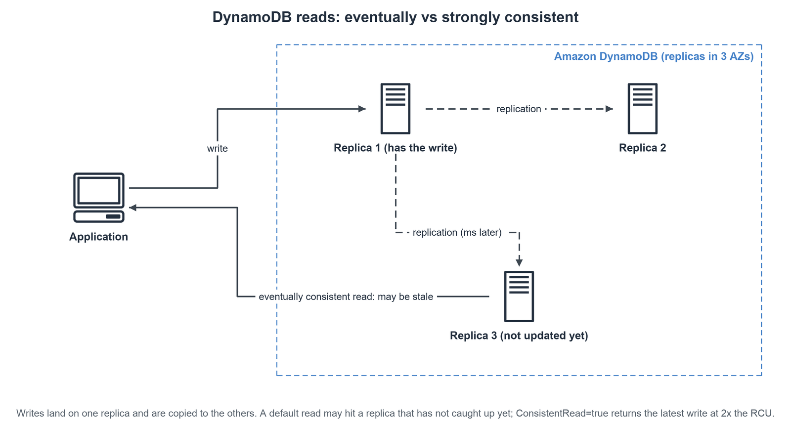
    - **Eventually consistent (default)**: a read right after a write may return old data while replicas catch up.
    - **Strongly consistent**: always returns the latest write; set `ConsistentRead=true` on `GetItem`, `BatchGetItem`, `Query`, `Scan`; costs **2x** the RCU.
- **RCU (read capacity unit)**
    - 1 RCU = **1 strongly consistent read** or **2 eventually consistent reads** per second for an item up to **4 KB**; size is rounded **up** to a multiple of 4 KB.
    - Formula: reads per second × ceil(size / 4 KB), then ÷ 2 if eventually consistent.
    - e.g. 20 strong reads/s of 4 KB → **20 RCU**.
    - e.g. 20 eventual reads/s of 8 KB → 20 × 2 ÷ 2 = **20 RCU**.
    - e.g. 6 strong reads/s of 5 KB → rounded to 8 KB → 6 × 2 = **12 RCU**.
- **Partitions (internal)**
    - 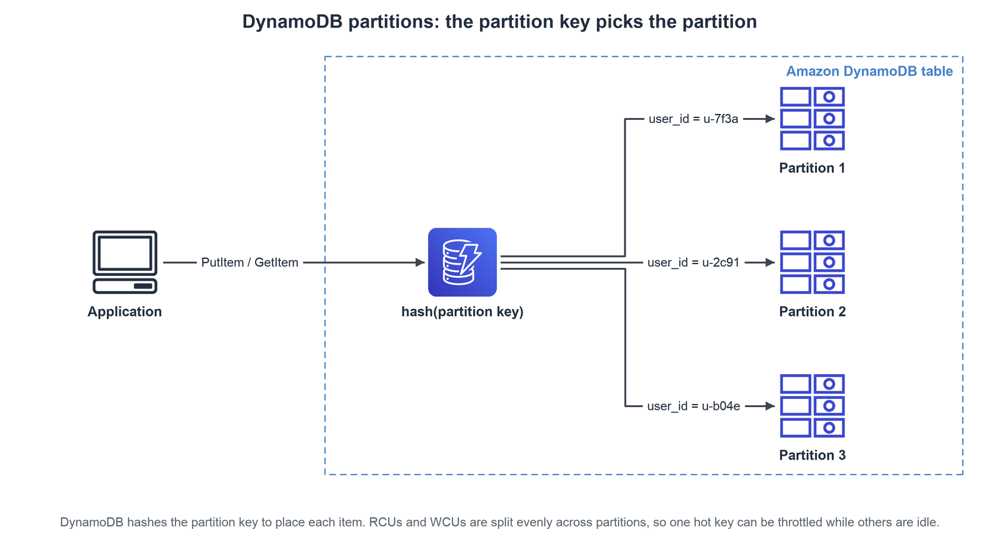
    - Data lives in partitions; a **hash of the partition key** decides which one.
    - Course formula for the number of partitions:
        - By capacity = RCU / 3000 + WCU / 1000.
        - By size = total size / 10 GB.
        - Partitions = ceil(max(by capacity, by size)); e.g. 6000 RCU, 2000 WCU, 25 GB → max(4, 2.5) → **4**.
    - RCU and WCU are **spread evenly** across partitions.
- **Throttling**
    - Exceeding RCU/WCU → `ProvisionedThroughputExceededException`.
    - Causes: **hot key** (one popular partition key), **hot partition**, **very large items** (cost more units).
    - Fixes: **exponential backoff** (built into the SDKs), spread partition keys, **DAX** for read-heavy hot items.

### Data Operations (APIs)

- **Write**
    - `PutItem`: create an item, or **replace the whole item** with the same primary key; consumes WCU.
    - `UpdateItem`: change only some attributes (creates the item if missing).
        - **Atomic counter**: increment a number in place, e.g. `SET views = views + 1`, no read needed.
    - **Conditional writes**: put/update/delete only if a condition holds (e.g. `attribute_not_exists(user_id)`), else an error.
        - Protects items from concurrent writers; no performance cost.
        - **Optimistic locking**: a strategy built on conditional writes so an item is not overwritten by someone who read an older copy.
            - 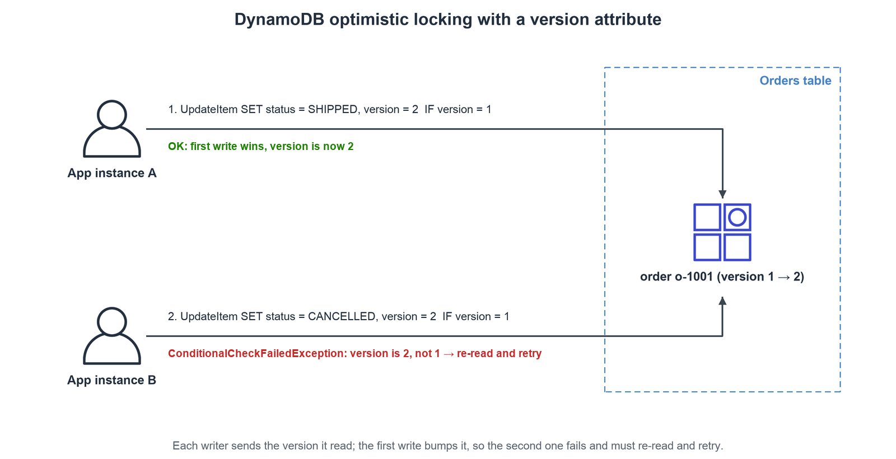
            - Each item carries a **version number** attribute.
            - Update/delete with `IF version = <the version you read>` and increment the version in the same write.
            - If another writer got there first → `ConditionalCheckFailedException` → re-read the item and retry.
- **Read**
    - `GetItem`: one item by its full primary key (partition key, plus sort key if the table has one).
        - Eventually consistent by default; strongly consistent costs more RCU and can be slower.
        - `ProjectionExpression`: return only the attributes you need.
    - 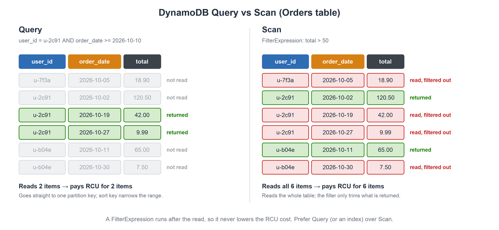
    - `Query`: items of **one partition key**.
        - `KeyConditionExpression`: partition key with `=` (required); sort key with `=`, `<`, `<=`, `>`, `>=`, `BETWEEN`, `begins_with` (optional).
        - `FilterExpression`: extra filter on **non-key** attributes, applied after the read and before the result is returned.
        - Returns up to `Limit` items or **1 MB**, then paginate; works on the table, an LSI or a GSI.
    - `Scan`: reads the **entire table**, then filters → slow and RCU-hungry.
        - Up to 1 MB per call, paginate to continue; reduce impact with `Limit` or smaller pages and pauses.
        - **Parallel scan**: several workers scan segments at once → faster but uses even more RCU.
        - `ProjectionExpression` and `FilterExpression` only shrink the response, not the RCU.
- **Delete**
    - `DeleteItem`: one item, optionally conditional.
    - `DeleteTable`: drops the table and all items, much faster than deleting items one by one.
- **Batch operations**: fewer API calls → lower latency; work runs in parallel; part of a batch can fail → retry the rest.
    - `BatchWriteItem`
        - Up to **25** `PutItem`/`DeleteItem` per call, up to **16 MB** total, 400 KB per item.
        - No updates (use `UpdateItem`).
        - Failed writes come back in `UnprocessedItems` → retry with exponential backoff or add WCU.
    - `BatchGetItem`
        - Up to **100** items, up to **16 MB**, from one or more tables; fetched in parallel.
        - Failed reads come back in `UnprocessedKeys` → retry with backoff or add RCU.
- **PartiQL**: SQL-compatible syntax for DynamoDB.
    - `SELECT`, `INSERT`, `UPDATE`, `DELETE`; can query several tables.
    - e.g. `SELECT order_date, total FROM Orders WHERE user_id = 'u-2c91'`.
    - Run it from the console, NoSQL Workbench, the DynamoDB API, the AWS CLI or the SDKs.

### Secondary Indexes

- Query on something other than the primary key without a `Scan`; an index is a re-keyed copy of the table's items that DynamoDB keeps in sync.
- 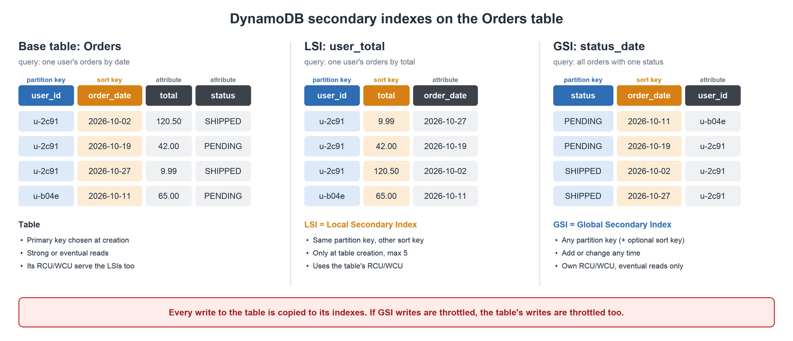
- Index keys are **scalar** attributes (String, Number or Binary).
- **Attribute projections**: which attributes are copied into the index.
    - `KEYS_ONLY`: index keys + table primary key.
    - `INCLUDE`: keys + the attributes you list.
    - `ALL`: every attribute (biggest index, no extra reads).
- **LSI (Local Secondary Index)**
    - **Same partition key** as the table, **different sort key** (e.g. a user's orders sorted by `total` instead of `order_date`).
    - Must be defined **when the table is created**; up to **5** per table.
    - Uses the table's RCU/WCU → no special throttling concerns.
    - Supports strongly consistent reads.
- **GSI (Global Secondary Index)**
    - **New primary key**: partition key, or partition + sort key, from any attributes (e.g. `status` + `order_date` to list all pending orders).
    - Speeds up queries on non-key attributes; can be **added or changed after** the table is created.
    - Has its **own RCU/WCU** to provision; reads are eventually consistent only.
    - ⚠️ **Throttling**: if writes to the GSI are throttled, writes to the **main table are throttled too**, even when the table has spare WCU → choose the GSI partition key and its WCU carefully.

### Transactions

- **All-or-nothing** writes/reads on several items, in one or more tables → **ACID** (atomicity, consistency, isolation, durability).
- 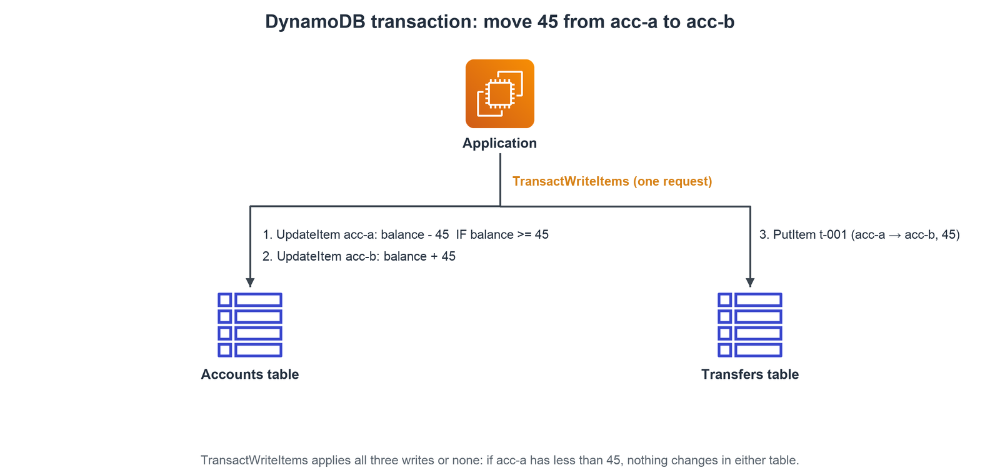
- **APIs**
    - `TransactGetItems`: one or more `GetItem`.
    - `TransactWriteItems`: one or more `PutItem`, `UpdateItem`, `DeleteItem` (each can carry a condition).
- **Modes**
    - Read: eventually consistent, strongly consistent, **transactional**.
    - Write: standard, **transactional**.
- **Cost: 2x** WCU and RCU, because DynamoDB does two steps per item (**prepare** + **commit**).
    - Transactional WCU = writes per second × ceil(item KB) × 2.
        - e.g. 4 writes/s of 3 KB → 4 × 3 × 2 = **24 WCU**.
    - Transactional RCU = reads per second × ceil(item KB / 4) × 2.
        - e.g. 10 reads/s of 6 KB → rounded to 8 KB → 10 × 2 × 2 = **40 RCU**.
- Use cases: money transfers, order processing (order + stock), multiplayer game state.

### Session State Store

- Common use: keep web/app **session state** in a DynamoDB table so every instance behind the load balancer sees the same session.
- 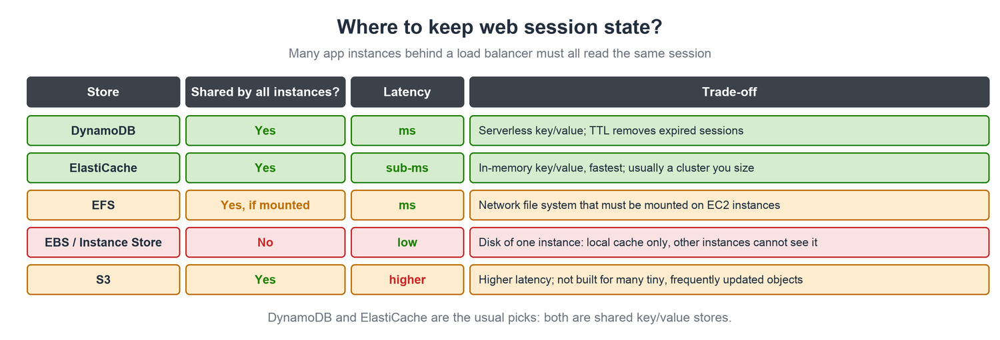
- **vs ElastiCache**: both key/value; ElastiCache is in-memory (faster), DynamoDB is serverless.
- **vs EFS**: EFS must be mounted on EC2 instances as a network drive.
- **vs EBS / Instance Store**: tied to one instance → local cache only, not shared.
- **vs S3**: higher latency, not meant for small, frequently changing objects.
- Tip: put an expiry attribute on each session and turn on **TTL** to clean up old sessions.

### Features

- **DAX (DynamoDB Accelerator)**: fully managed, highly available **in-memory cache** in front of DynamoDB.
    - 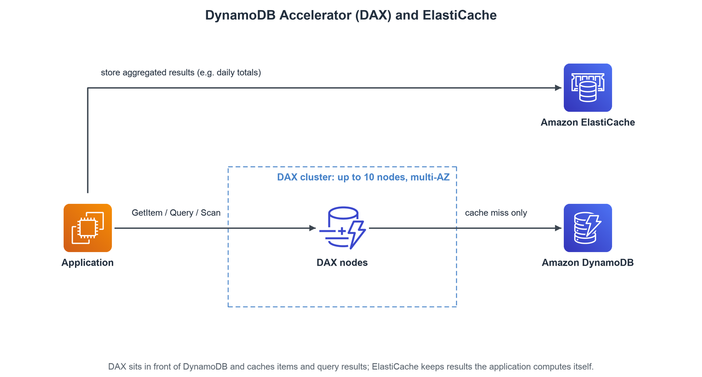
    - **Microsecond** latency for cached reads and queries.
    - Same API as DynamoDB → swap the client, no change to application logic.
    - Fixes the **hot key** problem (one item read too often) and helps avoid read throttling (`ProvisionedThroughputExceededException`).
    - Cache TTL **5 minutes** by default.
    - Cluster of up to **10 nodes**, multi-AZ (at least **3 nodes** recommended for production).
    - Secure: KMS encryption at rest, runs in your VPC, IAM, CloudTrail.
    - **DAX vs ElastiCache**: use both together.
        - DAX: caches individual items and `Query`/`Scan` results.
        - ElastiCache: stores results the app computes itself (aggregations, e.g. daily totals).
- **DynamoDB Streams**: ordered log of item-level changes (create, update, delete) in a table.
    - 
    - Records kept for **24 hours**; only changes made **after** the stream is enabled (no back-fill).
    - **Stream view type**: what each record contains.
        - 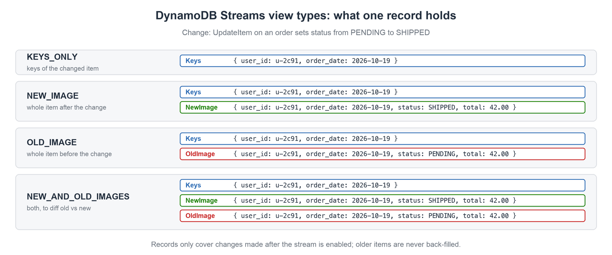
        - `KEYS_ONLY`: key attributes of the changed item.
        - `NEW_IMAGE`: whole item after the change.
        - `OLD_IMAGE`: whole item before the change.
        - `NEW_AND_OLD_IMAGES`: both.
    - Made of **shards** like Kinesis Data Streams, but AWS manages them (no shard provisioning).
    - Read by **Kinesis Client Library (KCL)** apps or **AWS Lambda**.
        - Lambda needs an **event source mapping** that polls the stream and invokes the function **synchronously** with a batch (see Lambda → Event Source Mapping).
        - The function's execution role needs permission to read the stream.
    - **Hands-on lab**: [DynamoDB Lab: Process DynamoDB Streams with Lambda](https://nshoa.github.io/aws-learning/labs/dynamodb/01_dynamodb_streams_with_lambda/)
    - Or send changes to **Kinesis Data Streams** (longer retention, more consumers, Firehose to Redshift/S3/OpenSearch).
    - Use cases
        - React in real time, e.g. welcome email when a user item is created.
        - Analytics; fill derived tables; index into OpenSearch.
        - Cross-region replication (Global Tables need Streams).
- **Global Tables**: Multi-region, active-active tables with low-latency access for globally distributed applications. Requires Streams enabled.
    - Table US-EAST-1 ⇄ two-way replication ⇄ Table US-EAST-2
- **TTL (Time To Live)**: automatically deletes items after an expiry timestamp.
    - 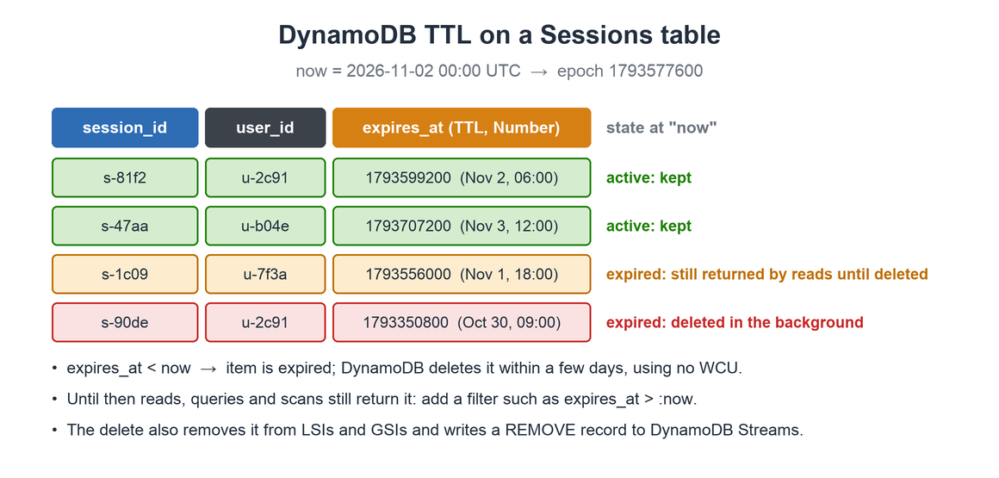
    - The TTL attribute must be a **Number** holding a **Unix epoch timestamp in seconds** (e.g. `expires_at = 1793599200`).
    - Deletes use **no WCU** → no extra cost.
    - Expired items are deleted **within a few days**, not at the exact second.
        - Until then they still show up in reads, queries and scans → filter them out (e.g. `expires_at > :now`).
    - Deleted from the table and from its **LSIs and GSIs**.
    - Each TTL delete enters **DynamoDB Streams** as a `REMOVE` record → can be used to archive or recover expired items.
    - Use cases: keep only current items (sessions, temporary data) to cut storage, meet data retention rules.
- **Backups**
    - **Point-in-Time Recovery (PITR)**: Continuous backups, restore to any second within the last 35 days. Creates a new table on restore.
    - **On-Demand Backups**: Full backups for long-term retention, manually deleted. Creates a new table on restore. Can manage via AWS Backup.
- **S3 Integration**
    - **Export to S3**: Export table data (PITR required) to S3 bucket (JSON or ION format) for analytics, auditing. Doesn't consume read capacity.
    - **Import from S3**: Load data from S3 (CSV, JSON, ION) into a **new** DynamoDB table. Doesn't consume write capacity.

## Amazon API Gateway

### Definition

- Fully managed service to create, publish, maintain, monitor, and secure APIs at scale. Acts as a "front door" for applications.
- Client → REST API → API Gateway → proxy request → Lambda → CRUD → DynamoDB

### Features

- Exposes backend services (Lambda, HTTP, other AWS services) via RESTful or WebSocket APIs.
- Handles API versioning, multiple environments (dev/test/prod).
- Security: Authentication (IAM, Cognito, Custom Authorizers), Authorization, API Keys.
- Request/Response transformation and validation.
- Throttling and usage plans.
- Response Caching.
- Generates client SDKs.

### Integrations

- **Lambda Function**: Invoke Lambda synchronously/asynchronously.
- **HTTP Proxy**: Forward requests to backend HTTP endpoints (e.g., EC2, containers, on-prem).
- **AWS Service Proxy**: Expose other AWS service actions directly (e.g., SQS SendMessage, Step Functions StartExecution).

### Endpoint Types

- **Edge-Optimized (Default)**: Routed via CloudFront edge locations for lower latency globally. API Gateway itself remains regional. Requires ACM certificate in `us-east-1` for custom domains.
- **Regional**: For clients within the same region as the API Gateway. Lower latency than Edge-Optimized if clients are regional. Requires ACM certificate in the API's region for custom domains.
- **Private**: Accessible only from within a VPC via an Interface VPC Endpoint (ENI). Uses resource policies for access control.

### Security

- **Authentication**: IAM (for internal/AWS access), Cognito User Pools (for app users), Lambda Custom Authorizers (custom logic).
- **Authorization**: IAM permissions, Resource Policies.
- **Custom Domains**: Use own domain name with HTTPS via ACM certificates.

## AWS Step Functions

- **Definition**: Serverless function orchestrator to build visual workflows.
- **Features**
    - Coordinate components (Lambda, ECS, EC2, API Gateway, SQS, on-prem, etc.).
    - Define workflows with sequences, parallel execution, conditions, error handling, timeouts.
    - Supports human approval steps.
    - State management for workflows.
- **Use Cases**
    - Order fulfillment
    - data processing pipelines
    - ETL orchestration
    - microservice coordination, any multi-step process.

## Customization at the Edge (CloudFront)

- **Concept**: Execute code closer to users at CloudFront edge locations to reduce latency and customize CDN behavior.

### Types

- **CloudFront Functions**
    - Lightweight, high-performance JavaScript functions.
    - Use Cases: Header manipulation, URL rewrites/redirects, cache key normalization, simple request validation/authorization.
    - Triggers: Viewer Request, Viewer Response.
    - Limits: <1ms execution, 2MB memory, 10KB package, no network/filesystem access.
- **Lambda@Edge**
    - More powerful Node.js/Python Lambda functions running at the edge.
    - Use Cases: Complex request/response manipulation, network calls to external services/AWS SDK, accessing request body, advanced AuthN/AuthZ.
    - Triggers: Viewer Request, Viewer Response, Origin Request, Origin Response.
    - Limits: 5-10s execution, up to 10GB memory, 1-50MB package, network/filesystem access.
    - Deployed via `us-east-1` region, replicated globally.

## Amazon Cognito

- **Definition**: Provides identity management for web and mobile applications. Handles user authentication, authorization, and user management. Scales to millions of users.
- **Cognito vs. IAM**: Use Cognito for application users (external), IAM for AWS resources/users/roles (internal).

### Components

- **Cognito User Pools (CUP)**
    - Acts as a user directory.
    - Provides sign-up/sign-in functionality (username/password, social IdPs like Facebook/Google/Apple, SAML, OpenID Connect).
    - Features: Email/phone verification, MFA, password reset.
    - Integrates with API Gateway & ALB for backend authentication.
- **Cognito Identity Pools (Federated Identities)**
    - Provides temporary AWS credentials to authenticated users.
    - Allows users to access AWS resources directly (e.g., user-specific S3 folder).
    - Identity sources can be CUP, social IdPs, SAML, etc..
    - Access controlled via IAM roles/policies assigned based on identity.

## Serverless Solution Architectures

### Mobile App (TodoList Example)

- Frontend: Mobile client.
- Authentication: Cognito User Pools (sign-in), Cognito Identity Pools (generate temp AWS creds for S3 access).
- API: API Gateway (HTTPS REST endpoint).
- Compute: Lambda functions (invoked by API Gateway).
- Database: DynamoDB (stores to-dos).
- Caching: DAX (for DynamoDB reads), API Gateway caching (for API responses).
- Storage: S3 (direct user file storage via Cognito Identity Pools).

### Serverless Website (Blog Example)

- Frontend Delivery: CloudFront (serves static content from S3, caches API responses).
- Static Content: S3 (using Origin Access Control - OAC - for security).
- API: API Gateway → Lambda → DynamoDB.
- Global Reach: CloudFront, DynamoDB Global Tables.
- Caching: CloudFront, DAX, API Gateway caching.
- Uploads: Consider S3 Transfer Acceleration via CloudFront.
- Event Handling
    - New User Email: DynamoDB Stream → Lambda → SES.
    - Image Uploads: S3 Trigger → Lambda (thumbnail generation). Optional SQS/SNS for decoupling.

### Microservices Architecture

- Design: Decompose application into smaller, independent services.
- Patterns: Mix synchronous (API Gateway, ALB) and asynchronous (SQS, Kinesis, SNS, Lambda triggers) communication.
- Benefits of Serverless: Reduced operational overhead, auto-scaling, easier environment cloning, generated SDKs (API Gateway).
- Example: Route 53 → service1 (ELB → ECS → DynamoDB), service2 (API Gateway → Lambda → ElastiCache), service3 (ELB → EC2 Auto Scaling → RDS)

### Software Update Offloading

- Problem: High load/cost on origin servers (EC2/ASG) when distributing large, static update files.
- Solution: Place CloudFront in front of the existing application (ALB/EC2).
- Benefit: CloudFront caches static files at the edge, drastically reducing requests to the origin, lowering EC2 load and network costs without application changes.
