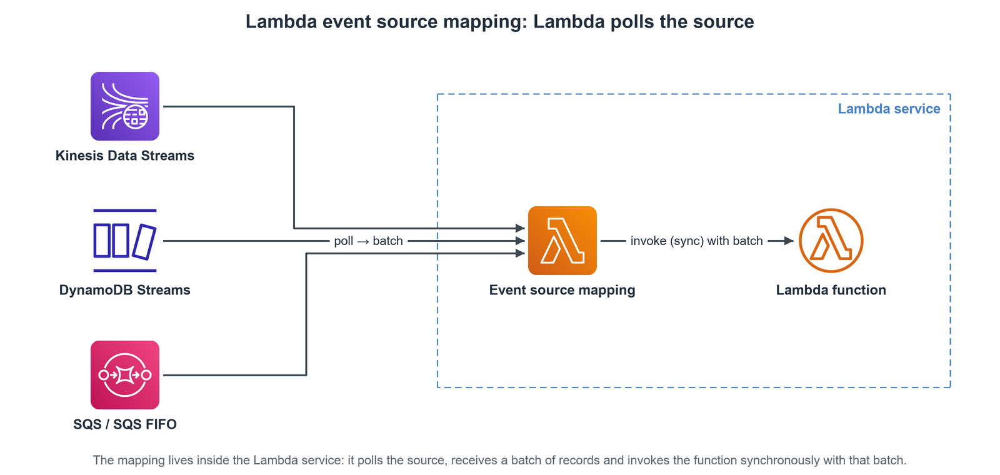
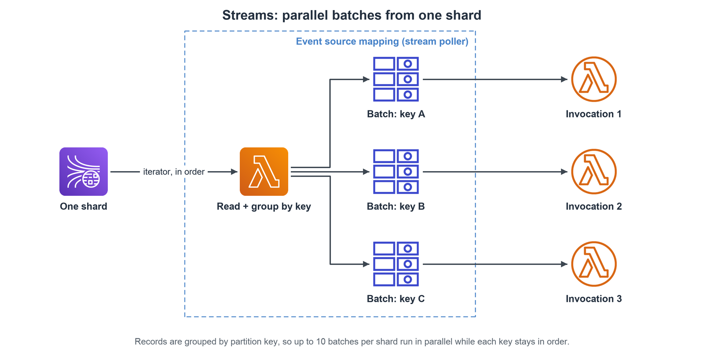

# Serverless Architecture

## Serverless Overview

### Concept

- Paradigm where developers don't manage servers.
- Deploy code, infrastructure scales automatically.
- Pay-per-use model.
- Includes Function-as-a-Service (FaaS) like Lambda, but also managed services (databases, messaging, storage, etc.).
- Servers still exist, but are abstracted away from the user.

### Key AWS Serverless Services

- AWS Lambda
- Amazon DynamoDB
- Amazon API Gateway
- Amazon S3
- Amazon Cognito
- Amazon SNS & SQS
- AWS Step Functions
- AWS Fargate
- Aurora Serverless
- Kinesis Data Firehose
- Example: Users → static content (S3), REST API (API Gateway → Lambda → DynamoDB), login (Cognito)

## AWS Lambda

### Definition

- Virtual functions, compute service without provisioning/managing servers. Executes code on-demand, scales automatically.

### Lambda vs. EC2

- No server management, time-limited execution, automated scaling (vs. continuous running, RAM/CPU limits, manual scaling for EC2).

### Benefits

- **Easy Pricing**: Pay per request and compute time (GB-seconds), generous free tier.
- **Integrations**: Works with numerous AWS services.
- **Language Support**: Node.js, Python, Java, C#, Ruby, Go, PowerShell, Custom Runtime API.
- **Resource Scaling**: Memory configurable (128MB - 10GB), increasing RAM improves CPU/network.
- **Container Image Support**: Deploy functions packaged as container images (must implement Lambda Runtime API).

### Core Concepts

- **Integrations**: Triggered by or interacts with API Gateway, Kinesis, DynamoDB, S3, CloudFront, EventBridge, CloudWatch Logs, SNS, SQS, Cognito, etc..
- **Pricing**: Per call ($0.2/M after free tier) and per duration (GB-seconds, free tier).
- **Cold Starts**: Initial delay when invoking a function on a new/idle instance while code/dependencies are loaded.
    - Put SDK clients and DB connections **outside the handler**: they run once in the init phase and are reused by warm invocations.
    - Cold start `REPORT` lines show an `Init Duration`; warm starts do not.
- **Provisioned Concurrency**: Keeps function instances initialized and ready, eliminating cold starts for predictable workloads. Can be managed by Application Auto Scaling.
- **Lambda SnapStart**: Reduces cold start latency (up to 10x) for Java/Python/.NET by caching a snapshot of the initialized execution environment.
    - SnapStart enabled: function is pre-initialized → Invoke → Shutdown
    - SnapStart disabled: Init → Invoke → Shutdown
- **Limits (Per Region)**
    - Execution Time: Max 900 seconds (15 minutes). Default timeout 3 seconds.
    - Memory: 128MB - 10GB.
    - Concurrency: 1000 concurrent executions default (soft limit).
    - Deployment Size: 50MB (zipped), 250MB (unzipped).
    - Temp Storage (`/tmp`): 512MB - 10GB.
    - Environment Variables: 4KB.
- **Concurrency & Throttling**
    - Limit applies across all functions in the account/region.
    - Reserved Concurrency: Dedicate a portion of the account limit to a specific function.
    - Throttling
        - Occurs when concurrency limit is exceeded. Sync calls get `ThrottleError (429)`
        - Async calls are retried (up to 6 hrs) then sent to Dead-Letter Queue (DLQ) if configured.
- **Hands-on lab**: [Lambda Lab: Timeout and Initialization Outside the Handler](https://nshoa.github.io/aws-learning/labs/lambda/06_lambda_performance/)

### Destinations

- Send the **result** of an **asynchronous** invocation to another service: **on success** and/or **on failure**.
- Targets: SQS, SNS, Lambda, EventBridge event bus.
- On failure: the record is sent after the retries are used up (default **2 retries**, 3 attempts).
- The record holds the original event (`requestPayload`), the result or error (`responsePayload`) and the `condition` (`Success`, `RetriesExhausted`).
- Recommended over a Lambda DLQ, which only gets the failed event, without the error.
- **Hands-on lab**: [Lambda Lab: Destinations for Asynchronous Invocations](https://nshoa.github.io/aws-learning/labs/lambda/05_lambda_destinations/)

### Event Source Mapping

- 
- **What it is**
    - A poller run by Lambda for sources that do not push events: **Kinesis Data Streams**, **DynamoDB Streams**, **SQS** and **SQS FIFO**.
    - Lambda reads records in **batches** and invokes the function **synchronously** with each batch.
    - Compare: S3, SNS and EventBridge push events to Lambda (asynchronous invocation).
- **Streams (Kinesis, DynamoDB Streams)**
    - 
    - One iterator per shard; records are processed in order within the shard.
    - Starting position: only new records, from the beginning of the stream, or from a timestamp.
    - Records stay in the stream after processing, so other consumers can still read them.
    - Low traffic: a **batch window** waits to collect more records before invoking.
    - **Parallelization**: up to **10 batches per shard** at the same time; order is still kept per partition key.
    - **Errors**
        - Default: a failing batch is retried as a whole until it succeeds or its records expire.
        - The shard waits meanwhile, to keep the order.
        - Tune it: discard records older than a max age, cap the retries, or **split the batch on error** (helps with timeouts).
        - Send discarded records to an **on-failure destination**.
- **Queues (SQS, SQS FIFO)**
    - The mapping uses **long polling**; batch size 1-10 messages (standard queues can go higher with a batch window).
    - Set the queue **visibility timeout to 6x the function timeout**.
    - Success → Lambda **deletes** the messages; error → the messages go back to the queue one by one and may be retried in different batches.
    - A message can be delivered twice even without an error → make the processing idempotent.
    - Standard queue: no ordering; FIFO queue: in order within each message group.
    - **DLQ**: set it on the **SQS queue**, not on Lambda (a Lambda DLQ only works for async invocations), or use an on-failure destination.
- **Hands-on lab**: [Lambda Lab: Event Source Mapping with an SQS Queue](https://nshoa.github.io/aws-learning/labs/lambda/04_lambda_event_source_mapping_sqs/)
- **Scaling**
    - Streams: one invocation per shard at a time, up to 10 per shard with parallelization.
    - SQS standard: scales out as fast as possible; course figures are +60 instances per minute and up to 1,000 batches at once (check the AWS docs for the current limits).
    - SQS FIFO: scales up to the number of active message groups; messages with the same group ID are processed in order.

### Networking

- **Default**: Runs outside your VPC, can access public internet/AWS APIs. Cannot access private VPC resources.
- **Lambda in VPC**: To access private resources (RDS, ElastiCache), deploy Lambda into specific VPC subnets with security groups. Creates Elastic Network Interfaces (ENIs) in your subnets. Needs NAT Gateway/VPC Endpoint for internet access from VPC.
- **RDS Proxy**: Recommended when Lambda connects to RDS. Pools/shares DB connections, improves scalability, availability (faster failover), security (IAM Auth, Secrets Manager). Requires Lambda in VPC.

### Database Interactions

- **Invoking Lambda from RDS**: Trigger Lambda functions from within RDS for PostgreSQL or Aurora MySQL (e.g., on data changes). Requires DB instance outbound network access and permissions.
    - Example: user registers (insert) → RDS → invoke Lambda → send mail via Amazon SES
- **RDS Event Notifications**: Get notified about DB **instance** events (create, stop, failover etc.) via SNS or EventBridge. Does not notify on data changes.

## Amazon DynamoDB

### Definition

- Fully managed, highly available NoSQL key-value and document database. Serverless, multi-AZ replication, scalable, fast/consistent performance (ms latency).

### Core Concepts

- **Tables**: Collections of Items.
- **Items**: Rows/records in a table. Max size 400KB.
- **Attributes**: Columns/fields within an item (can be added dynamically). Supports scalar, document, and set types.
- **Primary Key**: Uniquely identifies items. Defined at table creation. Can be Partition Key only, or Partition Key + Sort Key.
- **Read/Write Capacity Modes**
    - **Provisioned Mode**: Specify Read Capacity Units (RCU) and Write Capacity Units (WCU). Can be scaled manually or using Auto Scaling. Cost-effective for predictable workloads.
    - **On-Demand Mode**: Capacity scales automatically based on traffic. Pay per request, no planning needed. Good for unpredictable workloads.

### Features

- **DAX (DynamoDB Accelerator)**: Fully managed in-memory cache for DynamoDB reads. Provides microsecond latency for cached items. API-compatible with DynamoDB. Helps avoid read throttling (`ProvisionedThroughputExceededException`). Default TTL 5 mins.
- **DynamoDB Streams**: Time-ordered sequence of item-level changes (create, update, delete). 24-hour data retention. Can trigger Lambda functions. Prerequisite for Global Tables. Alternative integration via Kinesis Data Streams for longer retention/more consumers.
    - Application → table → DynamoDB Streams → processing layer (KCL adapter, Lambda) → SNS / DDB table; or → Kinesis Data Streams → Firehose → Redshift / S3 / OpenSearch
- **Global Tables**: Multi-region, active-active tables with low-latency access for globally distributed applications. Requires Streams enabled.
    - Table US-EAST-1 ⇄ two-way replication ⇄ Table US-EAST-2
- **TTL (Time To Live)**: Automatically deletes expired items based on a timestamp attribute. Reduces storage costs, helps with session management, compliance.
- **Backups**
    - **Point-in-Time Recovery (PITR)**: Continuous backups, restore to any second within the last 35 days. Creates a new table on restore.
    - **On-Demand Backups**: Full backups for long-term retention, manually deleted. Creates a new table on restore. Can manage via AWS Backup.
- **S3 Integration**
    - **Export to S3**: Export table data (PITR required) to S3 bucket (JSON or ION format) for analytics, auditing. Doesn't consume read capacity.
    - **Import from S3**: Load data from S3 (CSV, JSON, ION) into a **new** DynamoDB table. Doesn't consume write capacity.

## Amazon API Gateway

### Definition

- Fully managed service to create, publish, maintain, monitor, and secure APIs at scale. Acts as a "front door" for applications.
- Client → REST API → API Gateway → proxy request → Lambda → CRUD → DynamoDB

### Features

- Exposes backend services (Lambda, HTTP, other AWS services) via RESTful or WebSocket APIs.
- Handles API versioning, multiple environments (dev/test/prod).
- Security: Authentication (IAM, Cognito, Custom Authorizers), Authorization, API Keys.
- Request/Response transformation and validation.
- Throttling and usage plans.
- Response Caching.
- Generates client SDKs.

### Integrations

- **Lambda Function**: Invoke Lambda synchronously/asynchronously.
- **HTTP Proxy**: Forward requests to backend HTTP endpoints (e.g., EC2, containers, on-prem).
- **AWS Service Proxy**: Expose other AWS service actions directly (e.g., SQS SendMessage, Step Functions StartExecution).

### Endpoint Types

- **Edge-Optimized (Default)**: Routed via CloudFront edge locations for lower latency globally. API Gateway itself remains regional. Requires ACM certificate in `us-east-1` for custom domains.
- **Regional**: For clients within the same region as the API Gateway. Lower latency than Edge-Optimized if clients are regional. Requires ACM certificate in the API's region for custom domains.
- **Private**: Accessible only from within a VPC via an Interface VPC Endpoint (ENI). Uses resource policies for access control.

### Security

- **Authentication**: IAM (for internal/AWS access), Cognito User Pools (for app users), Lambda Custom Authorizers (custom logic).
- **Authorization**: IAM permissions, Resource Policies.
- **Custom Domains**: Use own domain name with HTTPS via ACM certificates.

## AWS Step Functions

- **Definition**: Serverless function orchestrator to build visual workflows.
- **Features**
    - Coordinate components (Lambda, ECS, EC2, API Gateway, SQS, on-prem, etc.).
    - Define workflows with sequences, parallel execution, conditions, error handling, timeouts.
    - Supports human approval steps.
    - State management for workflows.
- **Use Cases**
    - Order fulfillment
    - data processing pipelines
    - ETL orchestration
    - microservice coordination, any multi-step process.

## Customization at the Edge (CloudFront)

- **Concept**: Execute code closer to users at CloudFront edge locations to reduce latency and customize CDN behavior.

### Types

- **CloudFront Functions**
    - Lightweight, high-performance JavaScript functions.
    - Use Cases: Header manipulation, URL rewrites/redirects, cache key normalization, simple request validation/authorization.
    - Triggers: Viewer Request, Viewer Response.
    - Limits: <1ms execution, 2MB memory, 10KB package, no network/filesystem access.
- **Lambda@Edge**
    - More powerful Node.js/Python Lambda functions running at the edge.
    - Use Cases: Complex request/response manipulation, network calls to external services/AWS SDK, accessing request body, advanced AuthN/AuthZ.
    - Triggers: Viewer Request, Viewer Response, Origin Request, Origin Response.
    - Limits: 5-10s execution, up to 10GB memory, 1-50MB package, network/filesystem access.
    - Deployed via `us-east-1` region, replicated globally.

## Amazon Cognito

- **Definition**: Provides identity management for web and mobile applications. Handles user authentication, authorization, and user management. Scales to millions of users.
- **Cognito vs. IAM**: Use Cognito for application users (external), IAM for AWS resources/users/roles (internal).

### Components

- **Cognito User Pools (CUP)**
    - Acts as a user directory.
    - Provides sign-up/sign-in functionality (username/password, social IdPs like Facebook/Google/Apple, SAML, OpenID Connect).
    - Features: Email/phone verification, MFA, password reset.
    - Integrates with API Gateway & ALB for backend authentication.
- **Cognito Identity Pools (Federated Identities)**
    - Provides temporary AWS credentials to authenticated users.
    - Allows users to access AWS resources directly (e.g., user-specific S3 folder).
    - Identity sources can be CUP, social IdPs, SAML, etc..
    - Access controlled via IAM roles/policies assigned based on identity.

## Serverless Solution Architectures

### Mobile App (TodoList Example)

- Frontend: Mobile client.
- Authentication: Cognito User Pools (sign-in), Cognito Identity Pools (generate temp AWS creds for S3 access).
- API: API Gateway (HTTPS REST endpoint).
- Compute: Lambda functions (invoked by API Gateway).
- Database: DynamoDB (stores to-dos).
- Caching: DAX (for DynamoDB reads), API Gateway caching (for API responses).
- Storage: S3 (direct user file storage via Cognito Identity Pools).

### Serverless Website (Blog Example)

- Frontend Delivery: CloudFront (serves static content from S3, caches API responses).
- Static Content: S3 (using Origin Access Control - OAC - for security).
- API: API Gateway → Lambda → DynamoDB.
- Global Reach: CloudFront, DynamoDB Global Tables.
- Caching: CloudFront, DAX, API Gateway caching.
- Uploads: Consider S3 Transfer Acceleration via CloudFront.
- Event Handling
    - New User Email: DynamoDB Stream → Lambda → SES.
    - Image Uploads: S3 Trigger → Lambda (thumbnail generation). Optional SQS/SNS for decoupling.

### Microservices Architecture

- Design: Decompose application into smaller, independent services.
- Patterns: Mix synchronous (API Gateway, ALB) and asynchronous (SQS, Kinesis, SNS, Lambda triggers) communication.
- Benefits of Serverless: Reduced operational overhead, auto-scaling, easier environment cloning, generated SDKs (API Gateway).
- Example: Route 53 → service1 (ELB → ECS → DynamoDB), service2 (API Gateway → Lambda → ElastiCache), service3 (ELB → EC2 Auto Scaling → RDS)

### Software Update Offloading

- Problem: High load/cost on origin servers (EC2/ASG) when distributing large, static update files.
- Solution: Place CloudFront in front of the existing application (ALB/EC2).
- Benefit: CloudFront caches static files at the edge, drastically reducing requests to the origin, lowering EC2 load and network costs without application changes.
